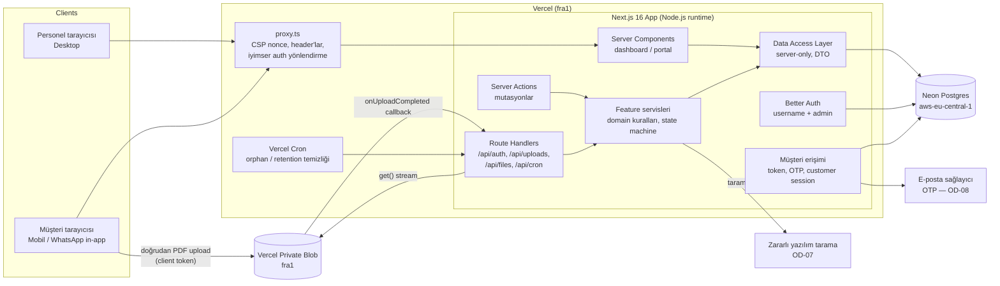
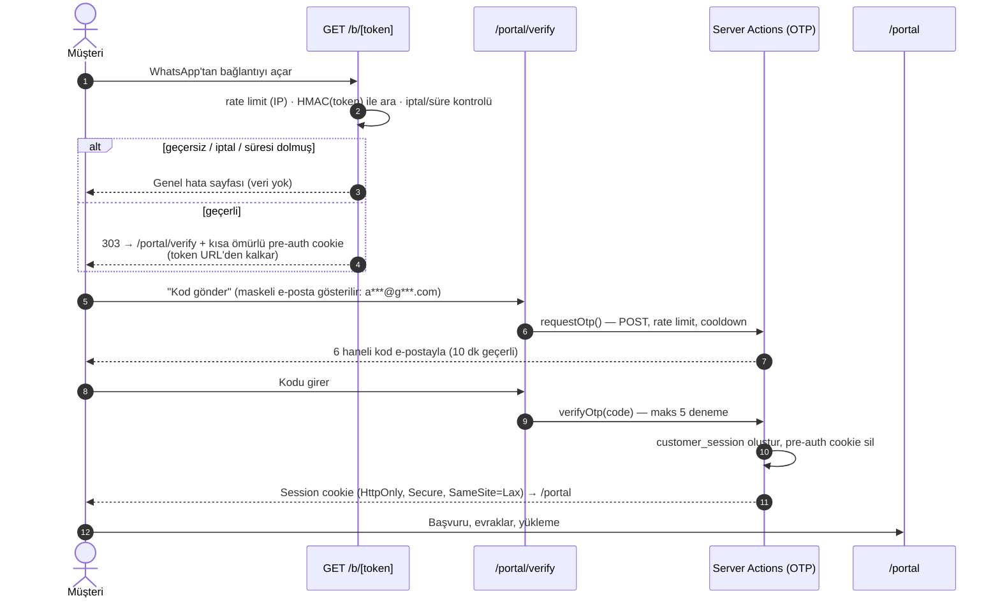

# Teknik Mimari

> Sürümler: [TECH_STACK.md](TECH_STACK.md) · API sözleşmeleri: [API_CONTRACTS.md](API_CONTRACTS.md) · Güvenlik: [SECURITY.md](SECURITY.md)

## 1. Mimari Özet

- **Tek repository, modüler monolit.** Next.js 16 (App Router) hem UI hem backend. Ayrı backend sunucusu, mikroservis yok (D-001).
- **React Server Components varsayılan**; Client Component yalnızca etkileşim gereken yerde (form, upload, combobox, dialog, kopyala butonu).
- **Mutasyonlar:** Server Actions (form tabanlı). **Binary / harici çağrı / auth:** Route Handlers (§6).
- **Katmanlar:** UI → Action/Route (giriş noktası) → Feature servisleri (domain + use-case) → Data access (Drizzle) → Neon Postgres. Dosyalar Vercel Private Blob.
- **Her giriş noktası** kimlik doğrular ve yetkilendirir. `proxy.ts` yalnızca iyimser yönlendirme + güvenlik header'ları.
- **Paylaşılan cache yok** (hassas veri için). `cacheComponents` kapalı, `use cache` hassas veride yasak (D-016).

## 2. Sistem Mimarisi Diyagramı



## 3. Başvuru Oluşturma Akışı

```mermaid
sequenceDiagram
    autonumber
    actor E as Çalışan
    participant UI as /dashboard/applications/new
    participant A as createApplicationAction
    participant S as applicationService
    participant DB as Postgres (tek transaction)

    E->>UI: Form doldur (ad, soyad, tel, e-posta, hizmet, not)
    UI->>A: findCustomerMatches (telefon / e-posta)
    A-->>UI: Olası eşleşmeler (maskeli)
    E->>UI: "Bu müşteriye bağla" veya "Yeni müşteri"
    UI->>A: submit(form, customerChoice, idempotencyKey)
    A->>A: Zod doğrula, session çöz, RBAC (application:create)
    A->>S: createApplication(input, actor)
    S->>DB: BEGIN
    S->>DB: idempotency kontrolü (idempotency_key unique)
    S->>DB: hizmet aktif mi? aktif şablon var mı? (FOR SHARE)
    S->>DB: müşteri INSERT veya mevcut müşteriyi doğrula
    S->>DB: yıllık sayaç UPSERT ... RETURNING (satır kilidi)
    S->>DB: applications INSERT (status=AWAITING_DOCUMENTS)
    S->>DB: application_document_requirements INSERT (snapshot)
    S->>S: token = CSPRNG 256-bit; hash = HMAC; enc = AES-256-GCM
    S->>DB: application_access_tokens INSERT (hash, enc)
    S->>DB: application_status_history INSERT (NULL → AWAITING_DOCUMENTS)
    S->>DB: application_internal_notes INSERT (varsa)
    S->>DB: audit_logs INSERT (APPLICATION_CREATED, ACCESS_LINK_CREATED)
    S->>DB: COMMIT
    S-->>A: {applicationId, number, link}
    A-->>UI: Sonuç ekranı (kopyala, WhatsApp, detaya git)
```

Herhangi bir adım başarısız olursa transaction tamamen geri alınır; sayaç da geri alındığı için numara boşluğu oluşmaz.

## 4. Müşteri Erişim Akışı



Ayrıntılar ve alternatifler (yalnızca bağlantı, fragment tabanlı token): [SECURITY.md](SECURITY.md) §4–5.

## 5. Katmanlar ve Sorumluluklar

| Katman | Konum | Kural |
|---|---|---|
| UI (RSC) | `src/app/**/page.tsx`, `src/features/*/components` | Veri okumayı DAL fonksiyonlarıyla yapar; yalnızca DTO alır. |
| UI (Client) | `"use client"` bileşenler | Yalnızca DTO / serileştirilebilir prop alır. Secret, DB, storage import edemez. |
| Giriş noktaları | `src/features/*/actions.ts` (`"use server"`), `src/app/api/**/route.ts` | Zod doğrulama → aktör çözme → yetki → servis çağrısı → `ActionResult`. **İş kuralı içermez.** |
| Servisler (use-case) | `src/features/*/service.ts` | Transaction, domain guard, audit. `server-only`. |
| Domain (saf) | `src/features/*/domain/*.ts` | State machine, tamamlanma hesapları, izin hesapları. **I/O yok**, unit test edilir. Client'ta da import edilebilir (yalnızca saf kod). |
| Data access | `src/features/*/queries.ts`, `src/server/db` | Drizzle sorguları, DTO eşleme, kapsam filtresi. `server-only`. |
| Altyapı | `src/server/{auth,db,storage,security,audit,email,env}` | Better Auth, DB client, Blob, kripto, rate limit, e-posta, env. `server-only`. |

### DTO kuralı
- Personel DTO'ları ve müşteri DTO'ları **ayrı tipler ve ayrı sorgu fonksiyonlarıdır** (`getStaffApplicationDetail`, `getCustomerPortalView`).
- Müşteri sorgu fonksiyonları `application_internal_notes`, `audit_logs`, `users` tablolarını **import etmez** (ESLint `no-restricted-imports` kuralı ile `src/features/portal/**` içinde zorlanır — PHASE 01).
- `select` her zaman açık kolon listesiyle yapılır; `select *` eşdeğeri (`db.select().from(x)`) müşteri yolunda yasaktır.

## 6. Server Actions vs Route Handlers

| Kullanım | Mekanizma | Gerekçe |
|---|---|---|
| Form mutasyonları (başvuru, müşteri, hizmet, şablon, çalışan, ayar, inceleme, statü geçişi, not, yorum, bağlantı yenile/iptal) | **Server Action** | Next.js'in yerleşik Origin/Host CSRF kontrolü, progressive enhancement, tipli sözleşme, `revalidatePath` ile UI güncelleme. Payload küçük (<1 MB). |
| Müşteri OTP iste / doğrula, incelemeye gönder, dosya kaldır | **Server Action** | Aynı gerekçeler; müşteri oturum cookie'si action içinde doğrulanır. |
| Better Auth (`/api/auth/[...all]`) | **Route Handler** | Kütüphanenin zorunlu handler'ı (`toNextJsHandler`). |
| Upload token üretimi + Blob `onUploadCompleted` callback (`/api/uploads`) | **Route Handler** | `handleUpload` API'si Request/Response bekler; callback Vercel Blob'dan gelen harici HTTP çağrısıdır. |
| Upload onayı (client confirm) | **Server Action** | Yerel geliştirmede callback çalışmadığı için; idempotent. |
| PDF görüntüle / indir (`/api/files/[fileId]`) | **Route Handler** | Binary stream yanıt, `Content-Disposition`, `Cache-Control: no-store`, CSP sandbox header'ları. Server Action binary döndürmeye uygun değil. |
| Bağlantı girişi (`/b/[token]`) | **Route Handler (GET)** | Token'ı doğrulayıp pre-auth cookie set eder ve 303 ile token'sız URL'e yönlendirir; sayfa render etmez. |
| Bakım işleri (`/api/cron/*`) | **Route Handler** | Vercel Cron GET çağrısı; `CRON_SECRET` Bearer doğrulaması. |

Server Actions **public endpoint** kabul edilir: sayfa seviyesindeki auth kontrolü action'ı korumaz; her action kendi kontrolünü yapar (Next.js Data Security rehberi).

## 7. Klasör Yapısı (nihai öneri)

```
.
├── CLAUDE.md
├── README.md
├── docs/                          # Proje dokümantasyonu
├── public/                        # Statik dosyalar (robots dışında hassas içerik yok)
├── scripts/
│   └── bootstrap-admin.ts         # İlk ADMIN oluşturma (PHASE 03)
├── tests/
│   ├── unit/                      # Saf domain, şema, kripto testleri
│   ├── integration/               # DB + servis testleri (Neon test branch)
│   ├── e2e/                       # Playwright (desktop + mobil projeler)
│   └── fixtures/                  # Sahte PDF'ler (temiz, JS'li, sahte MIME...)
├── drizzle.config.ts
├── next.config.ts
└── src/
    ├── proxy.ts                   # CSP nonce + header + iyimser yönlendirme (Next 16: src/ altında desteklenir)
    ├── app/
    │   ├── (auth)/login/page.tsx
    │   ├── (dashboard)/dashboard/
    │   │   ├── layout.tsx                 # requireStaff() + sidebar/header
    │   │   ├── page.tsx                   # Dashboard
    │   │   ├── applications/{page,new/page,[id]/page}.tsx
    │   │   ├── services/{page,new/page,[id]/page}.tsx
    │   │   ├── employees/{page,[id]/page}.tsx
    │   │   ├── audit-logs/page.tsx
    │   │   ├── settings/page.tsx
    │   │   └── account/page.tsx           # Şifre değiştir (kendi hesabı)
    │   ├── (portal)/
    │   │   ├── b/[token]/route.ts         # Token girişi → 303
    │   │   └── portal/{layout,page,verify/page}.tsx
    │   ├── api/
    │   │   ├── auth/[...all]/route.ts
    │   │   ├── uploads/route.ts
    │   │   ├── files/[fileId]/route.ts
    │   │   └── cron/cleanup/route.ts
    │   ├── layout.tsx, not-found.tsx, error.tsx, global-error.tsx
    │   └── robots.ts                      # Disallow: /
    ├── components/
    │   ├── ui/                            # shadcn/ui (üretilen)
    │   ├── shared/                        # Logo, StatusBadge, EmptyState, ConfirmDialog...
    │   ├── dashboard/                     # Sidebar, Header, Breadcrumb, DataTable
    │   └── portal/                        # Müşteri layout parçaları
    ├── features/
    │   ├── auth/            {actions, schemas, components}
    │   ├── applications/    {actions, service, queries, schemas, components, domain/}
    │   ├── customers/       {service, queries, schemas, domain/normalize.ts}
    │   ├── services/        {actions, service, queries, schemas, components}
    │   ├── documents/       {actions, service, queries, schemas, components, domain/}
    │   ├── portal/          {actions, service, queries, schemas, components}  # müşteri yolu
    │   ├── employees/       {actions, service, queries, schemas, components}
    │   ├── audit/           {service, queries, components}
    │   └── settings/        {actions, service, queries, schemas, components}
    ├── server/                            # Tümü `import 'server-only'`
    │   ├── env.ts                         # Zod ile env doğrulama
    │   ├── db/{client.ts, schema/*.ts, migrations/}
    │   ├── auth/{auth.ts, session.ts, permissions.ts}
    │   ├── customer-access/{tokens.ts, otp.ts, session.ts}
    │   ├── storage/{blob.ts, pdf-validation.ts, scanner.ts}
    │   ├── security/{crypto.ts, rate-limit.ts, headers.ts}
    │   ├── audit/log.ts
    │   └── email/send.ts
    ├── lib/                               # İzomorfik saf yardımcılar
    │   ├── dates.ts                       # UTC ↔ Europe/Istanbul formatlama
    │   ├── search.ts                      # Türkçe katlama
    │   ├── result.ts                      # ActionResult tipi
    │   └── utils.ts                       # cn() vb.
    └── types/                             # Yalnızca gerçekten paylaşılan tipler (minimal)
```

Brief'teki önerilen yapıdan farklar:
- `src/db` → `src/server/db` (server-only sınırını klasörle görünür kılmak için).
- `src/lib/{auth,security,storage}` → `src/server/*` (secret içeren her şey `server/` altında; `lib/` yalnızca saf ve izomorfik).
- `features/portal` eklendi: müşteri yolu kodu personel koduyla karışmasın, import kısıtı uygulanabilsin.
- Migration'lar `src/server/db/migrations` (drizzle-kit `out`).
- `tests/fixtures` eklendi.

### Client/Server sınırı
1. `src/server/**` ve tüm `service.ts` / `queries.ts` dosyaları ilk satırda `import 'server-only'`.
2. Yalnızca `NEXT_PUBLIC_APP_URL` (ve gerekirse `NEXT_PUBLIC_*` ile başlayan zararsız değerler) client'a çıkar. `env.ts` server değişkenlerini `server-only` modülde tutar.
3. ESLint `no-restricted-imports`: `src/components/**` ve `"use client"` dosyalarından `@/server/*` import'u yasak.
4. PHASE 01 build çıktısında client chunk'ları içinde secret adlarının bulunmadığı bir script ile kontrol edilir.

## 8. Route Mimarisi

| Route | Amaç | Roller | AuthN | AuthZ | Render | Cache | Hassas veri |
|---|---|---|---|---|---|---|---|
| `/` | Yönlendirme (`/login` veya `/dashboard`) | Herkes | — | — | Server redirect | no-store | Yok |
| `/login` | Personel girişi | Anonim | — | Girişliyse `/dashboard`'a | RSC + client form | no-store | Yok |
| `/dashboard` | Özet sayaçlar, son başvurular | ADMIN, EMPLOYEE | Staff session | `dashboard:read_stats` + kapsam | RSC (dinamik) | no-store | Orta |
| `/dashboard/applications` | Liste, arama, filtre, sayfalama (searchParams) | ADMIN, EMPLOYEE | ✅ | `application:list` + kapsam | RSC | no-store | Yüksek |
| `/dashboard/applications/new` | Başvuru oluşturma | ADMIN, EMPLOYEE | ✅ | `application:create` | RSC + client form | no-store | Yüksek |
| `/dashboard/applications/[id]` | Detay, evraklar, inceleme, notlar, geçmiş, bağlantı | ADMIN, EMPLOYEE | ✅ | `application:read` + kapsam (404) | RSC + client adalar | no-store | **Çok yüksek** |
| `/dashboard/services` · `/new` · `/[id]` | Hizmet + şablon yönetimi | ADMIN | ✅ | `service:manage` | RSC + client form | no-store | Düşük |
| `/dashboard/employees` · `/[id]` | Çalışan yönetimi | ADMIN | ✅ | `user:*` | RSC + client form | no-store | Orta |
| `/dashboard/audit-logs` | Audit listesi | ADMIN | ✅ | `audit_log:read` | RSC | no-store | Orta |
| `/dashboard/settings` | Ayarlar | ADMIN | ✅ | `settings:*` | RSC + client form | no-store | Düşük |
| `/dashboard/account` | Kendi şifresi / oturumları | ADMIN, EMPLOYEE | ✅ | 👤 | RSC + client form | no-store | Düşük |
| `GET /b/[token]` | Token doğrula → pre-auth cookie → 303 `/portal/verify` | Anonim | Token | Token geçerliliği | Route Handler | no-store | Token |
| `/portal/verify` | OTP iste / doğrula | Pre-auth | Pre-auth cookie | Bağlı token hâlâ geçerli | RSC + client form | no-store | Maskeli e-posta |
| `/portal` | Müşteri paneli | CUSTOMER | Customer session | Oturumun tek başvurusu | RSC + client adalar (upload) | no-store | **Çok yüksek** |
| `/api/auth/[...all]` | Better Auth | — | Better Auth | Better Auth + admin plugin | Route Handler | no-store | Kimlik |
| `POST /api/uploads` | Upload token üret / Blob callback | Staff, CUSTOMER, Blob (callback) | Session veya callback doğrulaması | `file:upload` + BR-44 | Route Handler | no-store | Metadata |
| `GET /api/files/[fileId]` | PDF stream (`?disposition=inline\|attachment`) | Staff, CUSTOMER | Session | `file:view_download` + kapsam + `CLEAN` | Route Handler | no-store | **Belge** |
| `GET /api/cron/cleanup` | Orphan upload, süresi dolan OTP/session/token, saklama temizliği | SYSTEM | `CRON_SECRET` | — | Route Handler | no-store | — |

Personel alanında ayrıca `/dashboard/applications/[id]` altında ayrı sayfa açmak yerine sekmeler (evraklar / geçmiş / notlar) kullanılır — gereksiz route çoğaltılmaz.

## 9. Cache Stratejisi (Next.js 16)

Doğrulanan davranış (nextjs.org/docs): Cache Components **opt-in**; açık değilken `fetch` cache'lenmez, `cookies()`/`headers()` okuyan sayfalar dinamik render edilir; Route Handler GET'ler varsayılan dinamik. `use cache` içinde `cookies()`/`headers()` çağrılamaz.

Kurallar (D-016):
1. `cacheComponents` **kapalı** (MVP). Açılması ayrı karar gerektirir.
2. `'use cache'`, `unstable_cache`, `fetch(..., { cache: 'force-cache' })`, `export const dynamic = 'force-static'`, `revalidate = N` **hassas veri içeren hiçbir yerde kullanılmaz**. ESLint/grep kontrolü PHASE 01'de eklenir.
3. Tüm `/dashboard`, `/portal`, `/b`, `/api` yanıtlarına `Cache-Control: private, no-store, max-age=0` (next.config `headers()` + Route Handler'larda açıkça).
4. Her korumalı layout/page `requireStaff()` / `requireCustomer()` çağırır → `cookies()` okur → dinamik render garanti.
5. CDN/edge cache kullanılmaz; Vercel'in `Vary`/`Cache-Control` davranışı PHASE 04'te response header'ları incelenerek doğrulanır.
6. Client Router Cache: çıkış (logout), bağlantı iptali ve rol değişikliği sonrası `router.refresh()` ve tam sayfa yönlendirmesi; müşteri oturumu bittiğinde `/portal` → `/b`-hata sayfası.
7. React `cache()` (istek kapsamlı memoization) aktör çözümü için **kullanılabilir** — istekler arası paylaşılmaz.
8. Paylaşılabilir cache yalnızca şu verilerde düşünülebilir: yok (MVP). Aktif hizmet listesi bile küçük olduğundan her istekte DB'den okunur.

## 10. Hata Yönetimi

- `ActionResult<T> = { ok: true; data: T } | { ok: false; error: { code: ErrorCode; message: string; fieldErrors?: Record<string, string[]> } }`.
- `ErrorCode`: `VALIDATION_ERROR`, `UNAUTHENTICATED`, `FORBIDDEN`, `NOT_FOUND`, `CONFLICT` (optimistic lock), `INVALID_STATUS_TRANSITION`, `GUARD_FAILED`, `RATE_LIMITED`, `FILE_REJECTED`, `INTERNAL_ERROR`.
- Domain hataları tipli `DomainError` sınıfıyla fırlatılır, giriş noktasında `ActionResult`'a çevrilir. Beklenmeyen hatalar loglanır (PII'siz, korelasyon ID'li) ve kullanıcıya "Beklenmeyen bir hata oluştu. Lütfen tekrar deneyin." döner.
- Türkçe mesajlar `src/lib/messages.ts` içinde tek yerde (i18n kütüphanesi yok — çoklu dil kapsam dışı).
- `error.tsx` / `global-error.tsx` stack trace göstermez.

## 11. Environment Doğrulama

`src/server/env.ts`: Zod şeması ile uygulama başlangıcında (ilk import) doğrulanır; eksik/hatalı değişkende açık hata ile başlamaz. Değişken listesi: [DEPLOYMENT.md](DEPLOYMENT.md) §3.

## 12. Transaction ve Idempotency

- DB erişimi `pg.Pool` (pooled URL) + `drizzle-orm/node-postgres`; interactive transaction'lar `db.transaction(async (tx) => ...)` (D-006).
- Transaction'lar kısa tutulur: dış çağrılar (e-posta gönderimi, Blob `get`, tarama) **transaction dışında** yapılır.
- Idempotency: başvuru oluşturma formu bir `idempotencyKey` (UUID, client'ta form açılışında üretilir) gönderir; `applications.idempotency_key` unique. Aynı anahtarla ikinci istek mevcut sonucu döndürür.
- Upload tamamlama: pathname unique (BR-92). Gönderim: statü guard'ı (BR-53).

## 13. Gözlemlenebilirlik (MVP)

- Vercel runtime logları + yapılandırılmış `console` logları (JSON, seviye, korelasyon ID). PII ve token **loglanmaz**; log yardımcı fonksiyonu bilinen hassas anahtarları maskeleyen bir redaksiyon listesi kullanır.
- `/b/[token]` yolu Vercel request loglarına düşer → token log sızıntısı riski ve azaltımı [SECURITY.md](SECURITY.md) §5.
- Harici APM/analytics MVP'de yok; müşteri panelinde üçüncü taraf script **yasak**.
