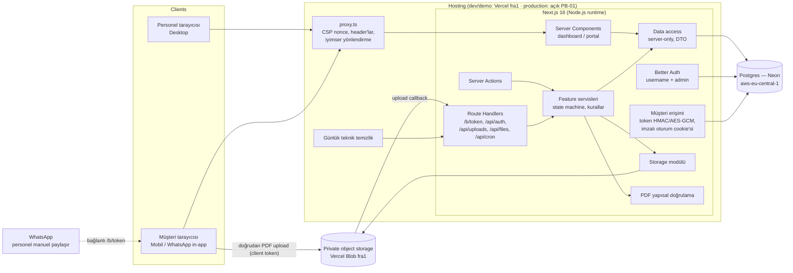
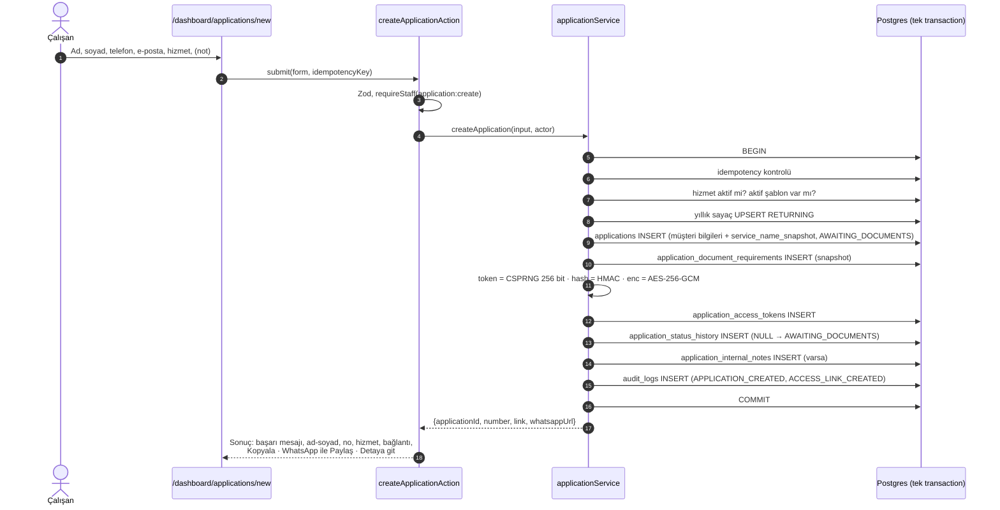
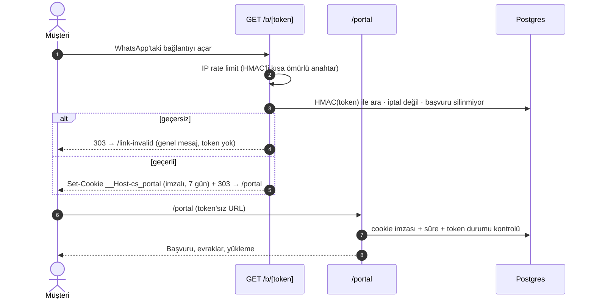

# Teknik Mimari

> Sürümler: [TECH_STACK.md](TECH_STACK.md) · API: [API_CONTRACTS.md](API_CONTRACTS.md) · Güvenlik: [SECURITY.md](SECURITY.md)
> Revizyon 2026-11-24: OD-01…OD-23 doğrultusunda sadeleştirildi (OTP, e-posta, müşteri profili/eşleştirme, atama, arşiv, ayarlar, harici AV kaldırıldı).

## 1. Mimari Özet

- **Tek repository, modüler monolit**, tek Next.js 16 (App Router) uygulaması; ayrı backend yok (D-001).
- **RSC varsayılan**; Client Component yalnızca etkileşim için (formlar, upload, combobox, dialog, kopyala/paylaş).
- **Mutasyonlar:** Server Actions. **Binary / harici callback / auth / bağlantı girişi / zamanlanmış iş:** Route Handlers (§6).
- **Katmanlar:** UI → giriş noktası (action/route) → feature servisleri (domain + use-case) → data access (Drizzle) → Postgres. Dosyalar private object storage'da, tek storage modülü arkasında.
- **Harici servis yok:** e-posta, SMS, antivirüs, kuyruk, Redis, analytics yok. Zorunlu altyapı: hosting + Postgres + private storage (OD-08, OD-07, OD-12).
- **Sabit yapılandırma:** şirket iletişim bilgileri, dosya limitleri, şifre/oturum parametreleri, rate limitler koddaki sabitlerdir; ayarlar sayfası/tablosu yok (§11).
- **Paylaşılan cache yok** (D-016).

## 2. Sistem Mimarisi



## 3. Başvuru Oluşturma Akışı



Müşteri eşleştirme/mükerrer kontrolü yoktur (OD-10). Herhangi bir adım başarısız olursa her şey geri alınır.

## 4. Müşteri Erişim Akışı



Ek doğrulama adımı yoktur (OD-01). GET hiçbir veriyi değiştirmez (BR-105). Ayrıntı: [SECURITY.md](SECURITY.md) §3.

## 5. Katmanlar ve Sorumluluklar

| Katman | Konum | Kural |
|---|---|---|
| UI (RSC) | `src/app/**/page.tsx`, `src/features/*/components` | Veriyi DAL fonksiyonlarıyla okur; yalnızca DTO alır. |
| UI (Client) | `"use client"` bileşenler | Yalnızca DTO / serileştirilebilir prop. Secret, DB, storage import edemez. |
| Giriş noktaları | `src/features/*/actions.ts`, `src/app/**/route.ts` | Zod → aktör → yetki → servis → `ActionResult`. İş kuralı içermez. |
| Servisler | `src/features/*/service.ts` | Transaction, guard, audit. `server-only`. |
| Domain (saf) | `src/features/*/domain/*.ts` | State machine'ler, tamamlanma hesapları, etiketler. I/O yok; unit test. |
| Data access | `src/features/*/queries.ts` | Drizzle sorguları, DTO eşleme, `deletion_requested_at IS NULL` filtresi. `server-only`. |
| Altyapı | `src/server/*` | Auth, DB, storage, PDF doğrulama, kripto, rate limit, audit, env. `server-only`. |

### DTO kuralı
- Personel ve müşteri DTO'ları ayrı tipler ve ayrı sorgu fonksiyonlarıdır (`getStaffApplicationDetail`, `getCustomerPortalView`).
- `src/features/portal/**` `application_internal_notes`, `audit_logs`, `users` şemalarını **import edemez** (ESLint `no-restricted-imports` — PHASE 01).
- Sorgular açık kolon listesiyle yapılır.

## 6. Server Actions vs Route Handlers

| Kullanım | Mekanizma | Gerekçe |
|---|---|---|
| Form mutasyonları (başvuru, müşteri bilgisi, hizmet, şablon, çalışan, inceleme, statü geçişi, not, yorum, bağlantı yenile/iptal, silme) | **Server Action** | Yerleşik Origin/Host CSRF kontrolü, tipli sözleşme, küçük payload (<1 MB) |
| Müşteri gönderimi, dosya kaldırma, upload onayı | **Server Action** | Aynı; müşteri cookie'si action içinde doğrulanır |
| Better Auth (`/api/auth/[...all]`) | **Route Handler** | Kütüphane handler'ı |
| Upload token + storage callback (`/api/uploads`) | **Route Handler** | `handleUpload` Request/Response bekler; callback harici HTTP çağrısıdır |
| PDF görüntüle/indir (`/api/files/[fileId]`) | **Route Handler** | Binary stream, özel header'lar |
| Bağlantı girişi (`/b/[token]`) | **Route Handler (GET)** | Cookie set + 303; sayfa render etmez |
| Teknik temizlik (`/api/cron/cleanup`) | **Route Handler** | Zamanlanmış GET; `CRON_SECRET` |

Server Actions public endpoint kabul edilir; her action kendi kontrolünü yapar.

## 7. Klasör Yapısı

```
.
├── CLAUDE.md
├── README.md
├── docs/
├── public/
├── scripts/
│   ├── bootstrap-admin.ts         # İlk ADMIN (PHASE 03)
│   └── recover-admin.ts           # ADMIN erişim kurtarma (PHASE 03)
├── tests/{unit,integration,e2e,fixtures}/
├── drizzle.config.ts
├── next.config.ts
└── src/
    ├── proxy.ts
    ├── config/
    │   ├── constants.ts           # MAX_PDF_SIZE_BYTES, şifre/oturum/rate limit sabitleri
    │   └── company.ts             # Şirket telefonu, WhatsApp (değerler sağlanana kadar null)
    ├── app/
    │   ├── (auth)/login/page.tsx
    │   ├── (dashboard)/dashboard/
    │   │   ├── layout.tsx         # requireStaff()
    │   │   ├── page.tsx           # Dashboard
    │   │   ├── applications/{page,new/page,[id]/page}.tsx
    │   │   ├── services/{page,new/page,[id]/page}.tsx    # ADMIN
    │   │   ├── employees/{page,[id]/page}.tsx            # ADMIN
    │   │   └── audit-logs/page.tsx                       # ADMIN
    │   ├── (portal)/
    │   │   ├── b/[token]/route.ts
    │   │   ├── portal/{layout,page}.tsx
    │   │   └── link-invalid/page.tsx
    │   ├── api/{auth/[...all],uploads,files/[fileId],cron/cleanup}/route.ts
    │   ├── layout.tsx, not-found.tsx, error.tsx, global-error.tsx
    │   └── robots.ts
    ├── components/
    │   ├── ui/                    # shadcn/ui
    │   ├── shared/                # Logo, StatusBadge, EmptyState, ConfirmDialog...
    │   ├── dashboard/             # Sidebar, Header, Breadcrumb, DataTable
    │   └── portal/
    ├── features/
    │   ├── auth/          {components, schemas}
    │   ├── applications/  {actions, service, queries, schemas, components, domain/}
    │   ├── services/      {actions, service, queries, schemas, components}
    │   ├── documents/     {actions, service, queries, schemas, components, domain/}
    │   ├── portal/        {actions, service, queries, components}
    │   ├── employees/     {actions, service, queries, schemas, components}
    │   └── audit/         {service, queries, components}
    ├── server/                    # Tümü `import 'server-only'`
    │   ├── env.ts
    │   ├── db/{client.ts, schema/*.ts, migrations/}
    │   ├── auth/{auth.ts, session.ts, permissions.ts}
    │   ├── customer-access/{tokens.ts, portal-session.ts}
    │   ├── storage/{storage.ts, pdf-validation.ts}
    │   ├── security/{crypto.ts, rate-limit.ts, headers.ts}
    │   └── audit/log.ts
    └── lib/                       # İzomorfik saf yardımcılar
        ├── dates.ts, search.ts, phone.ts, result.ts, messages.ts, whatsapp.ts, utils.ts
        └── upload-client.ts       # uploadPdf() — client tarafı storage sınırı
```

Önceki yapıdan kaldırılanlar: `features/customers`, `features/settings`, `server/email`, `server/customer-access/otp.ts`, `/dashboard/settings`, `/dashboard/account`, `/portal/verify`, `src/types` (gerçek ihtiyaç doğunca eklenir).

### Client/Server sınırı
1. `src/server/**`, `service.ts`, `queries.ts` ilk satırda `import 'server-only'`.
2. `NEXT_PUBLIC_*` değişken **yok**; bağlantılar sunucuda üretilir.
3. ESLint `no-restricted-imports`: `src/components/**` ve `"use client"` dosyalarından `@/server/*` yasak.
4. PHASE 01'de client chunk'larında secret adı kontrol script'i.

## 8. Route Mimarisi

| Route | Amaç | Roller | AuthN | AuthZ | Render | Cache | Hassas veri |
|---|---|---|---|---|---|---|---|
| `/` | `/login` veya `/dashboard`'a yönlendirme | Herkes | — | — | Redirect | no-store | Yok |
| `/login` | Personel girişi (yalnızca kullanıcı adı + şifre) | Anonim | — | Girişliyse yönlendir | RSC + client form | no-store | Yok |
| `/dashboard` | Sayaçlar, son başvurular, inceleme bekleyenler | ADMIN, EMPLOYEE | Staff session | `dashboard:read_stats` | RSC | no-store | Orta |
| `/dashboard/applications` | Tek liste; arama, statü/hizmet/tarih filtresi, sayfalama | ADMIN, EMPLOYEE | ✅ | `application:list` | RSC | no-store | Yüksek |
| `/dashboard/applications/new` | Başvuru oluşturma + sonuç ekranı | ADMIN, EMPLOYEE | ✅ | `application:create` | RSC + client form | no-store | Yüksek |
| `/dashboard/applications/[id]` | Detay: müşteri bilgisi, evraklar, inceleme, yorum, not, geçmiş, bağlantı, (ADMIN) geri alma/yeniden açma/silme | ADMIN, EMPLOYEE | ✅ | `application:read` (+ aksiyon izinleri) | RSC + client adalar | no-store | **Çok yüksek** |
| `/dashboard/services` · `/new` · `/[id]` | Hizmet + evrak şablonu | ADMIN | ✅ | `service:manage` | RSC + client form | no-store | Düşük |
| `/dashboard/employees` · `/[id]` | Çalışan yönetimi | ADMIN | ✅ | `user:*` | RSC + client form | no-store | Orta |
| `/dashboard/audit-logs` | Genel işlem geçmişi | ADMIN | ✅ | `audit_log:read` | RSC | no-store | Orta |
| `GET /b/[token]` | Token doğrula → cookie → 303 `/portal` | Anonim | Token | Token geçerliliği | Route Handler | no-store | Token |
| `/portal` | Müşteri paneli | CUSTOMER | Portal cookie | Tek başvuru | RSC + client adalar | no-store | **Çok yüksek** |
| `/link-invalid` | Genel geçersiz bağlantı mesajı | Herkes | — | — | RSC (statik içerik, no-store) | no-store | Yok |
| `/api/auth/[...all]` | Better Auth (kapalı uç noktalar hariç) | — | Better Auth | — | Route Handler | no-store | Kimlik |
| `POST /api/uploads` | Upload token / storage callback | Staff, CUSTOMER, storage | Session / callback doğrulaması | `file:upload` + BR-44 | Route Handler | no-store | Metadata |
| `GET /api/files/[fileId]` | PDF stream | Staff, CUSTOMER | Session | `file:view_download` | Route Handler | no-store | **Belge** |
| `GET /api/cron/cleanup` | Teknik temizlik | SYSTEM | `CRON_SECRET` | — | Route Handler | no-store | — |

Kaldırılan route'lar: `/dashboard/settings`, `/dashboard/account`, `/portal/verify`, arşiv görünümleri.

## 9. Cache Stratejisi (Next.js 16)

Doğrulanan davranış: Cache Components opt-in; kapalıyken `fetch` cache'lenmez, `cookies()`/`headers()` okuyan sayfalar dinamik; Route Handler GET'ler varsayılan dinamik; `use cache` içinde `cookies()` çağrılamaz.

Kurallar (D-016):
1. `cacheComponents` **kapalı**.
2. `'use cache'`, `unstable_cache`, `force-cache`, `force-static`, `revalidate = N` hassas veride **yasak** (lint/grep — PHASE 01).
3. `/dashboard`, `/portal`, `/b`, `/api`: `Cache-Control: private, no-store, max-age=0`.
4. Korumalı layout/page `requireStaff()` / `requireCustomer()` çağırır → dinamik render.
5. Çıkış, bağlantı iptali, rol değişikliği sonrası `router.refresh()` / tam yönlendirme.
6. React `cache()` yalnızca istek kapsamlı memoization için.

## 10. Hata Yönetimi

- `ActionResult<T> = { ok: true; data: T } | { ok: false; error: { code; message; fieldErrors? } }`.
- `ErrorCode`: `VALIDATION_ERROR`, `UNAUTHENTICATED`, `FORBIDDEN`, `NOT_FOUND`, `CONFLICT`, `INVALID_STATUS_TRANSITION`, `GUARD_FAILED`, `RATE_LIMITED`, `FILE_REJECTED`, `UPLOAD_IN_PROGRESS`, `INTERNAL_ERROR`.
- Türkçe mesajlar `src/lib/messages.ts`'te. Beklenmeyen hatalar PII'siz loglanır; kullanıcıya genel mesaj.
- Hata sayfaları stack trace, token veya iç ID göstermez.

## 11. Sabit Yapılandırma ve Environment

### 11.1 `src/config/constants.ts` (panelden değiştirilemez)
| Sabit | Değer | Kaynak |
|---|---|---|
| `ALLOWED_FILE_MIME` / `ALLOWED_FILE_EXTENSION` | `application/pdf` / `.pdf` | OD-16 |
| `MAX_PDF_SIZE_BYTES` | `10 * 1024 * 1024` = **10 485 760** ("10 MB") | OD-16 |
| `UPLOAD_TOKEN_TTL_SECONDS` | 900 | FILE_STORAGE §2.1 |
| `STALE_VALIDATION_MINUTES` | 10 | FILE_STORAGE §2.1 |
| `PASSWORD_MIN_LENGTH` / `PASSWORD_MAX_LENGTH` | 8 / 128 | OD-22 |
| `STAFF_SESSION_MAX_AGE_SECONDS` | 604800 (7 gün, uzatılmaz) | OD-22 |
| `CUSTOMER_SESSION_MAX_AGE_SECONDS` | 604800 (7 gün, uzatılmaz) | OD-22 |
| `ACCESS_TOKEN_BYTES` | 32 (256 bit) | OD-01 |
| Rate limitler | SECURITY §6 | |
| `PAGE_SIZES` | 10 / 20 / 50 | |

### 11.2 `src/config/company.ts` (OD-14)
`{ name: 'CS Global', phone: null, whatsapp: null }` — gerçek değerler Product Owner tarafından sağlanınca doldurulur; `null` iken UI disabled/placeholder gösterir (BR-171).

### 11.3 Environment
`src/server/env.ts` (Zod) başlangıçta doğrular. Liste: [DEPLOYMENT.md](DEPLOYMENT.md) §3. `APP_URL` tek bağlantı kaynağıdır (OD-20).

## 12. Transaction ve Idempotency

- `pg.Pool` (pooled URL) + `drizzle-orm/node-postgres`; interactive transaction (D-006).
- Transaction içinde ağ çağrısı yok (storage, doğrulama dışarıda).
- Başvuru oluşturma `idempotencyKey`; upload claim satır kilidi; gönderim statü guard'ı; bağlantı yenileme `applications FOR UPDATE` + partial unique index.

## 13. Gözlemlenebilirlik

- Hosting runtime logları + yapılandırılmış JSON loglar; PII ve token **loglanmaz** (redaksiyon listesi; `/b/` path'i maskelenir).
- Harici APM/analytics/hata izleme servisi yok; müşteri tarafında üçüncü taraf script yasak.
