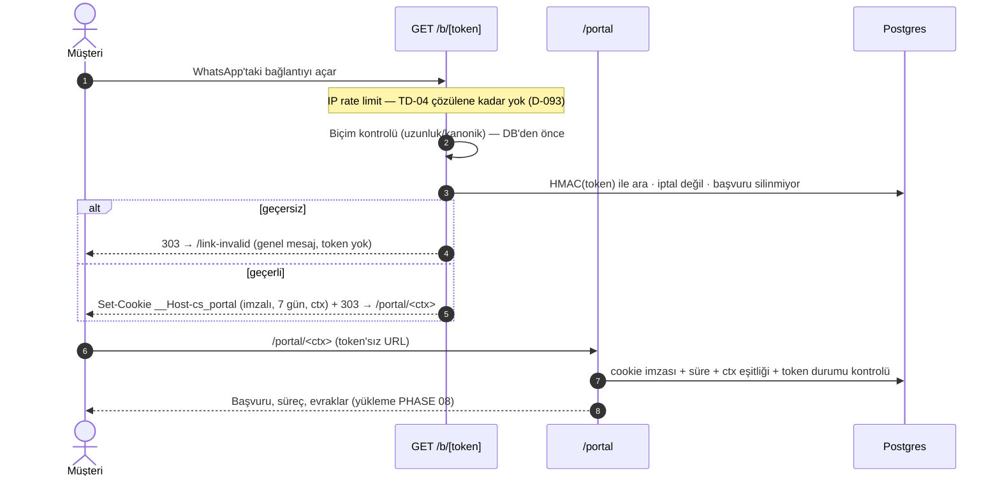

# Teknik Mimari

> Sürümler: [TECH_STACK.md](TECH_STACK.md) · API: [API_CONTRACTS.md](API_CONTRACTS.md) · Güvenlik: [SECURITY.md](SECURITY.md)
> Revizyon 2026-11-24: OD-01…OD-23 doğrultusunda sadeleştirildi (OTP, e-posta, müşteri profili/eşleştirme, atama, arşiv, ayarlar, harici AV kaldırıldı).

## 1. Mimari Özet

- **Tek repository, modüler monolit**, tek Next.js 16 (App Router) uygulaması; ayrı backend yok (D-001).
- **RSC varsayılan**; Client Component yalnızca etkileşim için (formlar, upload, combobox, dialog, kopyala/paylaş).
- **Mutasyonlar:** Server Actions. **Binary / harici callback / auth / bağlantı girişi / zamanlanmış iş:** Route Handlers (§6).
- **Katmanlar:** UI → giriş noktası (action/route) → feature servisleri (domain + use-case) → data access (Drizzle) → Postgres. Dosyalar private object storage'da, tek storage modülü arkasında.
- **Harici servis yok:** e-posta, SMS, antivirüs, kuyruk, Redis, analytics yok. Zorunlu altyapı: hosting + Postgres + private storage (OD-08, OD-07, OD-12).
- **Sabit yapılandırma:** şirket iletişim bilgileri, dosya limitleri, şifre/oturum parametreleri, rate limitler koddaki sabitlerdir; ayarlar sayfası/tablosu yok (§11).
- **Paylaşılan cache yok** (D-016).

## 2. Sistem Mimarisi

```mermaid
flowchart LR
    subgraph Clients
        S[Personel tarayıcısı<br/>Desktop]
        C[Müşteri tarayıcısı<br/>Mobil / WhatsApp in-app]
    end
    W[WhatsApp<br/>personel manuel paylaşır]

    subgraph Host["Hosting (dev/demo: Vercel fra1 · production: açık PB-01)"]
        P[proxy.ts<br/>CSP nonce, header'lar,<br/>iyimser yönlendirme]
        subgraph Next["Next.js 16 (Node.js runtime)"]
            RSC[Server Components<br/>dashboard / portal]
            SA[Server Actions]
            RH[Route Handlers<br/>/b/token,<br/>/api/documents/*/file, /api/portal/*,<br/>/api/files/*]
            SVC[Feature servisleri<br/>state machine, kurallar]
            DAL[Data access<br/>server-only, DTO]
            AUTH[Better Auth<br/>username + admin]
            CA[Müşteri erişimi<br/>token HMAC/AES-GCM,<br/>imzalı oturum cookie'si]
            STG[Storage modülü]
            VAL[PDF yapısal doğrulama]
        end
        CRON[Teknik temizlik — pnpm storage:cleanup (elle)]
    end

    DB[(Postgres — Neon<br/>aws-eu-central-1)]
    BLOB[(Private object storage<br/>Backblaze B2 eu-central-003<br/>SSE-B2, OD-25)]

    S --> P --> RSC
    C --> P
    W -. "bağlantı /b/token" .-> C
    RSC --> DAL
    SA --> SVC --> DAL --> DB
    RH --> SVC
    AUTH --> DB
    CA --> DB
    SVC --> STG --> BLOB
    SVC --> VAL
    C -- "ham PDF POST (XHR ilerleme)" --> RH
    CRON -. "CLI, elle" .-> STG
```

## 3. Başvuru Oluşturma Akışı


Müşteri eşleştirme/mükerrer kontrolü yoktur (OD-10). Herhangi bir adım başarısız olursa her şey geri alınır.

## 4. Müşteri Erişim Akışı



Ek doğrulama adımı yoktur (OD-01). GET hiçbir veriyi değiştirmez (BR-105). Ayrıntı: [SECURITY.md](SECURITY.md) §3.

## 5. Katmanlar ve Sorumluluklar

| Katman | Konum | Kural |
|---|---|---|
| UI (RSC) | `src/app/**/page.tsx`, `src/features/*/components` | Veriyi DAL fonksiyonlarıyla okur; yalnızca DTO alır. |
| UI (Client) | `"use client"` bileşenler | Yalnızca DTO / serileştirilebilir prop. Secret, DB, storage import edemez. |
| Giriş noktaları | `src/features/*/actions.ts`, `src/app/**/route.ts` | Zod → aktör → yetki → servis → `ActionResult`. İş kuralı içermez. |
| Servisler | `src/features/*/service.ts` | Transaction, guard, audit. `server-only`. |
| Domain (saf) | `src/features/*/domain/*.ts` | State machine'ler, tamamlanma hesapları, etiketler. I/O yok; unit test. |
| Data access | `src/features/*/queries.ts` | Drizzle sorguları, DTO eşleme, `deletion_requested_at IS NULL` filtresi. `server-only`. |
| Altyapı | `src/server/*` | Auth, DB, storage, PDF doğrulama, kripto, rate limit, audit, env. `server-only`. |

### DTO kuralı
- Personel ve müşteri DTO'ları ayrı tipler ve ayrı sorgu fonksiyonlarıdır (`getStaffApplicationDetail`, `getCustomerPortalView`).
- `src/features/portal/**` `application_internal_notes`, `audit_logs`, `users` şemalarını **import edemez** (ESLint `no-restricted-imports` — PHASE 01).
- Sorgular açık kolon listesiyle yapılır.

## 6. Server Actions vs Route Handlers

| Kullanım | Mekanizma | Gerekçe |
|---|---|---|
| Form mutasyonları (başvuru, müşteri bilgisi, hizmet, şablon, inceleme, statü geçişi, not, yorum, bağlantı yenile/iptal, silme) | **Server Action** | Proxy köken kontrolü (403, D-069) + yerleşik Origin/Host CSRF kontrolü, tipli sözleşme, küçük payload (<1 MB) |
| Müşteri gönderimi, dosya kaldırma, upload onayı | **Server Action** | Aynı; müşteri cookie'si action içinde doğrulanır |
| Personel girişi / çıkışı | **Server Action** (`auth.api`, D-060) | Better Auth HTTP route'u bağlanmaz; CSRF için Server Action origin kontrolü |
| PDF yükleme (`POST /api/documents/[requirementId]/file`, `POST /api/portal/[context]/documents/[requirementId]/file`) | **Route Handler** | 10 MiB ham gövde (Server Action 1 MB sınırı değiştirilmez), gerçek ilerleme (XHR), proxy dışı (D-100) |
| ~~Upload token + storage callback (`/api/uploads`)~~ | — | **Superseded** (OD-25, D-100) |
| PDF görüntüle/indir (`/api/files/[fileId]` personel, `/api/portal/[context]/files/[fileId]` müşteri) | **Route Handler** | Binary stream, özel header'lar (D-104) |
| Bağlantı girişi (`/b/[token]`) | **Route Handler (GET)** | Cookie set + 303; sayfa render etmez |
| Teknik temizlik | **CLI** (`pnpm storage:cleanup`, `storage:reconcile`) | Ücretli cron yok; `/api/cron/cleanup` uygulanmadı — zamanlama PHASE 10/13 (D-105) |

Server Actions public endpoint kabul edilir; her action kendi kontrolünü yapar.

## 7. Klasör Yapısı

```
.
├── CLAUDE.md
├── README.md
├── docs/
├── public/
├── scripts/
│   └── auth/{bootstrap,reset-password}.ts   # İki hesabı oluşturma / şifre sıfırlama (yerel CLI, PHASE 03)
├── tests/{unit,integration,e2e,fixtures}/
├── drizzle.config.ts          # PHASE 02
├── scripts/db/                # db:init, db:migrate, db:seed, db:verify, db:studio (Node 24 ile doğrudan)
├── next.config.ts
└── src/
    ├── proxy.ts
    ├── config/
    │   ├── constants.ts           # MAX_PDF_SIZE_BYTES, şifre/oturum/rate limit sabitleri
    │   └── company.ts             # Şirket telefonu, WhatsApp (değerler sağlanana kadar null)
    ├── app/
    │   ├── (auth)/login/page.tsx
    │   ├── (dashboard)/dashboard/
    │   │   ├── layout.tsx         # requireStaff() + DashboardShell (PHASE 04)
    │   │   ├── (overview)/{page,loading}.tsx   # Genel Bakış; iskelet yalnızca burada (404 için)
    │   │   ├── [...rest]/page.tsx # requireStaff() + notFound() (panel içi 404)
    │   │   ├── error.tsx, not-found.tsx
    │   │   ├── applications/{page,new/page,[id]/page}.tsx
    │   │   ├── services/{page,new/page,[id]/page}.tsx
    │   │   └── audit-logs/page.tsx                       # iki hesap eşit (OD-24)
    │   ├── (portal)/
    │   │   ├── b/[token]/route.ts
    │   │   ├── portal/{layout,page}.tsx
    │   │   └── link-invalid/page.tsx
    │   ├── api/{auth/[...all],uploads,files/[fileId],cron/cleanup}/route.ts
    │   ├── layout.tsx, not-found.tsx, error.tsx, global-error.tsx
    │   └── robots.ts
    ├── components/
    │   ├── ui/                    # shadcn/ui
    │   ├── shared/                # Logo, StatusBadge, EmptyState, ConfirmDialog...
    │   ├── dashboard/             # PHASE 04: Shell, Sidebar, MobileNavigation, Header, Breadcrumb, PageHeader, StatCard, Empty/Error/Loading, AccountMenu (DataTable PHASE 06)
    │   └── portal/
    ├── features/
    │   ├── auth/          {components, schemas}
    │   ├── applications/  {actions, service, queries, schemas, components, domain/}
    │   ├── services/      {actions, service, queries, schemas, components}
    │   ├── documents/     {service, handlers, http, queries, components, domain/}   # PHASE 08 (actions PHASE 09)
    │   ├── portal/        {actions, service, queries, components}
    │   └── audit/         {service, queries, components}
    ├── server/                    # Tümü `import 'server-only'`
    │   ├── env.ts
    │   ├── db/{client.ts, settings.ts, schema/*.ts, migrations/}   # PHASE 02
    │   ├── auth/{auth.ts, staff.ts, rate-limit.ts, password-policy.ts}   # PHASE 03 (permissions.ts yok — OD-24)
    │   ├── customer-access/{tokens.ts, portal-session.ts}
    │   ├── storage/{types, errors, config, b2, local-private, factory, quota}.ts   # PHASE 08 (D-097)
    │   ├── pdf/{pdf-checks, validation-worker, validate}.ts                      # PHASE 08 (D-099)
    │   ├── security/{crypto.ts, rate-limit.ts, headers.ts}
    │   └── audit/log.ts
    └── lib/                       # İzomorfik saf yardımcılar
        ├── dates.ts, search.ts, phone.ts, result.ts, messages.ts, whatsapp.ts, utils.ts
        └── (upload-client.ts yok — PHASE 08: yükleme `PdfUpload` bileşeninde XHR ile uygulama route'una)
```

**PHASE 02'de eklenenler:** `drizzle.config.ts`, `src/config/statuses.ts`, `src/server/db/{client.ts, settings.ts, schema/, migrations/}`, `scripts/db/`, `tests/integration/`, `vitest.integration.config.ts`.

**PHASE 01 itibarıyla mevcut olanlar:** `src/app/{layout.tsx, page.tsx, globals.css, robots.ts}`, `src/components/ui/{button,card,badge,alert,separator,input,label}.tsx`, `src/components/shared/logo.tsx`, `src/config/{company,constants}.ts`, `src/lib/utils.ts`, `src/server/env.ts`, `tests/{unit,e2e}/`, `scripts/check-client-bundle.mjs`, `.github/workflows/ci.yml`. Diğer klasörler gerçek kullanımları başladığı fazda oluşturulur (boş klasör/placeholder yok).

Önceki yapıdan kaldırılanlar: `features/customers`, `features/settings`, `server/email`, `server/customer-access/otp.ts`, `/dashboard/settings`, `/dashboard/account`, `/portal/verify`, `src/types` (gerçek ihtiyaç doğunca eklenir).

### Client/Server sınırı
1. `src/server/**`, `service.ts`, `queries.ts` ilk satırda `import 'server-only'`. **İstisna (D-057):** `src/server/db/schema/*` ve `src/server/db/settings.ts` Node CLI'ında (drizzle-kit, `scripts/db`) da yüklendiği için `server-only` içermez; secret içermezler ve client'tan import ESLint kuralıyla engellidir. Veritabanına bağlanan `src/server/db/client.ts` `server-only`'dir.
2. `NEXT_PUBLIC_*` değişken **yok**; bağlantılar sunucuda üretilir.
3. ESLint `no-restricted-imports`: `src/components/**` ve `src/lib/**` içinden `@/server/*` ve `server-only` yasak. `"use client"` dosyaları glob ile hedeflenemediğinden, onlar için güvence `server-only`'nin derleme zamanı hatasıdır.
4. `pnpm check:bundle` (`scripts/check-client-bundle.mjs`): build sonrası `.next/static` içinde sunucu env adları ve sunucu modülü işaretleri aranır; bulunursa başarısız olur (CI'da çalışır).

## 8. Route Mimarisi

| Route | Amaç | Roller | AuthN | AuthZ | Render | Cache | Hassas veri |
|---|---|---|---|---|---|---|---|
| `/` | `/login` veya `/dashboard`'a yönlendirme (PHASE 03). PHASE 01–02'de statik altyapı önizleme sayfası (veri/işlev yok) | Herkes | — | — | Redirect (PHASE 01: statik) | no-store (PHASE 01: hassas veri yok, statik) | Yok |
| `/login` | Personel girişi (yalnızca kullanıcı adı + şifre) | Anonim | — | Girişliyse yönlendir | RSC + client form | no-store | Yok |
| `/dashboard` | Sayaçlar, son başvurular, inceleme bekleyenler (PHASE 03: korumalı placeholder) | Personel | Staff session | `requireStaff` | RSC | no-store | Orta |
| `/dashboard/applications` | Tek liste; arama, statü/hizmet/tarih filtresi, sayfalama | Personel | ✅ | `requireStaff` | RSC | no-store | Yüksek |
| `/dashboard/applications/new` | Başvuru oluşturma + sonuç ekranı | Personel | ✅ | `requireStaff` | RSC + client form | no-store | Yüksek |
| `/dashboard/applications/[id]` | Detay: müşteri bilgisi, evraklar, inceleme, yorum, not, geçmiş, bağlantı, geri alma/yeniden açma/silme | Personel | ✅ | `requireStaff` + kaynak kontrolü | RSC + client adalar | no-store | **Çok yüksek** |
| `/dashboard/services` · `/new` · `/[serviceId]` | Hizmet listesi (arama, durum filtresi) · yeni hizmet · genel bilgiler + durum + evrak şablonları (PHASE 05 — uygulandı) | Personel | ✅ | `requireStaff` | RSC + client form | no-store | Düşük |
| `/dashboard/audit-logs` | Genel işlem geçmişi | Personel | ✅ | `requireStaff` | RSC | no-store | Orta |
| `GET /b/[token]` | Token doğrula → cookie → 303 `/portal/<ctx>` (PHASE 07 — uygulandı) | Anonim | Token | Token geçerliliği | Route Handler | no-store | Token |
| `/portal/[context]` | Müşteri paneli (PHASE 07 — uygulandı, salt okunur) | CUSTOMER | Portal cookie + URL bağlamı | Tek başvuru, `requireCustomerAccess` | RSC + küçük client adalar | no-store | **Çok yüksek** |
| `/portal` | Bağlamsız eski adres: bilgi ekranı, oturum açmaz | Herkes | — | — | RSC | no-store | Yok |
| `/link-invalid` · `/link-unavailable` | Genel geçersiz bağlantı / geçici erişim sorunu mesajı | Herkes | — | — | RSC (no-store) | no-store | Yok |
| `POST /api/documents/[requirementId]/file` | PDF yükleme (müşteri adına) | Staff | Personel oturumu + Origin | BR-44 (personel) | Route Handler (proxy dışı) | no-store | **Belge** |
| `POST /api/portal/[context]/documents/[requirementId]/file` | PDF yükleme | CUSTOMER | `requireCustomerAccess(context)` + Origin | BR-44 (müşteri) | Route Handler (proxy dışı) | no-store | **Belge** |
| `GET /api/files/[fileId]` | PDF stream (aktif + önceki versiyonlar) | Staff | Personel oturumu | — | Route Handler (proxy dışı) | no-store | **Belge** |
| `GET /api/portal/[context]/files/[fileId]` | PDF stream (yalnızca ACTIVE) | CUSTOMER | `requireCustomerAccess(context)` | kapsam: oturum başvurusu | Route Handler (proxy dışı) | no-store | **Belge** |
| ~~`GET /api/cron/cleanup`~~ | Teknik temizlik | — | — | — | Uygulanmadı (CLI — D-105) | — | — |

Kaldırılan route'lar: `/dashboard/settings`, `/dashboard/account`, `/portal/verify`, arşiv görünümleri.

## 9. Cache Stratejisi (Next.js 16)

Doğrulanan davranış: Cache Components opt-in; kapalıyken `fetch` cache'lenmez, `cookies()`/`headers()` okuyan sayfalar dinamik; Route Handler GET'ler varsayılan dinamik; `use cache` içinde `cookies()` çağrılamaz.

Kurallar (D-016):
1. `cacheComponents` **kapalı**.
2. `'use cache'`, `unstable_cache`, `force-cache`, `force-static`, `revalidate = N` hassas veride **yasak** (lint/grep — PHASE 01).
3. `/dashboard`, `/portal`, `/b`, `/api`: `Cache-Control: private, no-store, max-age=0`.
4. Korumalı layout/page `requireStaff()` / `requireCustomer()` çağırır → dinamik render.
5. Çıkış, bağlantı iptali, rol değişikliği sonrası `router.refresh()` / tam yönlendirme.
6. React `cache()` yalnızca istek kapsamlı memoization için.

## 10. Hata Yönetimi

- `ActionResult<T> = { ok: true; data: T } | { ok: false; error: { code; message; fieldErrors? } }`.
- `ErrorCode`: `VALIDATION_ERROR`, `UNAUTHENTICATED`, `FORBIDDEN`, `NOT_FOUND`, `CONFLICT`, `INVALID_STATUS_TRANSITION`, `GUARD_FAILED`, `RATE_LIMITED`, `FILE_REJECTED`, `UPLOAD_IN_PROGRESS`, `INTERNAL_ERROR`.
- Türkçe mesajlar `src/lib/messages.ts`'te. Beklenmeyen hatalar PII'siz loglanır; kullanıcıya genel mesaj.
- Hata sayfaları stack trace, token veya iç ID göstermez.

## 11. Sabit Yapılandırma ve Environment

### 11.1 `src/config/constants.ts` (panelden değiştirilemez)
| Sabit | Değer | Kaynak |
|---|---|---|
| `ALLOWED_FILE_MIME` / `ALLOWED_FILE_EXTENSION` | `application/pdf` / `.pdf` | OD-16 |
| `MAX_PDF_SIZE_BYTES` | `10 * 1024 * 1024` = **10 485 760** ("10 MB") | OD-16 |
| `UPLOAD_TOKEN_TTL_SECONDS` | 900 | FILE_STORAGE §2.1 |
| `STALE_VALIDATION_MINUTES` | 10 | FILE_STORAGE §2.1 |
| `PASSWORD_MIN_LENGTH` / `PASSWORD_MAX_LENGTH` | 8 / 128 | OD-22 |
| `STAFF_SESSION_MAX_AGE_SECONDS` | 604800 (7 gün, uzatılmaz) | OD-22 |
| `CUSTOMER_SESSION_MAX_AGE_SECONDS` | 604800 (7 gün, uzatılmaz) | OD-22 |
| `ACCESS_TOKEN_BYTES` | 32 (256 bit) | OD-01 |
| Rate limitler | SECURITY §6 | |
| `PAGE_SIZES` | 10 / 20 / 50 | |

### 11.2 `src/config/company.ts` (OD-14)
`{ name: 'CS Global', tagline: 'Vize Danışmanlık', productName: 'Vize Danışmanlık Yönetim Platformu', phoneE164: null, whatsappE164: null }` — gerçek numaralar Product Owner tarafından sağlanınca E.164 biçiminde doldurulur; `null` iken UI disabled/placeholder gösterir, bağlantı üretmez (BR-171). Unit test uydurma biçimi reddeder.

### 11.3 Environment
`src/server/env.ts` (Zod, `server-only`) **ilk kullanımda** doğrular (D-047): henüz kullanılmayan servis değişkenleri build'i bozmaz; her değişken onu kullanan kodla birlikte şemaya eklenir ve production'da zorunludur (fail-closed). `NODE_ENV=production` iken `APP_ENV` zorunlu; development dışında `APP_URL` `https` origin olmalıdır. Liste: [DEPLOYMENT.md](DEPLOYMENT.md) §3. `APP_URL` tek bağlantı kaynağıdır (OD-20).

## 12. Transaction ve Idempotency

- `pg.Pool` (pooled URL) + `drizzle-orm/node-postgres`; interactive transaction (D-006). Ayrıntı §12.1.
- Transaction içinde ağ çağrısı yok (storage, doğrulama dışarıda).
- Başvuru oluşturma `idempotencyKey`; upload claim satır kilidi; gönderim statü guard'ı; bağlantı yenileme `applications FOR UPDATE` + partial unique index.

## 13. Gözlemlenebilirlik

- Hosting runtime logları + yapılandırılmış JSON loglar; PII ve token **loglanmaz** (redaksiyon listesi; `/b/` path'i maskelenir).
- Harici APM/analytics/hata izleme servisi yok; müşteri tarafında üçüncü taraf script yasak.

### 12.1 Veritabanı bağlantı katmanı (PHASE 02 — D-055)
- `getDb()` (`src/server/db/client.ts`): ilk çağrıda `getDatabaseEnv()` ile `DATABASE_URL` doğrulanır, **süreç başına tek** `pg.Pool` kurulur; modül import'u bağlantı açmaz. Development'ta hot reload'da `globalThis` üzerinden yeniden kullanılır. İstek veya sorgu başına Pool/bağlantı açılmaz.
- Doğrudan Drizzle sorgu ve `db.transaction()` API'si kullanılır; generic repository, Unit of Work veya DI katmanı yoktur.
- **Pool ayarları ve gerekçesi:** `max: 5` — Neon pooler (PgBouncer, transaction modu) istemci bağlantılarını 10 000'e kadar kabul eder ve sunucu bağlantılarını `0.9 × max_connections` (0.25 CU'da ≈100) havuzunda çoğullar; sunucusuz örnek başına küçük havuz yeterlidir. `idleTimeoutMillis: 10s` — boştaki istemciler kapanır. `connectionTimeoutMillis: 10s` — Neon'un scale-to-zero sonrası uyanması "birkaç yüz ms"dir (Free plan'da 5 dk hareketsizlikte uyur); pay bırakılır. Bu değerler başlangıç değerleridir; yük testleri PHASE 12'de, hosting'e özgü havuz yaşam döngüsü (ör. Vercel `attachDatabasePool`) PHASE 13'te değerlendirilir.
- **Zaman aşımları rol düzeyindedir** (`statement_timeout 15s`, `lock_timeout 5s`, `idle_in_transaction_session_timeout 15s` — `pnpm db:init`): pooler transaction modunda oturum `SET`'i korunmaz ve başka istemcilere taşabilir; transaction içi gereksinimde `SET LOCAL` kullanılır.
- Pooler kısıtları: oturum `SET/RESET`, `LISTEN/NOTIFY`, SQL `PREPARE`, oturum düzeyi advisory lock kullanılmaz.
- Hata logu yalnızca PostgreSQL hata kodunu içerir; bağlantı adresi, kullanıcı adı, şifre, sorgu parametresi veya kişisel veri loglanmaz.
- Statik başlangıç sayfası ve `next build` veritabanı gerektirmez.

### 12.2 Personel kimlik doğrulaması (PHASE 03 — D-060…D-064)
- `src/server/auth/auth.ts`: `createAuth()` / `getAuth()` (lazy) — Better Auth, yalnızca sunucu; HTTP route'u yok.
- `src/server/auth/staff.ts`: `getCurrentStaff()` (istek başına `cache`; cookie yoksa DB'ye gitmez) ve `requireStaff()` — tek ortak kontrol (OD-24).
- `src/server/auth/rate-limit.ts`: giriş sayaçları; `src/server/auth/credentials-policy.ts`: kullanıcı adı/şifre politikası (CLI ile ortak, saf modül).
- `src/features/auth/{actions.ts, schemas.ts, components/login-form.tsx}`: `signInAction` / `signOutAction` (Server Action), ortak giriş formu.
- `src/app/(auth)/login`, `src/app/(dashboard)/dashboard` (korumalı placeholder), `src/app/page.tsx` (yönlendirme), `src/proxy.ts` (nonce'lu CSP).
- `scripts/auth/{accounts,bootstrap,reset-password,prompt}.ts`: yerel hesap CLI'ı.
- Ortam: `getAuthEnv()` → `BETTER_AUTH_SECRET`, `RATE_LIMIT_KEY_SECRET`, `APP_URL` (D-066).

## PHASE 04 Notları (uygulandı)
- **Panel düzeni:** `layout.tsx` oturumu çözer ve `DashboardShell`'i render eder; her sayfa ayrıca `requireStaff()` çağırır. Menü `src/config/navigation.ts` (iki hesap için aynı); aktif durum istemcide `usePathname` ile (`NavLinks`). Mobil drawer Radix Dialog (`radix-ui` paketi); hesap menüsü Radix DropdownMenu.
- **Genel Bakış verisi:** `src/features/dashboard/queries.ts` — `getDashboardOverview(getDb())` salt okunur REPEATABLE READ transaction, yalnızca DTO döner; hata `{ ok: false }` (boş durumdan ayrı). Sayaç tanımları `src/features/dashboard/domain.ts` (D-070).
- **Proxy:** önce köken kontrolü (durum değiştiren, `/api/*` dışı istekler → 403), sonra nonce'lu CSP. Proxy kimlik doğrulama yapmaz.
- **CSP + Radix:** kaydırma kilidinin `<style>` etiketi için nonce `CspNonce` ile `get-nonce`'a verilir (D-071).

## PHASE 05 Notları (uygulandı)
- **Hizmet modülü:** `src/features/services/{schemas,queries,service,actions}.ts` + `components/`. Katmanlar: `schemas` (Zod, istemci+sunucu ortak) → `actions` ("use server": `requireStaff()` + parse + `revalidatePath`) → `service` (server-only, tek transaction, kilit + version + audit) → Drizzle (runtime rolü). Okuma `queries` (DTO).
- **Ortak yardımcılar:** `src/lib/action-result.ts` (`ActionResult`), `src/lib/search.ts` (BR-80 katlaması, LIKE kaçışı), `src/server/db/errors.ts` (yalnızca PG hata kodu), `src/components/dashboard/{confirm-dialog,form-field,use-unsaved-changes}.tsx`, `src/components/ui/textarea.tsx`.
- **Kilit sözleşmesi:** services → service_document_requirements → (başvuru zinciri). Ayrıntı ve PHASE 06 snapshot sözleşmesi: DATABASE_SCHEMA §6, D-074.
- **Test altyapısı:** `scripts/test/isolated-db.ts` (Docker, geçici PostgreSQL 18.7 — D-077).

## PHASE 06 Notları (uygulandı)
- **Başvuru modülü:** `src/features/applications/{schemas,queries,service,actions}.ts` + `domain/{phone,search-text,whatsapp,template-fingerprint,document-status-labels}.ts` + `components/`. Rotalar `/dashboard/applications` (liste), `/new`, `/[applicationId]`.
- **Token:** `src/server/access-tokens/crypto.ts` (server-only); anahtarlar `getAccessTokenEnv()` (`src/server/env.ts`).
- **Kilit sırası:** services (FOR SHARE) → şablonlar → sayaç → başvuru kayıtları; bağlantı işlemleri applications (FOR UPDATE) → access_tokens (FOR UPDATE).
- **Gizlilik:** arama metni Server Action gövdesinde (URL'de değil); bağlantı yalnızca açık aksiyonla çözülür.
- **Ortak yardımcılar:** `src/lib/{field-errors,clipboard}.ts`; `ActionErrorCode` + `STALE_PREVIEW`.

## PHASE 07 Notları (uygulandı)
- **Müşteri erişimi:** `src/server/customer-session/{session,access}.ts` (server-only) — imzalı cookie, bağlam kimliği, `requireCustomerAccess(context)` (tek giriş noktası; sayfalar ve PHASE 08/09 mutasyonları). Anahtar `getCustomerSessionEnv()` (`CUSTOMER_SESSION_SECRET`).
- **Rotalar:** `src/app/b/[token]/route.ts`; `src/app/(customer)/` route group: `layout.tsx` (metadata `noindex`, `no-referrer`, `PortalShell`), `portal/[context]/{page,loading,error}.tsx`, `portal/page.tsx`, `link-invalid/page.tsx`, `link-unavailable/page.tsx`. Personel paneliyle ortak layout/oturum yok.
- **Modül:** `src/features/customer-portal/{queries.ts, domain/progress.ts, components/*}` — yalnızca okuma; personel modüllerinden yalnızca sunum bileşenleri (`DocumentStatusBadge`, `RequiredBadge`) ve ortak UI kullanılır. ESLint sınırı D-091.
- **İstemci adaları:** `RevalidateOnReturn` (sekmeye/bfcache'ten dönüşte sunucuda yeniden doğrulama), `ReloadButton`, `error.tsx`. Müşteri verisi istemci durumunda/depolamada tutulmaz.
- **Başlıklar:** `next.config.ts` müşteri yolları (`no-referrer`, `private, no-store`), `logging.incomingRequests.ignore` (`/b/`), `logging.serverFunctions: false` (D-093).
- **Mimari kararlar:** D-087…D-095.

## PHASE 08 Notları (uygulandı)
- **Storage (OD-25, D-096, D-097):** `src/server/storage/{types,errors,config,b2,local-private,factory,quota}.ts`. Domain AWS SDK'yi bilmez; B2 adapter S3 API (path-style, `WHEN_REQUIRED` checksum, SSE-B2, sınırlı zaman aşımı/1 yeniden deneme, versiyona özgü silme); yerel private adapter yalnızca izole test/yerel geliştirme. Lazy yapılandırma: eksikse yalnızca dosya işlemleri 503.
- **Yükleme (D-100, D-103):** `src/features/documents/{handlers,http,service,queries}.ts` + 4 Route Handler. Akış: köken → kimlik → Zod → başlık → rate limit → kilitsiz ön kontrol → eşzamanlılık slotu → sınırlı gövde okuma → izole PDF doğrulama → SHA-256 → TX1 rezervasyon (başvuru → evrak → dosyalar → `storage_quota_state` kilidi) → B2 PutObject (TX dışı) → TX2 aktivasyon (yeniden doğrulama, SUPERSEDED/ACTIVE, evrak statüsü, audit) → yanıt. Proxy matcher'ı `api/documents/`, `api/portal/`, `api/files/` yollarını dışlar (gövde tamponu/kesme).
- **PDF doğrulama (D-099):** `src/server/pdf/{pdf-checks,validation-worker,validate}.ts`; worker `new Worker(...)` ile (Turbopack paketler), `pdfjs-dist` `serverExternalPackages`; worker env boş, bellek/süre sınırlı.
- **Görüntüleme (D-104):** ayrı personel/müşteri route'ları; audit → `GetObject(key, versionId)` → akış; boyut kontrolü.
- **UI:** `PdfUpload` (XHR gerçek ilerleme, hydration sonrası etkin), `StaffDocumentCard` (aktif dosya, v, yükleyen, tarih, görüntüle/indir, değiştir onayı, geçmiş), müşteri `DocumentCard` (aktif dosya + yükle/değiştir), dashboard `StorageCapacityCard` (yalnızca DB).
- **Bakım (D-105):** `scripts/storage/{verify,reconcile,cleanup,maintenance,common}.ts`, `scripts/env/configure-b2.ts`. Ücretli cron yok.
- **Kilit sırası:** applications → application_document_requirements → application_document_files → storage_quota_state.

## PHASE 09 Notları (uygulandı)
- **Domain:** `src/features/applications/domain/application-status.ts` (T1–T12 tablosu, guard'lar, `staffActions`), `src/features/documents/domain/document-status.ts` (karar, kaldırma), `transition-labels.ts` (etiketler).
- **Mutasyonlar:** `src/features/workflow/service.ts` (tek transaction: başvuru kilidi → müşteri token/süre → sürüm → evraklar id sırasıyla → dosyalar → guard → yazma → geçmiş → audit). Personel: `workflow/actions.ts`; müşteri: `customer-portal/actions.ts` → `workflow/customer-entry.ts` (dar giriş noktası).
- **Okuma:** `workflow/queries.ts` (inceleme geçmişi + dosya versiyonu, yorumlar, statü geçmişi + gerekçe, guard girdileri); müşteri portalı sorgusu yorumlar + herkese açık zaman çizelgesi ile genişletildi.
- **UI:** personel `WorkflowPanel` (yalnızca matristeki aksiyonlar, pasifler nedenleriyle, onay + gerekçe; T12 evrak seçimi), `ReviewActions` (incelenen versiyon gösterilir), inceleme geçmişi, yorum formu, statü geçmişi; müşteri `SubmitPanel`, "incelemeye gönderildi" bilgisi, `RemoveFileButton`, yorumlar, süreç geçmişi.
- Hiçbir iş akışı işlemi storage/PDF çağrısı yapmaz; yeni migration ve bağımlılık yok.

## PHASE 10 Notları (uygulandı)
- **İç notlar:** `src/features/internal-notes/{schemas,service,queries,actions}.ts` + `components/` — `addInternalNote` tek transaction (başvuru kilidi → evrak kapsamı → idempotent INSERT → audit); ortak `src/server/idempotency/payload-hash.ts`. Müşteri modülleri içe aktaramaz (ESLint).
- **İşlem geçmişi:** `src/features/audit-logs/{domain/labels,domain/url,schemas,queries,actions}.ts` + `components/` — salt okunur, keyset sayfalama, allowlist sunum; sayfa `/dashboard/audit-logs` (RSC, `searchParams`).
- **Kalıcı silme:** `src/features/deletion/{schemas,service,queries,actions}.ts` + `components/`. Talep (kısa TX) → kiralı sınırlı adımlar (TX dışında storage: listeleme → sahiplik → envanter → versiyona özgü silme → doğrulama listelemesi) → sonlandırma (kısa TX: blob_deleted_at → kota kilidi → DELETE applications → audit). Yalnızca bu modül iş akışı dışında storage'a yazar/siler; `GetObject` kullanmaz. DB trigger'ı `applications_guard_delete` (D-117). Kilit sırası: applications → application_deletions → application_document_files → storage_quota_state.
- Silme sürecindeki başvuru: personel sorguları (`deletion_requested_at IS NULL`) normal verileri döndürmez; detay sayfası yalnızca `getDeletionProgress` ile ilerleme gösterir; liste sayfasında `listDeletionQueue`.

## PHASE 10.1 Notları (uygulandı)
- **Yükleme yazım hattı:** rezervasyon TX'i `storage_write_attempts` (`ADMITTED`) → (isteğe bağlı test zamanlayıcısı `beforeStorageWrite`) → `beginStorageWrite` çiti (`IN_PROGRESS`, commit) → tek girişimli PUT (`putClient`, `maxAttempts: 1`) → `settleStorageWrite` (`CONFIRMED`/`FAILED NOT_SENT`/`UNKNOWN`) → aktivasyon. Sonuç kaydı başarısızsa girişim `IN_PROGRESS` kalır (çözülmemiş).
- **Silme adımı:** her tur listeleme başlangıcını DB saatiyle kaydeder; envanter → `resolveAttemptsByObservation` (çitleme + gözlemle çözüm + çözülmüş yarım kayıtların EXPIRED yapılması) → silme → doğrulama; boş listede onaylanmış versiyonlar için versiyona özgü HEAD; `finalize(listingStartedAt)`. Zaman kapısı yok.
- Kilit sırası: applications → application_deletions → storage_write_attempts → application_document_files → storage_quota_state (yükleme çiti/sonuç kaydı yalnızca girişim satırını kilitler).

## 12d. PHASE 11 Uygulama Notları (performans ve PDF teslimi)
- **Range (D-135):** `src/features/documents/domain/byte-range.ts` (saf ayrıştırıcı/politika), `src/server/storage/exact-length.ts` (uzunluk korumalı akış), `StorageAdapter.getObject(key, versionId, { range, signal })` (B2: `GetObject` `Range` + `VersionId`; yerel: `createReadStream({ start, end })`), `openDocumentFile(deps, actor, FileRequest)` sırası: kayıt + yetki → aralık kararı → sınıf bazlı rate limit → HEAD/416 (sağlayıcı yok) → audit → sağlayıcıdan yalnızca aralık → yanıt doğrulaması → akış. Route'lar `GET` + `HEAD` (aynı işleyici, `request.method`).
- **Görüntüleyici (D-136):** `src/features/documents/components/pdf-viewer/` (`pdf-viewer-dialog.tsx` istemci düğme + Dialog, `pdf-viewer.tsx` tembel, `range-fetch.ts`, `pdf.worker.ts`). Müşteri tarafı aynı ortak bileşeni kullanır (müşteri ESLint sınırı korunur). `src/components/csp-nonce.tsx` her iki düzende.
- **Ön-getirme (D-137):** yalnızca ana gezinme/breadcrumb; diğer `Link`'ler `prefetch={false}`. Ölçüm: PHASE 11 raporu.
- **Veritabanı (D-138):** migration 0010 bileşik audit indeksi; başvuru sorgularına indeks eklenmedi (ölçüm).
- **Keep-alive / ısıtma sorgusu yok;** soğuk başlangıç kabul edilir (sağlayıcı ölçeklemesi).

## 12e. PHASE 12.1 — Kapsam sadeleştirmesi (OD-27)

Uygulamaya özel yedekleme/geri yükleme/felaket kurtarma bileşeni yoktur (tatbikat, geri yükleme sonrası kilitleme/rapor, VersionId eşleme kaldırıldı). Neon ve Backblaze B2 birincil veri kaynaklarıdır; yerleşik sağlayıcı özellikleri uygulama tarafından yönetilmez. Veri bütünlüğü mekanizmaları (versiyon geçmişi, yazım girişimleri, kalıcı silme, mutabakat, kota, append-only audit) değişmedi.
