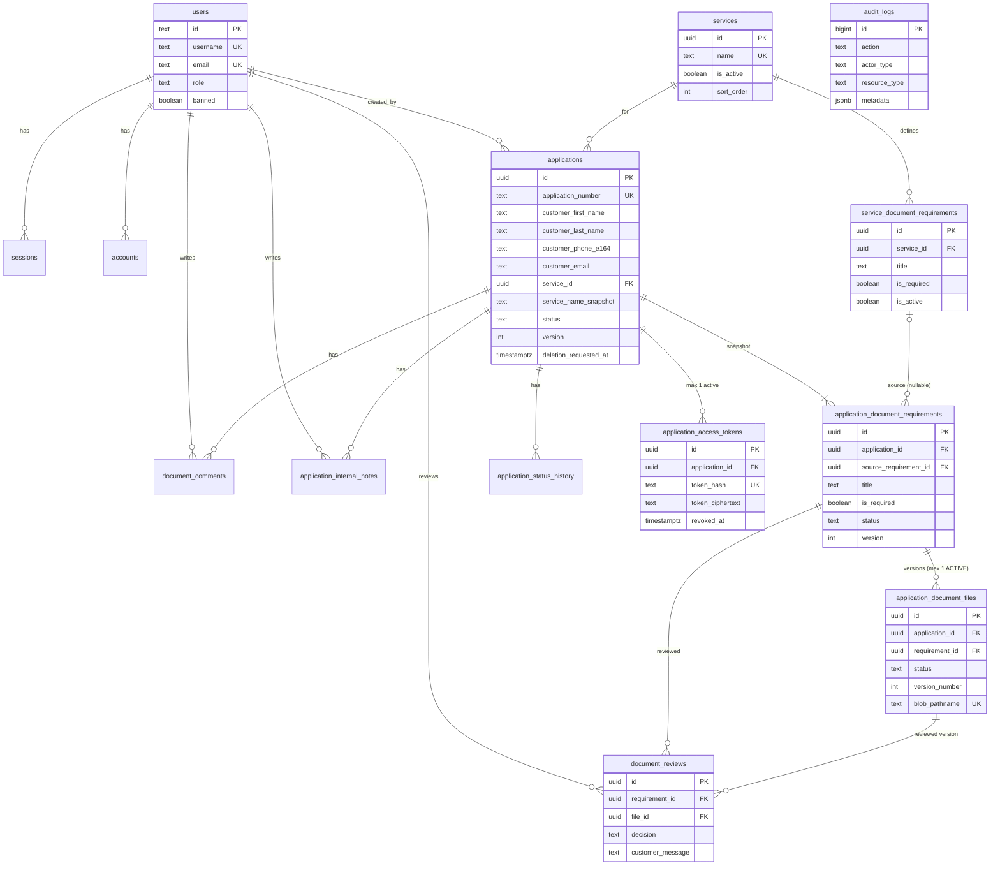

# Veritabanı Şeması

> PostgreSQL (Neon) + Drizzle ORM 0.45.4. **PHASE 02'de uygulandı:** şema `src/server/db/schema/*`, migration'lar `src/server/db/migrations/` (0000–0002). Uygulama ayrıntıları, invariant'lar ve yetkiler §9'da. Gerçek veritabanında doğrulama durumu: [PROJECT_STATE.md](PROJECT_STATE.md).
> İş kuralları: [BUSINESS_RULES.md](BUSINESS_RULES.md) · State machine: [STATE_TRANSITIONS.md](STATE_TRANSITIONS.md) · Silme: BR-150…BR-155
> Revizyon (2026-11-24, OD-01…OD-23): 23 → **17 tablo**. Değişiklik özeti §8'de.

## 1. Genel Kurallar

| Konu | Karar |
|---|---|
| İsimlendirme | Tablo/kolon `snake_case`, çoğul. Drizzle TS tarafında `camelCase`; kolon adları şemada açıkça yazılır (`casing` seçeneğine bağlı değil — D-058). |
| PK (domain) | `uuid DEFAULT gen_random_uuid()` (D-007). |
| PK (Better Auth) | Kütüphanenin ürettiği `text` ID'ler (Better Auth varsayılan ID üretimi; `generateId` değiştirilmez). Domain → `users` FK'ları `text`. |
| PK (audit) | `bigint GENERATED ALWAYS AS IDENTITY`. |
| Public referans | `applications.application_number`. Personel URL'lerinde UUID; her istekte yetki kontrolü. |
| Statü/enum | `text` + `CHECK (col IN (...))` (PostgreSQL enum değil: değer ekleme/çıkarma basit migration'dır). Değer listeleri ve TS union tipleri tek kaynak `src/config/statuses.ts`. |
| Zaman | Tümü `timestamptz` UTC, `DEFAULT now()`; `updated_at` veritabanı trigger'ıyla güncellenir (D-058). Gösterim `Europe/Istanbul`. |
| Silme davranışı | Kullanıcılar ve hizmetler silinmez → FK `ON DELETE RESTRICT`. Başvuruya ait tüm alt kayıtlar `ON DELETE CASCADE` — **yalnızca ADMIN manuel silme** tetikler (BR-150). |
| Soft delete | Yok. Arşiv yok (OD-23). `deletion_requested_at` yalnızca devam eden gerçek silme işleminin işaretidir (BR-153), soft delete değildir. |
| Sabit limitler | Dosya tipi/boyutu/sayısı şemada **kolon değildir** (OD-16); `src/config/constants.ts` + DB kısıtları (tek aktif dosya). |
| Kişisel teknik veri | IP, hash'lenmiş IP, user-agent, cihaz/tarayıcı bilgisi **saklanmaz** (OD-09). |
| Optimistic locking | `applications.version`, `application_document_requirements.version`. |

## 2. ER Diyagramı



İlişkisiz (diyagramda gösterilmeyen) tablolar: `verifications` (Better Auth), `application_number_counters`, `rate_limit_buckets`.

## 3. Better Auth Tabloları (4)

> Kesin kolon listesi PHASE 03'te `npx auth@latest generate` çıktısından alınır. Better Auth'un zorunlu tabloları kaldırılmaz. Çoğul tablo adı kullanımı adapter seçeneğiyle PHASE 03'te doğrulanır; mümkün değilse kütüphane varsayılanları korunur.

### 3.1 `users`
| Kolon | Tip | Null | Default | Not |
|---|---|---|---|---|
| `id` | text | ✗ | Better Auth | PK |
| `name` | text | ✗ | | Ad Soyad |
| `email` | text | ✗ | | UNIQUE. Better Auth zorunlu kılar; sistem e-posta göndermez (OD-08). Değer politikası TD-05. |
| `email_verified` | boolean | ✗ | false | Kullanılmaz |
| `image` | text | ✓ | | Kullanılmaz |
| `username` | text | ✗* | | UNIQUE, lowercase (username plugin). *Uygulama zorunlu kılar. |
| `display_username` | text | ✓ | | Plugin alanı |
| `role` | text | ✗ | `'employee'` | CHECK `IN ('admin','employee')` |
| `banned` | boolean | ✗ | false | "Pasif" anlamında (D-021) |
| `ban_reason` | text | ✓ | | Personel içi |
| `ban_expires` | timestamptz | ✓ | | Kullanılmaz (süresiz pasif) |
| `created_at` / `updated_at` | timestamptz | ✗ | now() | |

`must_change_password` alanı **kaldırıldı** (OD-11: ilk girişte zorunlu değişim yok). Silme: yapılmaz.

### 3.2 `sessions`
`id` PK, `token` UNIQUE, `user_id` FK CASCADE, `expires_at`, `ip_address` (✓), `user_agent` (✓), `impersonated_by` (✓, admin plugin — kullanılmaz), `created_at`, `updated_at`.
**OD-09 kısıtı:** `CHECK (ip_address IS NULL AND user_agent IS NULL)` — kütüphane bu alanlara değer yazmaya çalışırsa kayıt **başarısız olur** (sessiz veri toplama yerine görünür hata). Doldurulmaması için yapılandırma: SECURITY §2. Süresi dolan oturumlar günlük temizlik işiyle silinir.

### 3.3 `accounts`
`id` PK, `account_id`, `provider_id` (`credential`), `user_id` FK CASCADE, `password` (scrypt hash), OAuth alanları (null), `created_at`, `updated_at`.

### 3.4 `verifications`
`id`, `identifier`, `value`, `expires_at`, `created_at`, `updated_at`. Kütüphanenin çekirdek tablosu; e-posta akışı olmadığından fiilen boş kalması beklenir.

Better Auth `rateLimit` tablosu **oluşturulmaz**: `disableIpTracking` yerleşik HTTP rate limiter'ı kapattığı için giriş sınırlaması `rate_limit_buckets` ile yapılır (SECURITY §2).

## 4. Domain Tabloları (13)

### 4.1 `services`
| Kolon | Tip | Null | Default | Kısıt |
|---|---|---|---|---|
| `id` | uuid | ✗ | gen | PK |
| `name` | text | ✗ | | 2–150; UNIQUE INDEX `lower(name)` |
| `description` | text | ✓ | | ≤2000 |
| `is_active` | boolean | ✗ | true | |
| `sort_order` | integer | ✗ | 0 | |
| `created_by_user_id` / `updated_by_user_id` | text | ✓ / ✓ | | FK users RESTRICT. NULL = sistem/seed kaydı (D-053); personel işlemlerinde uygulama zorunlu doldurur |
| `created_at` / `updated_at` | timestamptz | ✗ | now() | |

Index `(is_active, sort_order)`. Silme yok (BR-22).

### 4.2 `service_document_requirements` (şablon)
| Kolon | Tip | Null | Default | Kısıt |
|---|---|---|---|---|
| `id` | uuid | ✗ | gen | PK |
| `service_id` | uuid | ✗ | | FK services RESTRICT |
| `title` | text | ✗ | | 2–150 |
| `description` | text | ✓ | | ≤2000 |
| `instructions` | text | ✓ | | ≤4000, düz metin |
| `is_required` | boolean | ✗ | true | |
| `sort_order` | integer | ✗ | 0 | |
| `is_active` | boolean | ✗ | true | |
| `created_by_user_id` / `updated_by_user_id` | text | ✓ / ✓ | | FK users RESTRICT (D-053) |
| `created_at` / `updated_at` | timestamptz | ✗ | now() | |

Index `(service_id, is_active, sort_order)`. **Kaldırılan alanlar:** `allowed_mime_type`, `max_file_size_bytes`, `max_file_count` (OD-16).

### 4.3 `application_number_counters`
`year smallint PK`, `last_value integer NOT NULL`. Başvuru transaction'ında:
```sql
INSERT INTO application_number_counters (year, last_value) VALUES ($1, 1)
ON CONFLICT (year) DO UPDATE SET last_value = application_number_counters.last_value + 1
RETURNING last_value;
```
Satır kilidi eşzamanlı oluşturmaları sıraya koyar; geri alınan transaction sayacı da geri alır (D-008).

### 4.4 `applications` (müşteri bilgileri dahil — OD-10)
| Kolon | Tip | Null | Default | Kısıt / Not |
|---|---|---|---|---|
| `id` | uuid | ✗ | gen | PK |
| `application_number` | text | ✗ | | UNIQUE; CHECK `~ '^CS-[0-9]{4}-[0-9]{6,}$'` |
| `customer_first_name` | text | ✗ | | 1–100 |
| `customer_last_name` | text | ✗ | | 1–100 |
| `customer_phone_e164` | text | ✗ | | CHECK `~ '^\+[1-9][0-9]{7,14}$'`; **UNIQUE değil** |
| `customer_email` | text | ✗ | | Normalize, ≤254; **UNIQUE değil** |
| `search_text` | text | ✗ | | BR-80 (uygulama üretir) |
| `service_id` | uuid | ✗ | | FK services RESTRICT |
| `service_name_snapshot` | text | ✗ | | Oluşturma anındaki hizmet adı |
| `status` | text | ✗ | `'AWAITING_DOCUMENTS'` | CHECK 7 değer |
| `status_changed_at` | timestamptz | ✗ | now() | |
| `submitted_at` | timestamptz | ✓ | | Son gönderim |
| `created_by_user_id` | text | ✗ | | FK users RESTRICT |
| `updated_by_user_id` | text | ✓ | | FK users RESTRICT |
| `idempotency_key` | uuid | ✓ | | UNIQUE (form tekrar gönderimine karşı) |
| `version` | integer | ✗ | 1 | Optimistic lock |
| `deletion_requested_at` | timestamptz | ✓ | | BR-153 — dolu ise başvuru **tüm okumalarda erişilemez** |
| `deletion_requested_by_user_id` | text | ✓ | | FK users RESTRICT |
| `created_at` / `updated_at` | timestamptz | ✗ | now() | |

Index:
- `(created_at DESC)` — varsayılan liste
- `(status, created_at DESC)` — statü filtresi + dashboard sayaçları
- `(service_id, created_at DESC)` — hizmet filtresi
- `(customer_phone_e164)`, `(customer_email)` — arama
- `GIN (search_text gin_trgm_ops)` — `pg_trgm` (Neon desteği PHASE 02'de doğrulanır; yoksa btree + `ILIKE 'prefix%'` yedek)
- `(deletion_requested_at) WHERE deletion_requested_at IS NOT NULL` — yarım kalan silmeleri bulmak

**Kaldırılan alanlar:** `customer_id`, `assigned_user_id`, `archived_at`, `archived_by_user_id`, `terminal_at`.

### 4.5 `application_document_requirements` (snapshot + statü)
| Kolon | Tip | Null | Default | Kısıt / Not |
|---|---|---|---|---|
| `id` | uuid | ✗ | gen | PK |
| `application_id` | uuid | ✗ | | FK applications CASCADE |
| `source_requirement_id` | uuid | ✓ | | FK service_document_requirements SET NULL |
| `title`, `description`, `instructions`, `is_required`, `sort_order` | | | | **Snapshot** — §4.2 kısıtları |
| `status` | text | ✗ | `'NOT_UPLOADED'` | CHECK 5 değer |
| `status_changed_at` | timestamptz | ✗ | now() | |
| `version` | integer | ✗ | 1 | Optimistic lock; her dosya aktivasyonunda ve kararda artar |
| `created_at` / `updated_at` | timestamptz | ✗ | now() | |

Index `(application_id, sort_order)`. **Kaldırılan alanlar:** `allowed_mime_type`, `max_file_size_bytes`, `max_file_count`, `added_after_creation`.

### 4.6 `application_document_files` (versiyonlar)
| Kolon | Tip | Null | Default | Kısıt / Not |
|---|---|---|---|---|
| `id` | uuid | ✗ | gen | PK |
| `application_id` | uuid | ✗ | | FK applications CASCADE (yetki sorgusu için denormalize) |
| `requirement_id` | uuid | ✗ | | FK application_document_requirements CASCADE |
| `status` | text | ✗ | `'UPLOAD_PENDING'` | CHECK `IN ('UPLOAD_PENDING','VALIDATING','ACTIVE','SUPERSEDED','REMOVED','REJECTED','EXPIRED')` |
| `version_number` | integer | ✓ | | Aktif olunca atanır (BR-71) |
| `blob_pathname` | text | ✗ | | UNIQUE. `applications/{applicationId}/{requirementId}/{fileId}.pdf` — kişisel veri yok |
| `original_filename` | text | ✗ | | Sanitize, ≤200 |
| `size_bytes` | integer | ✓ | | Blob'dan doğrulanan gerçek boyut; CHECK `size_bytes <= 10485760` |
| `sha256` | text | ✓ | | Doğrulamada hesaplanır |
| `rejection_reason` | text | ✓ | | `NOT_PDF`, `ACTIVE_CONTENT`, `EMBEDDED_FILE`, `ENCRYPTED`, `MALFORMED`, `TOO_LARGE`, `RESOURCE_LIMIT`, `STATE_CHANGED`, `VALIDATION_ERROR` — personel içi |
| `uploaded_by_actor_type` | text | ✗ | | CHECK `IN ('USER','CUSTOMER')` |
| `uploaded_by_user_id` | text | ✓ | | FK users RESTRICT |
| `uploaded_by_access_token_id` | uuid | ✓ | | Bileşik FK `(uploaded_by_access_token_id, application_id)` → tokens, NO ACTION (D-052) |
| `upload_expires_at` | timestamptz | ✗ | | Token süresi (+tolerans) |
| `uploaded_at` | timestamptz | ✓ | | Blob alındı |
| `activated_at` | timestamptz | ✓ | | ACTIVE oldu |
| `ended_at` | timestamptz | ✓ | | SUPERSEDED / REMOVED oldu |
| `ended_by_actor_type` / `ended_by_user_id` | text | ✓ | | Kaldıran/değiştiren |
| `blob_deleted_at` | timestamptz | ✓ | | Blob fiziksel olarak silindi (REJECTED/EXPIRED) |
| `created_at` | timestamptz | ✗ | now() | |

Kısıtlar ve index'ler:
- **Tek aktif PDF:** `UNIQUE (requirement_id) WHERE status = 'ACTIVE'` (OD-16)
- **Tek devam eden yükleme:** `UNIQUE (requirement_id) WHERE status IN ('UPLOAD_PENDING','VALIDATING')`
- `UNIQUE (requirement_id, version_number) WHERE version_number IS NOT NULL`
- CHECK `(uploaded_by_actor_type = 'USER') = (uploaded_by_user_id IS NOT NULL)`
- CHECK `(status IN ('ACTIVE','SUPERSEDED','REMOVED')) = (version_number IS NOT NULL)`
- `(status, upload_expires_at) WHERE status = 'UPLOAD_PENDING'` — teknik temizlik
- `(application_id)` — silme ve yetki

`mime_type` kolonu yoktur: kabul edilen tek tip `application/pdf`'tir ve doğrulama ile garanti edilir.

### 4.7 `document_reviews`
| Kolon | Tip | Null | Kısıt |
|---|---|---|---|
| `id` | uuid | ✗ | PK |
| `application_id` | uuid | ✗ | FK CASCADE |
| `requirement_id` | uuid | ✗ | FK CASCADE |
| `file_id` | uuid | ✗ | FK application_document_files CASCADE — **incelenen versiyon** (BR-57) |
| `decision` | text | ✗ | CHECK `IN ('APPROVED','REVISION_REQUIRED')` |
| `customer_message` | text | ✓ | CHECK `decision <> 'REVISION_REQUIRED' OR char_length(customer_message) BETWEEN 10 AND 1000` |
| `reviewed_by_user_id` | text | ✗ | FK users RESTRICT |
| `created_at` | timestamptz | ✗ | now() |

Index `(requirement_id, created_at DESC)`. Immutable. Tek aktif dosya kuralıyla `document_review_files` bağlantı tablosu gereksizleşti (D-034).

### 4.8 `document_comments` (müşteriye görünür)
`id` uuid PK · `application_id` FK CASCADE · `requirement_id` FK CASCADE ✓ (null = başvuru geneli) · `body` text 1–2000 · `author_user_id` FK RESTRICT · `created_at`. Index `(application_id, created_at)`. Immutable.

### 4.9 `application_internal_notes` (yalnızca personel)
`id` uuid PK · `application_id` FK CASCADE · `requirement_id` FK CASCADE ✓ · `body` text 1–5000 · `author_user_id` FK RESTRICT · `created_at`. Index `(application_id, created_at)`. Immutable. Müşteri yolu kodundan erişilmez (BR-121). Başvuru oluşturma formundaki "şirket içi not" bu tabloya yazılır.

### 4.10 `application_status_history`
| Kolon | Tip | Null | Kısıt |
|---|---|---|---|
| `id` | uuid | ✗ | PK |
| `application_id` | uuid | ✗ | FK CASCADE |
| `from_status` | text | ✓ | NULL = oluşturma |
| `to_status` | text | ✗ | CHECK 7 değer |
| `transition_code` | text | ✗ | `CREATE`, `SUBMIT`, …, `REVERT_FOR_REVISION` (T-kodları) |
| `actor_type` | text | ✗ | CHECK `IN ('USER','CUSTOMER')` |
| `actor_user_id` | text | ✓ | FK users RESTRICT |
| `actor_access_token_id` | uuid | ✓ | Bileşik FK `(actor_access_token_id, application_id)` → tokens, NO ACTION (D-052) |
| `on_behalf_of_customer` | boolean | ✗ | false |
| `reason` | text | ✓ | ≤1000; personel içi; T7–T12'de zorunlu (CHECK `transition_code NOT IN (...) OR reason IS NOT NULL`) |
| `created_at` | timestamptz | ✗ | now() |

CHECK `(actor_type = 'USER') = (actor_user_id IS NOT NULL)`; `on_behalf_of_customer → actor_type = 'USER'`. Index `(application_id, created_at)`.
T8 hedefi: `SELECT from_status FROM application_status_history WHERE application_id = $1 AND to_status = 'CANCELLED' ORDER BY created_at DESC LIMIT 1`.

### 4.11 `application_access_tokens`
| Kolon | Tip | Null | Not |
|---|---|---|---|
| `id` | uuid | ✗ | PK |
| `application_id` | uuid | ✗ | FK CASCADE |
| `token_hash` | text | ✗ | UNIQUE. `HMAC-SHA256(ACCESS_TOKEN_HMAC_KEY, token)` hex — doğrulama |
| `token_ciphertext` | text | ✗ | AES-256-GCM (`v1:<keyId>:<iv>:<ct>:<tag>`, AAD = `application_id`) — tekrar görüntüleme (OD-19) |
| `encryption_key_id` | text | ✗ | Anahtar rotasyonu |
| `revoked_at` | timestamptz | ✓ | |
| `revoked_by_user_id` | text | ✓ | FK users RESTRICT |
| `revoke_reason` | text | ✓ | CHECK `IN ('ROTATED','REVOKED','APPLICATION_DELETION')` |
| `created_by_user_id` | text | ✗ | FK users RESTRICT |
| `created_at` | timestamptz | ✗ | now() |

**Tek aktif bağlantı (OD-18):** `UNIQUE (application_id) WHERE revoked_at IS NULL` + yenileme transaction'ında `applications FOR UPDATE` kilidi. Eşzamanlı iki yenileme isteğinden ikincisi kilidi bekler, ardından `expectedVersion`/güncel token kontrolünde ya kendi yenilemesini sırayla yapar ya da reddedilir; her durumda **en fazla bir** aktif satır kalır (constraint son savunma).
**Kaldırılan alanlar:** `expires_at` (OD-04), `last_used_at` (GET isteği veri değiştirmesin — BR-105). Düz token hiçbir kolonda yoktur.

### 4.12 `rate_limit_buckets` (kısa ömürlü teknik anahtarlar)
| Kolon | Tip | Not |
|---|---|---|
| `key` | text PK | Ör. `login:ip:<hmac>`, `login:user:<hmac(username)>`, `link:ip:<hmac>`, `upload:actor:<id>`, `file:actor:<id>` |
| `window_started_at` | timestamptz | |
| `count` | integer | |
| `expires_at` | timestamptz | Pencere sonu. Index; süresi dolan satırlar aynı anahtarın sonraki isteğinde üzerine yazılır ve günlük temizlikte silinir |

OD-09 istisnası: IP'den türetilen anahtarlar yalnızca HMAC'lenmiş, pencere süresiyle sınırlı **teknik** verilerdir; audit veya kullanıcı izleme için kullanılmaz, başka tabloya kopyalanmaz. Ömür: pencere süresi + en fazla ~24 saat (günlük temizlik).

### 4.13 `audit_logs`
| Kolon | Tip | Null | Not |
|---|---|---|---|
| `id` | bigint identity | ✗ | PK |
| `occurred_at` | timestamptz | ✗ | now() |
| `action` | text | ✗ | [SECURITY.md](SECURITY.md) §8 |
| `actor_type` | text | ✗ | `USER` / `CUSTOMER` / `SYSTEM` / `ANONYMOUS` |
| `actor_user_id` | text | ✓ | FK yok |
| `actor_access_token_id` | uuid | ✓ | FK yok |
| `resource_type` | text | ✗ | `application`, `document`, `file`, `user`, `service`, `document_template`, `access_link`, `session` |
| `resource_id` | text | ✓ | |
| `application_id` | uuid | ✓ | FK yok — başvuru silinse de minimum kayıt kalır |
| `metadata` | jsonb | ✗ | `'{}'`; whitelist anahtarlar; PII/token/şifre yok |

IP / user-agent / `ip_hash` / `request_id` kolonları **yoktur** (OD-09). Index: `(occurred_at DESC)`, `(action, occurred_at DESC)`, `(actor_user_id, occurred_at DESC)`, `(application_id, occurred_at DESC)`.
**Değiştirilemezlik (D-039):** uygulama runtime rolü yalnızca `INSERT, SELECT` (`REVOKE UPDATE, DELETE, TRUNCATE`) + `BEFORE UPDATE OR DELETE` trigger'ı hata fırlatır. Otomatik saklama/silme işi **yoktur** (OD-06). Neon'da SQL ile oluşturulan rolün `neon_superuser` üyeliği almadığı dokümandan doğrulandı (D-054). Metadata CHECK'i yalnızca izinli üst düzey anahtarları kabul eder (`src/config/statuses.ts` → `AUDIT_METADATA_KEYS`).

## 5. Normalizasyon ve Arama
- Telefon: E.164 (BR-07); arama girdisi de normalize edilir.
- E-posta: lowercase + trim (BR-08).
- Türkçe arama: `src/lib/search.ts` (yazma + sorgu tarafında aynı fonksiyon).
- Liste: `applications JOIN services` gereksiz — `service_name_snapshot` kullanılır; tek tablo sorgusu + `LIMIT/OFFSET` (≤50) + `COUNT(*)`. Evrak özetleri tek aggregate alt sorgu. N+1 yok.
- Tüm sorgular `deletion_requested_at IS NULL` filtresi içerir (silme sürecindeki başvurular için ADMIN'e özel ayrı sorgu hariç).

## 6. Transaction Sınırları

| İşlem | İçerik | Kilit |
|---|---|---|
| Başvuru oluştur | sayaç, başvuru (müşteri bilgileri dahil), snapshot, token, statü geçmişi, iç not, audit | sayaç satırı; `idempotency_key` |
| Gönder (T1/T4) | başvuru, evrak statüleri, geçmiş, audit | `applications FOR UPDATE` + version |
| Evrak kararı (D4–D6) | review (`file_id`), evrak statüsü, audit | `applications FOR SHARE` + requirement `FOR UPDATE` + aktif dosya eşleşmesi + version |
| Statü geçişi (T2–T12) | başvuru, geçmiş, (T12: seçilen evraklar + review), (T7: devam eden yüklemeler `EXPIRED`), audit | `applications FOR UPDATE` + version |
| Upload token | önceki pending'i `EXPIRED`, yeni `UPLOAD_PENDING` | requirement `FOR UPDATE` |
| Upload claim | `UPLOAD_PENDING → VALIDATING` | file `FOR UPDATE` |
| Aktivasyon | BR-45 kontrolü, eski ACTIVE → SUPERSEDED, yeni → ACTIVE + version_number, evrak statüsü (D1/D7/D9), audit | `applications FOR SHARE` → requirement `FOR UPDATE` → files |
| Bağlantı yenile/iptal | eski token revoke (+ yeni token), audit | `applications FOR UPDATE` |
| Silme aşama 1 | `deletion_requested_at`, aktif token revoke, devam eden yüklemeler `EXPIRED`, audit | `applications FOR UPDATE` |
| Silme aşama 2 | başvuru satırını sil (CASCADE), audit | `applications FOR UPDATE` |

Transaction içinde ağ çağrısı yok (Blob, doğrulama dışarıda); kilit sırası **applications → requirements → files**.

## 7. Migration Stratejisi (PHASE 02 — uygulandı, D-056)
- `pnpm db:generate` (`drizzle-kit generate`) → SQL migration'lar repoya; SQL her seferinde incelenir. `push` hiçbir ortamda kullanılmaz.
- CHECK, partial unique index ve bileşik FK'lar Drizzle şemasından üretilir; extension, trigger, fonksiyon ve GRANT/REVOKE elle yazılan migration'lardadır (`--custom`).
- Uygulama: `pnpm db:migrate` — pooler olmayan URL, sahip rol, tek transaction; önce `pnpm db:init` (runtime rolü). Tek veritabanı (D-059).
- Uygulanmış migration dosyası **değiştirilmez**; düzeltme yeni migration ile yapılır. Yeni tablo ekleyen migration GRANT'larını da içerir (integration testi yakalar).
- Expand → migrate → contract. `db:reset` / `db:drop` / `DROP SCHEMA` kullanılmaz.

## 8. Önceki ve Yeni Model Farkı

| | Önceki (ilk PHASE 00) | Yeni |
|---|---|---|
| Tablo sayısı | **23** (Better Auth 5 + domain 18) | **17** (Better Auth 4 + domain 13) |
| Kaldırılan tablolar | — | `customers`, `customer_otp_challenges`, `customer_sessions`, `document_review_files`, `system_settings`, Better Auth `rate_limits` |
| Müşteri bilgisi | `customers` tablosu, `applications.customer_id` | `applications.customer_*` kolonları |
| Müşteri oturumu | `customer_sessions` tablosu | İmzalı cookie + her istekte token durumu kontrolü (D-032) |
| Dosya modeli | çoklu dosya, `upload_status` + `scan_status` iki eksen | tek aktif dosya, tek `status` ekseni, partial unique index'ler |
| İnceleme → dosya | `document_review_files` (N:N) | `document_reviews.file_id` (N:1) |
| Kaldırılan alanlar | — | `assigned_user_id`, `archived_*`, `terminal_at`, `must_change_password`, `expires_at`/`last_used_at` (token), `max_file_*`/`allowed_mime_type`, `added_after_creation`, `ip_hash`/`request_id` (audit), tüm ayar kolonları |
| Eklenen alanlar | — | `applications.customer_*`, `search_text` (taşındı), `deletion_requested_*`, `application_status_history.transition_code`, `document_reviews.file_id`, `sessions` CHECK (IP/UA null) |

## 9. PHASE 02 Uygulama Notları

### 9.1 Invariant'lar → mekanizma → test

| ID | Invariant | Veritabanı mekanizması | Doğrulama |
|---|---|---|---|
| INV-01 | Başvuru numarası benzersiz, biçimli | `applications_number_unique` + CHECK `^CS-[0-9]{4}-[0-9]{6,}$` | constraints, concurrency (10 eşzamanlı) |
| INV-02 | Başvuru başına tek aktif token | Partial unique `(application_id) WHERE revoked_at IS NULL` | constraints, concurrency (2 bağlantı) |
| INV-03 | Token hash benzersiz; düz token yok | `access_tokens_hash_unique` + 64 hex CHECK; `token`/`expires_at` kolonu yok | constraints |
| INV-04 | Evrak başına tek ACTIVE PDF | Partial unique `(requirement_id) WHERE status = 'ACTIVE'` | constraints, concurrency |
| INV-05 | Evrak başına tek devam eden yükleme | Partial unique `WHERE status IN ('UPLOAD_PENDING','VALIDATING')` | constraints |
| INV-06 | 0 < boyut ≤ 10 485 760 | CHECK (yapısal PDF doğrulamasının yerine geçmez — PHASE 08) | constraints |
| INV-07 | Yalnızca PDF metadata'sı | `mime_type` kolonu yok (tek tür); storage yolu kimliklerden türetilmiş `.pdf` (CHECK) | constraints |
| INV-08 | Versiyon evrak içinde benzersiz, ≥ 1; yalnızca doğrulanmış dosyada | Partial unique `(requirement_id, version_number)` + CHECK | constraints, concurrency |
| INV-09 | İnceleme yalnızca aynı evrağın/başvurunun dosyasına | Bileşik FK `(file_id, requirement_id, application_id)` (D-052) | constraints |
| INV-10 | Snapshot/yorum/not başka başvuruya bağlanamaz; şablon değişikliği snapshot'ı etkilemez | Bileşik FK'lar; şablona yalnızca `SET NULL` referans | constraints |
| INV-11 | Personel kullanıcı adı benzersiz, küçük harf | UNIQUE + CHECK `^[a-z0-9_.]{3,30}$` | constraints |
| INV-12 | IP/UA kalıcı tutulmaz | `sessions` CHECK `ip_address IS NULL AND user_agent IS NULL` (+ `impersonated_by IS NULL`) | constraints |
| INV-13 | Audit değiştirilemez | Runtime: yalnızca SELECT+INSERT; trigger UPDATE/DELETE/TRUNCATE'i herkes için reddeder; metadata anahtar beyaz listesi | privileges |
| INV-14 | Geçersiz FK reddedilir | Tüm FK'lar | constraints |
| INV-15 | Silme bütünlüğü | Başvuru → alt kayıtlar CASCADE; hizmet/kullanıcı RESTRICT; audit'te FK yok | transactions-and-deletion |
| INV-16 | Optimistic lock | `version >= 1` CHECK; desen §9.3 | constraints, concurrency |
| INV-17 | Zaman tutarlılığı | Tümü `timestamptz`; `updated_at` trigger | privileges (tip), constraints |

### 9.2 Runtime rolü yetkileri (D-054)

| Yetki | Tablolar |
|---|---|
| SELECT, INSERT, UPDATE, DELETE | `applications`, `sessions`, `verifications`, `rate_limit_buckets` |
| SELECT, INSERT, UPDATE | `users`, `accounts`, `services`, `service_document_requirements`, `application_number_counters`, `application_document_requirements`, `application_document_files`, `application_access_tokens` |
| SELECT, INSERT | `document_reviews`, `document_comments`, `application_internal_notes`, `application_status_history`, `audit_logs` |
| Hiçbiri | TRUNCATE, REFERENCES, TRIGGER, DDL, `drizzle` şeması, `public`'te CREATE, TEMP |

Bu yetkiler sunucu tarafı yetkilendirmenin yerine geçmez: örneğin runtime rolünün `audit_logs`'u okuyabilmesi, EMPLOYEE'nin audit ekranını görebileceği anlamına gelmez (AUTHORIZATION_MATRIX).

### 9.3 Mutasyon desenleri (sonraki fazlar için)
- **Optimistic lock:** `UPDATE … SET …, version = version + 1 WHERE id = $1 AND version = $expected RETURNING …` → 0 satır = `CONFLICT` (kullanıcıya "kayıt başka biri tarafından değiştirildi"). Eşzamanlı ikinci güncelleme ilk commit'i bekler ve 0 satır döner (integration testiyle doğrulandı).
- **Kilit sırası:** `applications` → `application_document_requirements` → `application_document_files` (`SELECT … FOR UPDATE/SHARE`). Ters sıra yasaktır (deadlock).
- **Hata kodları:** `23505` unique → `CONFLICT`; `23514` check / `23503` FK → uygulama hatası, `INTERNAL_ERROR` (girdi doğrulaması Zod'da yapılmış olmalı); `40001` serialization / `40P01` deadlock → en fazla 1 kez yeniden deneme, sonra `CONFLICT`; `55P03` lock timeout / `57014` statement timeout → `CONFLICT`/`INTERNAL_ERROR`, yeniden deneme yok. Sonsuz retry yoktur. Hata mesajları kullanıcıya iletilmez, PII/SQL parametresi loglanmaz.
- **Başvuru numarası:** §4.3 sayaç sorgusu; numara boşluksuz değildir (geri alınan transaction aynı numarayı bir sonrakine bırakabilir; silinen başvurunun numarası tekrar kullanılmaz — sayaç geri gitmez). 7+ haneye taşma biçimce desteklenir.

### 9.4 Silme ve storage
Veritabanı CASCADE'i storage nesnelerini **silmez**. BR-153 sırası korunur: aşama 1 `deletion_requested_*` + token iptali → storage nesneleri silinip doğrulanır (PHASE 08/10) → aşama 2 DB satırı silinir. Storage silme başarısızsa DB kaydı silinmez (aksi halde sahipsiz kişisel veri kalır). `audit_logs` FK içermez ve kişisel veri içermediği için başvuru silinince kalır.

### 9.5 Türkçe arama
Veritabanının `lower()`/`ILIKE` davranışı collation'a bağlıdır ve Türkçe `I/ı`, `İ/i` kurallarını uygulamaz (integration testi bunu gösterir). Bu nedenle arama **uygulamada** yapılan Türkçe katlama ile çalışır (BR-80): `search_text` yazılırken ve sorgu metni aynı fonksiyondan (`src/lib/search.ts`, PHASE 06) geçer; veritabanında `pg_trgm` GIN index'i bu katlanmış metin üzerindedir. Full-text search altyapısı kurulmaz. `services_name_lower_unique` ASCII dışı büyük/küçük harf eşleşmesini garanti etmez (Türkçe harfli hizmet adlarında aynı adın farklı yazımı ayrı kayıt sayılabilir — PHASE 05'te uygulama normalizasyonuyla ele alınır).

### 9.6 Kimlik doğrulama tabloları (PHASE 03 notları)
Better Auth 1.7.27 + username + admin alanları kütüphanenin `getAuthTables` çıktısıyla karşılaştırıldı (izole kurulum). PHASE 03'te doğrulanacaklar: Drizzle adapter yapılandırması (`schema: { user: users, session: sessions, account: accounts, verification: verifications }` veya `usePlural`), Better Auth'un oturum oluştururken IP/UA yazmaması (yazarsa CHECK kaydı reddeder — görünür hata), `role` varsayılanı `employee`, personel e-posta politikası (TD-05: `<username>@staff.invalid` önerisi; e-posta UNIQUE + NOT NULL; kullanıcı adı değişirse türetilmiş e-posta da güncellenmeli), kullanıcıların silinmemesi (runtime'da `users` DELETE yetkisi yok).
