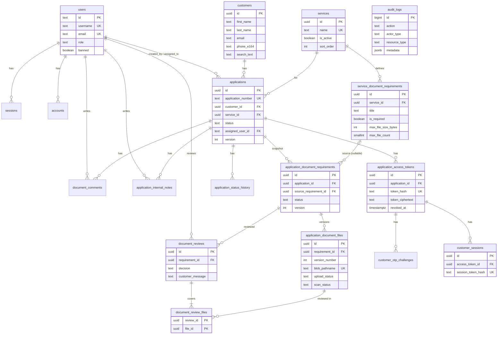

# Veritabanı Şeması

> PostgreSQL (Neon) + Drizzle ORM 0.45.x. Bu bir **tasarım dokümanıdır**; PHASE 00'da fiziksel DB, migration veya bağlantı oluşturulmamıştır.
> İş kuralları: [BUSINESS_RULES.md](BUSINESS_RULES.md) · State machine: [STATE_TRANSITIONS.md](STATE_TRANSITIONS.md) · Saklama: [DATA_PRIVACY.md](DATA_PRIVACY.md)

## 1. Genel Kurallar

| Konu | Karar |
|---|---|
| İsimlendirme | Tablo/kolon `snake_case`, tablo adları çoğul. Drizzle TS tarafında `camelCase` (`casing: 'snake_case'`). |
| Primary key (domain) | `uuid` + `DEFAULT gen_random_uuid()` (UUID v4) — D-007. UUID v7 (sıralı) PG18 `uuidv7()` ile ileride değerlendirilebilir; bu ölçekte v4'ün index parçalanma maliyeti önemsiz. |
| Primary key (Better Auth) | Better Auth'un ürettiği `text` ID'ler (kütüphane varsayılanı korunur). Domain → `users` FK'ları `text`. |
| Primary key (audit) | `bigint GENERATED ALWAYS AS IDENTITY` (ekleme sırası, append-only). |
| Public referans | `applications.application_number` (`CS-YYYY-NNNNNN`). URL'lerde personel tarafında UUID kullanılır; yetki her istekte kontrol edildiği için UUID gizli değildir, ancak tahmin edilemez olması ek savunmadır. |
| Statü/enum | `text` + `CHECK (col IN (...))`. PG enum yerine — değer ekleme/çıkarma migration'ı daha basit. TS tarafında union tipler domain modülünden türetilir. |
| Zaman | Tümü `timestamptz`, UTC, `DEFAULT now()`. Gösterim `Europe/Istanbul`. |
| `updated_at` | Değiştirilebilir tablolarda var; uygulama katmanı (Drizzle `$onUpdate`) günceller. Immutable tablolarda (`*_history`, `document_reviews`, `document_comments`, `application_internal_notes`, `audit_logs`) yok. |
| Aktör izleme | `actor_type` (`USER` \| `CUSTOMER` \| `SYSTEM`) + `actor_user_id` (text FK, nullable) + `actor_access_token_id` (uuid, nullable). CHECK ile tutarlılık. |
| Silme davranışı | Kullanıcılar ve hizmetler **silinmez** (pasifleştirilir) → FK `ON DELETE RESTRICT`. Başvuruya ait alt kayıtlar `ON DELETE CASCADE` (yalnızca saklama/silme işi tetikler). |
| Soft delete | Genel soft-delete yok. Kavramsal alanlar: `archived_at` (başvuru), `is_active` (hizmet/şablon), `banned` (kullanıcı), `removed_at` (dosya), `revoked_at` (token/oturum), `anonymized_at` (müşteri). |
| Optimistic locking | `applications.version`, `application_document_requirements.version` (BR-90). |
| Metin uzunlukları | `text` + `CHECK (char_length(...) BETWEEN ...)` — Zod şemalarıyla aynı sınırlar. |

## 2. ER Diyagramı



`application_number_counters`, `rate_limit_buckets`, `system_settings`, Better Auth `verifications` ve `rate_limits` tabloları bağımsızdır (ilişkisiz) ve diyagramda gösterilmemiştir.

## 3. Better Auth Tabloları

> Kesin kolon listesi PHASE 03'te `npx auth@latest generate` çıktısından alınır; buradaki liste dokümanlardan doğrulanan alanlar + eklentilerdir. Better Auth varsayılan tablo adları tekildir (`user`, `session`...); çoğul isim kullanımı adapter seçeneği ile PHASE 03'te doğrulanacak, mümkün değilse varsayılan adlar korunur.

### 3.1 `users`
| Kolon | Tip | Null | Default | Not |
|---|---|---|---|---|
| `id` | text | ✗ | Better Auth | PK |
| `name` | text | ✗ | | Ad Soyad |
| `email` | text | ✗ | | UNIQUE. Kurumsal e-posta (Better Auth zorunlu kılar). |
| `email_verified` | boolean | ✗ | false | |
| `image` | text | ✓ | | Kullanılmaz |
| `username` | text | ✗* | | UNIQUE, lowercase (username plugin). *Uygulama zorunlu kılar. |
| `display_username` | text | ✓ | | Plugin alanı |
| `role` | text | ✗ | `'employee'` | CHECK `IN ('admin','employee')` (admin plugin) |
| `banned` | boolean | ✗ | false | "Pasif" anlamında kullanılır (BR-132) |
| `ban_reason` | text | ✓ | | Personel içi |
| `ban_expires` | timestamptz | ✓ | | Kullanılmaz (süresiz pasif) |
| `must_change_password` | boolean | ✗ | false | `additionalFields` — D-020 |
| `created_at` / `updated_at` | timestamptz | ✗ | now() | |

Silme: **yapılmaz** (audit ve FK bütünlüğü). Saklama: hesap pasifleştikten sonra iş ilişkisi süresince (OD-06).

### 3.2 `sessions`
`id` PK, `token` UNIQUE, `user_id` FK → users (CASCADE), `expires_at`, `ip_address` (✓), `user_agent` (✓), `impersonated_by` (✓, admin plugin — kullanılmayacak), `created_at`, `updated_at`. Index: `user_id`, `token`.
Saklama: süresi dolan oturumlar cron ile silinir. IP/UA saklama süresi OD-09.

### 3.3 `accounts`
`id` PK, `account_id`, `provider_id` (`credential`), `user_id` FK CASCADE, `password` (scrypt hash), OAuth alanları (null), `created_at`, `updated_at`.

### 3.4 `verifications`
`id`, `identifier`, `value`, `expires_at`, `created_at`, `updated_at`. Personel akışlarında minimal kullanım (ör. şifre sıfırlama ileride).

### 3.5 `rate_limits` (Better Auth `rateLimit` modeli)
`storage: "database"` seçildiği için. Alanlar PHASE 03'te üretilir (`key`, `count`, `last_request` bekleniyor).

## 4. Domain Tabloları

### 4.1 `customers`
| Kolon | Tip | Null | Default | Kısıt / Not |
|---|---|---|---|---|
| `id` | uuid | ✗ | gen_random_uuid() | PK |
| `first_name` | text | ✗ | | 1–100 kr. |
| `last_name` | text | ✗ | | 1–100 kr. |
| `email` | text | ✗ | | Normalize (BR-08), ≤254 kr. **UNIQUE değil** (BR-04) |
| `phone_e164` | text | ✗ | | CHECK `phone_e164 ~ '^\+[1-9][0-9]{7,14}$'`. **UNIQUE değil** |
| `search_text` | text | ✗ | | BR-80 katlanmış arama metni (uygulama üretir) |
| `anonymized_at` | timestamptz | ✓ | | KVKK silme/anonimleştirme sonrası |
| `created_by_user_id` | text | ✗ | | FK users RESTRICT |
| `updated_by_user_id` | text | ✓ | | FK users RESTRICT |
| `created_at` / `updated_at` | timestamptz | ✗ | now() | |

Index: `(phone_e164)`, `(email)` — mükerrer adayı arama; `GIN (search_text gin_trgm_ops)` — `pg_trgm` (Neon desteği PHASE 02'de doğrulanır; yoksa `ILIKE` + btree prefix yedek planı).
Silme: Saklama süresi dolunca anonimleştirme/silme işi (DATA_PRIVACY §5). Başvurusu olan müşteri doğrudan silinmez (RESTRICT); önce başvuru verileri silinir.

### 4.2 `services`
| Kolon | Tip | Null | Default | Kısıt |
|---|---|---|---|---|
| `id` | uuid | ✗ | gen | PK |
| `name` | text | ✗ | | 2–150 kr.; UNIQUE INDEX `lower(name)` |
| `description` | text | ✓ | | ≤2000 |
| `is_active` | boolean | ✗ | true | |
| `sort_order` | integer | ✗ | 0 | |
| `created_by_user_id` / `updated_by_user_id` | text | ✗ / ✓ | | FK users RESTRICT |
| `created_at` / `updated_at` | timestamptz | ✗ | now() | |

Index: `(is_active, sort_order)`. Silme: yapılmaz (BR-22).

### 4.3 `service_document_requirements` (şablon)
| Kolon | Tip | Null | Default | Kısıt |
|---|---|---|---|---|
| `id` | uuid | ✗ | gen | PK |
| `service_id` | uuid | ✗ | | FK services RESTRICT |
| `title` | text | ✗ | | 2–150 |
| `description` | text | ✓ | | ≤2000 |
| `instructions` | text | ✓ | | ≤4000 (düz metin; HTML yok) |
| `is_required` | boolean | ✗ | true | |
| `allowed_mime_type` | text | ✗ | `'application/pdf'` | CHECK `= 'application/pdf'` (MVP) |
| `max_file_size_bytes` | integer | ✗ | | CHECK `> 0 AND <= 104857600`; uygulama ayrıca sistem üst sınırını uygular (BR-24) |
| `max_file_count` | smallint | ✗ | 1 | CHECK `BETWEEN 1 AND 10` |
| `sort_order` | integer | ✗ | 0 | |
| `is_active` | boolean | ✗ | true | |
| `created_by_user_id` / `updated_by_user_id` | text | ✗ / ✓ | | FK users |
| `created_at` / `updated_at` | timestamptz | ✗ | now() | |

Index: `(service_id, is_active, sort_order)`.

### 4.4 `application_number_counters`
| Kolon | Tip | Not |
|---|---|---|
| `year` | smallint PK | Europe/Istanbul yılı |
| `last_value` | integer NOT NULL | |

Kullanım (başvuru transaction'ı içinde, D-008):
```sql
INSERT INTO application_number_counters (year, last_value) VALUES ($1, 1)
ON CONFLICT (year) DO UPDATE SET last_value = application_number_counters.last_value + 1
RETURNING last_value;
```
Satır kilidi eşzamanlı oluşturmaları sıraya koyar; transaction geri alınırsa sayaç da geri alınır (boşluk yok). Bu ölçekte darboğaz değildir. Alternatif (`SEQUENCE`) yıllık sıfırlama ve boşluksuzluk sağlamadığı için tercih edilmedi.

### 4.5 `applications`
| Kolon | Tip | Null | Default | Kısıt / Not |
|---|---|---|---|---|
| `id` | uuid | ✗ | gen | PK |
| `application_number` | text | ✗ | | UNIQUE; CHECK `~ '^CS-[0-9]{4}-[0-9]{6,}$'` |
| `customer_id` | uuid | ✗ | | FK customers RESTRICT |
| `service_id` | uuid | ✗ | | FK services RESTRICT |
| `service_name_snapshot` | text | ✗ | | Oluşturma anındaki hizmet adı (hizmet sonradan yeniden adlandırılsa da başvuru değişmez) |
| `status` | text | ✗ | `'AWAITING_DOCUMENTS'` | CHECK 7 değer |
| `status_changed_at` | timestamptz | ✗ | now() | |
| `submitted_at` | timestamptz | ✓ | | Son gönderim |
| `terminal_at` | timestamptz | ✓ | | COMPLETED/CANCELLED zamanı (saklama süreleri için) |
| `assigned_user_id` | text | ✓ | | FK users RESTRICT (OD-03) |
| `created_by_user_id` | text | ✗ | | FK users RESTRICT |
| `archived_at` | timestamptz | ✓ | | BR-140; CHECK `archived_at IS NULL OR status IN ('COMPLETED','CANCELLED')` |
| `archived_by_user_id` | text | ✓ | | FK users |
| `idempotency_key` | uuid | ✓ | | UNIQUE (Architecture §12) |
| `version` | integer | ✗ | 1 | Optimistic lock |
| `created_at` / `updated_at` | timestamptz | ✗ | now() | |

Index:
- `(status, created_at DESC) WHERE archived_at IS NULL` — liste + statü filtresi
- `(created_at DESC) WHERE archived_at IS NULL` — varsayılan liste
- `(service_id, created_at DESC)` — hizmet filtresi
- `(customer_id)` — müşterinin başvuruları
- `(assigned_user_id) WHERE assigned_user_id IS NOT NULL` — ASSIGNED_ONLY kapsamı
- `(created_by_user_id)`

### 4.6 `application_document_requirements` (snapshot + statü)
| Kolon | Tip | Null | Default | Kısıt / Not |
|---|---|---|---|---|
| `id` | uuid | ✗ | gen | PK |
| `application_id` | uuid | ✗ | | FK applications CASCADE |
| `source_requirement_id` | uuid | ✓ | | FK service_document_requirements SET NULL |
| `title`, `description`, `instructions`, `is_required`, `allowed_mime_type`, `max_file_size_bytes`, `max_file_count`, `sort_order` | | | | **Snapshot** — §4.3 ile aynı kısıtlar |
| `added_after_creation` | boolean | ✗ | false | BR-33 (gelecek özellik) |
| `status` | text | ✗ | `'NOT_UPLOADED'` | CHECK 5 değer |
| `status_changed_at` | timestamptz | ✗ | now() | |
| `version` | integer | ✗ | 1 | Optimistic lock |
| `created_at` / `updated_at` | timestamptz | ✗ | now() | |

Index: `(application_id, sort_order)`.

### 4.7 `application_document_files`
| Kolon | Tip | Null | Default | Kısıt / Not |
|---|---|---|---|---|
| `id` | uuid | ✗ | gen | PK |
| `application_id` | uuid | ✗ | | FK applications CASCADE (yetki sorgusu için denormalize) |
| `requirement_id` | uuid | ✗ | | FK application_document_requirements CASCADE |
| `version_number` | integer | ✗ | | UNIQUE `(requirement_id, version_number)` |
| `blob_pathname` | text | ✗ | | UNIQUE. Biçim: `applications/{applicationId}/{requirementId}/{fileId}.pdf` — **kişisel veri yok** |
| `original_filename` | text | ✗ | | Sanitize edilmiş, ≤200 kr. (FILE_STORAGE §4) |
| `declared_size_bytes` | integer | ✗ | | İstemcinin bildirdiği (token öncesi kontrol) |
| `size_bytes` | integer | ✓ | | Blob'dan doğrulanan gerçek boyut |
| `mime_type` | text | ✗ | `'application/pdf'` | |
| `sha256` | text | ✓ | | Tarama sırasında hesaplanır (hex, 64 kr.) |
| `upload_status` | text | ✗ | `'PENDING'` | CHECK `IN ('PENDING','UPLOADED','EXPIRED')` |
| `upload_expires_at` | timestamptz | ✗ | | Token süresi (+ tolerans) |
| `uploaded_at` | timestamptz | ✓ | | |
| `scan_status` | text | ✗ | `'PENDING'` | CHECK `IN ('PENDING','CLEAN','REJECTED','ERROR')` |
| `scan_reason_code` | text | ✓ | | `NOT_PDF`, `ACTIVE_CONTENT`, `ENCRYPTED`, `MALFORMED`, `MALWARE`, `SIZE_MISMATCH` — personel içi |
| `scan_attempts` | smallint | ✗ | 0 | |
| `scanned_at` | timestamptz | ✓ | | |
| `uploaded_by_actor_type` | text | ✗ | | CHECK `IN ('USER','CUSTOMER')` |
| `uploaded_by_user_id` | text | ✓ | | FK users |
| `uploaded_by_access_token_id` | uuid | ✓ | | FK application_access_tokens SET NULL |
| `removed_at` | timestamptz | ✓ | | Güncel setten çıkarıldı |
| `removed_by_actor_type` / `removed_by_user_id` | text | ✓ | | |
| `blob_deleted_at` | timestamptz | ✓ | | Blob fiziksel olarak silindi (metadata kalabilir) |
| `created_at` | timestamptz | ✗ | now() | |

CHECK: `(uploaded_by_actor_type = 'USER') = (uploaded_by_user_id IS NOT NULL)`.
Index:
- `(requirement_id) WHERE upload_status = 'UPLOADED' AND removed_at IS NULL` — güncel set
- `(upload_status, upload_expires_at) WHERE upload_status = 'PENDING'` — orphan temizliği
- `(scan_status) WHERE scan_status IN ('PENDING','ERROR')` — tarama kuyruğu
- `(application_id)`

`version_number` ataması: requirement satırı `FOR UPDATE` kilitlenip `max(version_number)+1` alınır (aynı transaction).

### 4.8 `document_reviews`
| Kolon | Tip | Null | Kısıt |
|---|---|---|---|
| `id` | uuid | ✗ | PK |
| `application_id` | uuid | ✗ | FK CASCADE |
| `requirement_id` | uuid | ✗ | FK CASCADE |
| `decision` | text | ✗ | CHECK `IN ('APPROVED','REVISION_REQUIRED')` |
| `customer_message` | text | ✓ | CHECK `decision <> 'REVISION_REQUIRED' OR char_length(customer_message) BETWEEN 10 AND 1000` |
| `reviewed_by_user_id` | text | ✗ | FK users RESTRICT |
| `created_at` | timestamptz | ✗ | now() |

Index: `(requirement_id, created_at DESC)`. Immutable.

### 4.9 `document_review_files`
`review_id` uuid FK CASCADE, `file_id` uuid FK CASCADE, PK `(review_id, file_id)`. İncelenen dosya setinin anlık görüntüsü (BR-57).

### 4.10 `document_comments` (müşteriye görünür)
| Kolon | Tip | Null | Kısıt |
|---|---|---|---|
| `id` | uuid | ✗ | PK |
| `application_id` | uuid | ✗ | FK CASCADE |
| `requirement_id` | uuid | ✓ | FK CASCADE (null = başvuru geneli mesaj) |
| `body` | text | ✗ | 1–2000 |
| `author_user_id` | text | ✗ | FK users RESTRICT |
| `created_at` | timestamptz | ✗ | now() |

Index: `(application_id, created_at)`. Immutable.

### 4.11 `application_internal_notes` (yalnızca personel)
`id` uuid PK · `application_id` FK CASCADE · `requirement_id` FK CASCADE ✓ · `body` text 1–5000 · `author_user_id` FK RESTRICT · `created_at`. Index `(application_id, created_at)`. Immutable. **Müşteri yolu kodundan erişilmez** (BR-121).

### 4.12 `application_status_history`
| Kolon | Tip | Null | Kısıt |
|---|---|---|---|
| `id` | uuid | ✗ | PK |
| `application_id` | uuid | ✗ | FK CASCADE |
| `from_status` | text | ✓ | NULL = oluşturma |
| `to_status` | text | ✗ | CHECK 7 değer |
| `actor_type` | text | ✗ | CHECK `IN ('USER','CUSTOMER','SYSTEM')` |
| `actor_user_id` | text | ✓ | FK users |
| `actor_access_token_id` | uuid | ✓ | FK application_access_tokens SET NULL |
| `on_behalf_of_customer` | boolean | ✗ | false |
| `reason` | text | ✓ | ≤1000; personel içi |
| `created_at` | timestamptz | ✗ | now() |

CHECK: `(actor_type = 'USER') = (actor_user_id IS NOT NULL)`; `on_behalf_of_customer` → `actor_type = 'USER'`. Index `(application_id, created_at)`.

### 4.13 `application_access_tokens`
| Kolon | Tip | Null | Kısıt / Not |
|---|---|---|---|
| `id` | uuid | ✗ | PK |
| `application_id` | uuid | ✗ | FK CASCADE |
| `token_hash` | text | ✗ | UNIQUE. `HMAC-SHA256(ACCESS_TOKEN_HMAC_KEY, token)` hex |
| `token_ciphertext` | text | ✗ | AES-256-GCM (`v1:<iv>:<ciphertext>:<tag>` base64url) — personelin bağlantıyı tekrar görebilmesi için (D-011) |
| `encryption_key_id` | text | ✗ | Anahtar rotasyonu için (ör. `k1`) |
| `expires_at` | timestamptz | ✗ | BR-102 |
| `revoked_at` | timestamptz | ✓ | |
| `revoked_by_user_id` | text | ✓ | FK users |
| `revoke_reason` | text | ✓ | CHECK `IN ('ROTATED','REVOKED','APPLICATION_TERMINAL','EXPIRED_CLEANUP')` |
| `last_used_at` | timestamptz | ✓ | Son başarılı doğrulama |
| `created_by_user_id` | text | ✗ | FK users |
| `created_at` | timestamptz | ✗ | now() |

Index: UNIQUE `(application_id) WHERE revoked_at IS NULL` — tek aktif bağlantı (BR-100).
Token düz metni **hiçbir kolonda** saklanmaz; ciphertext yalnızca ADMIN/EMPLOYEE "bağlantıyı göster" işleminde çözülür ve audit'lenir.

### 4.14 `customer_otp_challenges`
| Kolon | Tip | Null | Not |
|---|---|---|---|
| `id` | uuid | ✗ | PK |
| `access_token_id` | uuid | ✗ | FK CASCADE |
| `code_hash` | text | ✗ | `HMAC-SHA256(OTP_HMAC_KEY, challengeId + code)` |
| `expires_at` | timestamptz | ✗ | +10 dk (ayar) |
| `attempts` | smallint | ✗ | 0 |
| `consumed_at` | timestamptz | ✓ | Tek kullanımlık |
| `created_at` | timestamptz | ✗ | now() |

Index `(access_token_id, created_at DESC)`. Saklama: 24 saat sonra cron ile silinir.

### 4.15 `customer_sessions`
| Kolon | Tip | Null | Not |
|---|---|---|---|
| `id` | uuid | ✗ | PK |
| `access_token_id` | uuid | ✗ | FK CASCADE |
| `application_id` | uuid | ✗ | FK CASCADE (denormalize — tüm müşteri sorgularının kapsamı) |
| `session_token_hash` | text | ✗ | UNIQUE. SHA-256(cookie değeri) |
| `expires_at` | timestamptz | ✗ | Mutlak süre (ayar, Proposed 12 saat) |
| `last_seen_at` | timestamptz | ✗ | Boşta kalma süresi (Proposed 60 dk) — yazma sıklığı ≥5 dk aralıkla sınırlanır |
| `revoked_at` | timestamptz | ✓ | |
| `created_at` | timestamptz | ✗ | now() |

Geçerlilik: `revoked_at IS NULL AND expires_at > now() AND last_seen_at > now() - idle` **ve** bağlı token iptal edilmemiş/süresi dolmamış (her istekte join ile — BR-101). Saklama: süresi dolanlar 7 gün sonra silinir.

### 4.16 `rate_limit_buckets` (uygulama seviyesi)
| Kolon | Tip | Not |
|---|---|---|
| `key` | text PK | Ör. `link:ip:<hmac(ip)>`, `otp_send:token:<id>`, `otp_verify:token:<id>`, `upload:actor:<id>` — IP ham saklanmaz |
| `window_started_at` | timestamptz | |
| `count` | integer | |
| `expires_at` | timestamptz | Index — cron temizliği |

Atomik `INSERT ... ON CONFLICT (key) DO UPDATE ... RETURNING count` (sabit pencere). Better Auth'un `rate_limits` tablosundan ayrıdır (D-019).

### 4.17 `audit_logs`
| Kolon | Tip | Null | Not |
|---|---|---|---|
| `id` | bigint identity | ✗ | PK |
| `occurred_at` | timestamptz | ✗ | now() |
| `action` | text | ✗ | Event kodu ([SECURITY.md](SECURITY.md) §8) |
| `actor_type` | text | ✗ | `USER` / `CUSTOMER` / `SYSTEM` / `ANONYMOUS` |
| `actor_user_id` | text | ✓ | **FK yok** (log bağımsız yaşar) |
| `actor_access_token_id` | uuid | ✓ | FK yok |
| `resource_type` | text | ✗ | `application`, `document`, `file`, `user`, `service`, `settings`, `access_link`, `session` |
| `resource_id` | text | ✓ | |
| `application_id` | uuid | ✓ | FK yok — filtre için |
| `metadata` | jsonb | ✗ | `'{}'` — whitelist anahtarlar; token/şifre/OTP/PII yok |
| `ip_hash` | text | ✓ | OD-09: varsayılan HMAC'lenmiş IP (ham IP yok) |
| `request_id` | text | ✓ | Korelasyon |

Index: `(occurred_at DESC)`, `(action, occurred_at DESC)`, `(actor_user_id, occurred_at DESC)`, `(resource_type, resource_id)`, `(application_id, occurred_at DESC)`.

**Değiştirilemezlik (D-025):**
1. Uygulama runtime rolü (`cs_app`) yalnızca `INSERT, SELECT` yetkisine sahiptir: `REVOKE UPDATE, DELETE, TRUNCATE ON audit_logs FROM cs_app`.
2. `BEFORE UPDATE OR DELETE` trigger'ı, saklama rolü (`cs_maintenance`) dışında hata fırlatır.
3. Saklama süresi dolan kayıtlar yalnızca `cs_maintenance` ile çalışan bakım işiyle silinir.
Neon'da özel rol oluşturma ve yetki ayrımı PHASE 02'de doğrulanacak; mümkün değilse trigger + uygulama seviyesinde yalnızca insert API'si yedek plandır.

### 4.18 `system_settings` (tek satır)
| Kolon | Tip | Default | Not |
|---|---|---|---|
| `id` | smallint PK | 1 | CHECK `id = 1` |
| `company_name` | text | `'CS Global'` | |
| `contact_email`, `contact_phone`, `contact_address`, `contact_whatsapp` | text ✓ | | Müşteri paneli iletişim alanı |
| `portal_contact_message` | text ✓ | | Düz metin |
| `max_upload_size_bytes` | integer | 10485760 | Sistem üst sınırı (10 MB) |
| `default_max_file_count` | smallint | 1 | |
| `access_link_ttl_days` | integer | 180 | OD-04 |
| `access_link_post_terminal_days` | integer | 30 | OD-04 |
| `customer_session_absolute_hours` | integer | 12 | |
| `customer_session_idle_minutes` | integer | 60 | |
| `otp_ttl_minutes` | smallint | 10 | |
| `otp_max_attempts` | smallint | 5 | |
| `employee_application_scope` | text | `'ALL'` | CHECK `IN ('ALL','ASSIGNED_ONLY')` |
| `superseded_file_retention_days` | integer ✓ | NULL | OD-06 — karar verilene kadar silme işi çalışmaz |
| `terminal_application_retention_days` | integer ✓ | NULL | OD-06 |
| `updated_by_user_id` | text ✓ | | |
| `updated_at` | timestamptz | now() | |

Tipli tek satır tercih edildi (D-026): key-value tablosuna göre tip güvenliği ve CHECK kısıtları sağlar; ayar ekleme bir migration gerektirir (nadir).

## 5. Normalizasyon ve Arama

- Telefon: `libphonenumber-js` → E.164 (BR-07). Aramada kullanıcının girdiği numara da aynı fonksiyondan geçirilir; `05321234567`, `532 123 45 67`, `+90 532...` aynı sonuca normalize olur.
- E-posta: lowercase + trim (BR-08).
- Türkçe arama: BR-80 katlaması uygulama katmanında (`src/lib/search.ts`) — hem yazma hem sorgu tarafında aynı fonksiyon. DB collation'a bağımlı değildir (Neon'da ICU `tr-TR` collation desteği doğrulanmadı; gerek de kalmaz).
- Liste sorgusu: `applications JOIN customers JOIN services` tek sorgu, `LIMIT/OFFSET` (sayfa ≤ 50) + ayrı `COUNT(*)`; ilişkili sayımlar (ör. evrak durumları) için alt sorgu/aggregate — N+1 yok.

## 6. Transaction Sınırları

| İşlem | Transaction içeriği | Kilit |
|---|---|---|
| Başvuru oluştur | müşteri, sayaç, başvuru, snapshot, token, statü geçmişi, not, audit | sayaç satırı; idempotency unique |
| Gönder (T1/T4) | başvuru statüsü, evrak statüleri, statü geçmişi, audit | `applications FOR UPDATE` + version |
| Evrak kararı (D4–D6) | review, review_files, evrak statüsü, audit | `applications FOR SHARE` + requirement `FOR UPDATE` + version |
| Statü geçişi (T2/T3/T5–T7) | başvuru, geçmiş, (T7'de token iptal), audit | `applications FOR UPDATE` + version |
| Upload token üret | `PENDING` dosya kaydı + version_number | requirement `FOR UPDATE` |
| Upload tamamla | dosya `UPLOADED`, evrak statüsü (D1/D7), tek dosyalıda eski dosyayı `removed_at`, audit | `applications FOR SHARE`, requirement `FOR UPDATE` |
| Tarama sonucu | dosya scan_status, (REJECTED'da `removed_at` + D2) | requirement `FOR UPDATE` |
| Bağlantı yenile | eski token revoke + yeni token + oturumları revoke + audit | `applications FOR UPDATE` |

Kurallar: transaction içinde ağ çağrısı yok; kilit sırası her zaman **applications → requirements → files** (deadlock önleme).

## 7. Migration Stratejisi (PHASE 02)

- `drizzle-kit generate` ile SQL migration dosyaları üretilir ve **repoya commit edilir**; `drizzle-kit push` production'da **kullanılmaz**.
- Migration'lar direct (pooler olmayan) URL ile çalışır.
- CHECK, partial index, trigger, GRANT/REVOKE gibi Drizzle'ın ifade edemediği yapılar özel SQL migration'larıyla eklenir.
- Her migration ileri-uyumlu yazılır (expand → migrate → contract) — preview ve production aynı şemayı paylaşmaz ama sıralı uygulanır.
