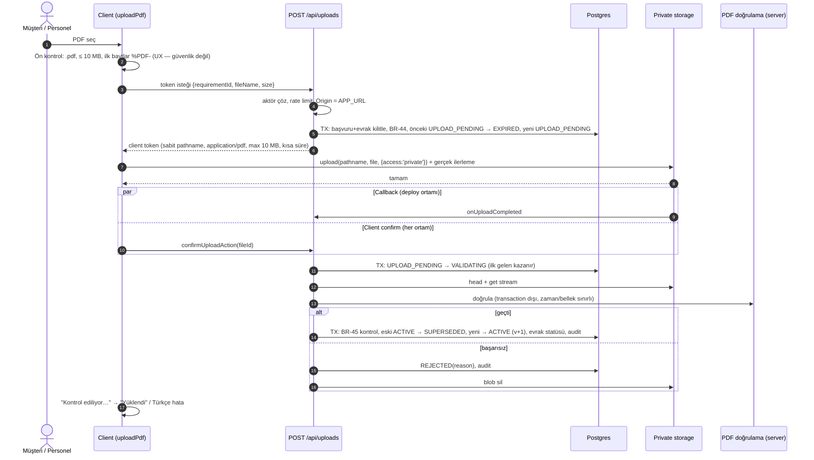
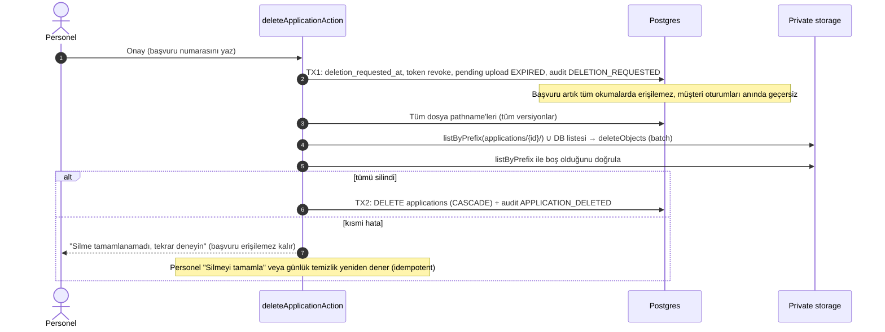

# PDF Depolama ve Dosya Güvenliği

> Doğrulama kaynakları: vercel.com/docs/vercel-blob (private-storage, client-upload, using-blob-sdk, usage-and-pricing), vercel.com/docs/functions/limitations — 2026-11-24.
> Kurallar: BR-40…BR-48, BR-70…BR-73, BR-150…BR-153 · Dosya state'leri: [STATE_TRANSITIONS.md](STATE_TRANSITIONS.md) §3 · Şema: [DATABASE_SCHEMA.md](DATABASE_SCHEMA.md) §4.6

## 1. Temel Kararlar

| Konu | Karar |
|---|---|
| Depolama | Private object storage — geliştirme/demo için **Vercel Blob private store** (`access: 'private'`, `@vercel/blob >= 2.3`). Public store/bucket **yok**. Production sağlayıcısı açık (PB-01). |
| Storage sınırı | Tüm storage erişimi tek modülden: `src/server/storage/storage.ts` (`createUploadToken`, `handleUploadCallback`, `head`, `getStream`, `deleteObjects`, `listByPrefix`) + client tarafında tek `uploadPdf()` yardımcısı. Sağlayıcı değişirse yalnızca bu iki dosya değişir. Çoklu sağlayıcı soyutlaması **yapılmaz** (D-040, OD-12). |
| Bölge | `fra1` (store oluşturulurken seçilir, sonradan değiştirilemez). |
| DB'de binary | Yok. Yalnızca metadata. |
| Yükleme yolu | **Client upload** (tarayıcı → storage doğrudan). Function body limiti 4.5 MB, Server Action limiti 1 MB olduğu için sunucu üzerinden geçirilmez (D-017). |
| Okuma yolu | Yalnızca `GET /api/files/[fileId]`: yetki → `get(pathname, { access: 'private' })` → stream. Kalıcı/public URL yok; signed URL kullanılmaz. |
| Pathname | `applications/{applicationId}/{requirementId}/{fileId}.pdf` — yalnızca UUID; kişisel veri ve orijinal ad yok. Pathname'i **sunucu** belirler. `addRandomSuffix: false`, `allowOverwrite: false`. |
| Sabit limitler (OD-16) | Yalnızca PDF · dosya başına `MAX_PDF_SIZE_BYTES = 10 485 760` (10 MB) · evrak başına **1 aktif PDF** · panelden değiştirilemez. Sabit: `src/config/constants.ts`; client ön kontrolü, upload token, sunucu doğrulaması, DB CHECK ve testler aynı değeri kullanır. |
| Versiyonlama | Her yükleme yeni dosya kaydı; yalnızca yeni versiyon `ACTIVE`, öncekiler `SUPERSEDED`. "Tek aktif PDF" ≠ "tek dosya geçmişi". |

## 2. Yükleme Akışı

### 2.1 Kurallar
1. **Token üretimi:** istemcinin pathname'i kullanılmaz; sunucu `fileId` üretir, pathname'i belirler, `tokenPayload = { fileId }`. `allowedContentTypes: ['application/pdf']`, maksimum boyut `MAX_PDF_SIZE_BYTES`, kısa geçerlilik (15 dk). SDK parametre adları PHASE 08'de doğrulanır (TD-11).
2. **Callback doğrulaması:** SDK doğrulaması + `tokenPayload.fileId` ile DB'deki kayıt ve `blob.pathname` eşleşmeli; değilse 400 (Blob 400'de yeniden denemez).
3. **Idempotency:** `UPLOAD_PENDING → VALIDATING` geçişi satır kilidiyle yapılır; ikinci çağrı mevcut durumu döndürür. Callback 5xx'te en fazla 5 kez yeniden denenir — güvenli.
4. **Localhost:** callback yerelde çalışmaz → client confirm aynı fonksiyonu çağırır. Kullanıcı confirm'den önce sayfayı kapatırsa (ve callback yoksa) kayıt `UPLOAD_PENDING` kalır → teknik temizlikte `EXPIRED` + blob silinir.
5. **Doğrulama senkron** yapılır (10 MB sınırı Function süre/bellek limitleri içinde); kuyruk/arka plan servisi yok. Doğrulama 10 dakikadan uzun `VALIDATING`'de kalırsa bir sonraki token isteğinde veya temizlikte `REJECTED (VALIDATION_ERROR)`.
6. **Yarış (BR-45):** aktivasyon transaction'ında başvuru/evrak durumu yüklemeye izin vermiyorsa `REJECTED (STATE_CHANGED)` + blob silinir. Mesaj: "Başvurunuzun durumu bu sırada değiştiği için dosya kaydedilemedi."
7. **Gerçek boyut:** storage'dan okunan boyut > `MAX_PDF_SIZE_BYTES` → `REJECTED (TOO_LARGE)`.
8. **Eşzamanlılık:** evrak başına tek aktif + tek devam eden yükleme DB kısıtlarıyla garanti; inceleme kararı BR-57 ile aktif `fileId`'ye bağlı.
9. **Personel `UNDER_REVIEW` yüklemesi (OD-17):** aynı akış; aktivasyonda evrak `PENDING_REVIEW` olur, önceki onay aktarılmaz.
10. **İlerleme:** client upload ilerleme callback'i ile gerçek yüzde (API adı TD-11); hata durumunda "Tekrar dene"; buton yükleme sırasında devre dışı (çift gönderim engeli).

## 3. Görüntüleme / İndirme

`GET /api/files/[fileId]?disposition=inline|attachment`
1. Aktör çöz (personel veya müşteri). Yoksa 401.
2. Dosya + başvuru getir; başvuru `deletion_requested_at` doluysa 404.
3. **Müşteri:** `file.application_id = oturum.applicationId` ve `status = 'ACTIVE'` değilse **404**. **Personel:** `status ∈ {ACTIVE, SUPERSEDED, REMOVED}` değilse 404.
4. `get(pathname, { access: 'private', useCache: false })` → stream yanıt.
5. Header'lar: `Content-Type: application/pdf`, `Content-Disposition: inline|attachment; filename*=UTF-8''<encoded>`, `Cache-Control: private, no-store`, `X-Content-Type-Options: nosniff`, `Content-Security-Policy: default-src 'none'; sandbox; frame-ancestors 'self'`, `Referrer-Policy: no-referrer`.
6. Audit `DOCUMENT_VIEWED` / `DOCUMENT_DOWNLOADED`; rate limit.

**Görüntüleme yaklaşımı:** varsayılan olarak tarayıcının yerleşik (sandbox'lı) PDF görüntüleyicisinde `inline` açma. PHASE 08 testlerinde bir tarayıcıda (iOS Safari, WhatsApp in-app, Android Chrome) güvenli inline görüntüleme sağlanamazsa o ortamda `attachment` (indirme) kullanılır ve kullanıcıya açıklama gösterilir (TD-12). Personel için öneri: dosyaları masaüstü PDF okuyucu yerine tarayıcıda açmak (tarayıcı PDF motorları sandbox içinde çalışır).

## 4. Dosya Adı Sanitizasyonu

Unicode NFC; kontrol karakterleri ve `/ \ : * ? " < > |` kaldırılır; baştaki noktalar kaldırılır; çoklu boşluk teke; ≤200 karakter (uzantı korunarak); boşsa `belge.pdf`; uzantı `.pdf` değilse red. UI'da `truncate` + `title` + `overflow-wrap:anywhere`. Orijinal ad yalnızca metadata.

## 5. Versiyonlar, Teknik Temizlik ve Silme

| Veri | Davranış |
|---|---|
| `ACTIVE`, `SUPERSEDED`, `REMOVED` dosyalar | **Otomatik silinmez** (OD-06). Yalnızca personelin manuel başvuru silme işlemiyle (OD-24: iki hesap eşit). |
| `REJECTED` dosyalar | Blob hemen silinir; metadata kalır (teknik — saklama politikası değildir). |
| `UPLOAD_PENDING` > 1 saat | Teknik temizlik: blob varsa silinir, `EXPIRED`. |
| Orphan blob'lar | Teknik temizlik: `listByPrefix('applications/')` ↔ DB mutabakatı; DB'de karşılığı olmayan ve 24 saatten eski blob'lar silinir. |
| Yarım kalan başvuru silmeleri | Teknik temizlik: `deletion_requested_at` dolu başvurular için silme aşama 2 yeniden denenir. |

Teknik temizlik: günlük zamanlanmış iş (`GET /api/cron/cleanup`; Vercel Hobby'de cron en sık **günde bir**, ±59 dk hassasiyetle — doğrulandı). Bu mekanizma müşteri verisi saklama süresi politikası **değildir**.

### 5.1 Başvuru silme (BR-150…BR-154)

DB kayıtları, storage nesneleri silindiği doğrulanmadan silinmez — böylece storage'da sahipsiz kişisel veri kalmaz.

## 6. PDF Doğrulama (OD-07)

### 6.1 Riskler
- Uzantı ve MIME istemci kontrollüdür — güvenilmez.
- PDF aktif içerik taşıyabilir: JavaScript (`/JavaScript`, `/JS`), otomatik aksiyonlar (`/OpenAction`, `/AA`), dış program (`/Launch`), gömülü dosyalar (`/EmbeddedFile`, `/EmbeddedFiles`, `/FileAttachment`), form/veri gönderimi (`/SubmitForm`, `/ImportData`, `/XFA`), `/RichMedia`, `/GoToR`, `/GoToE`.
- Polyglot dosyalar, şifreli PDF'ler, bozuk yapı ile parser istismarı, dekompresyon bombaları ve derin iç içe yapılar (kaynak tüketimi).
- Hedef: dosyayı açan **personel cihazı**.

### 6.2 Uygulanacak kontroller (zorunlu, uygulama içi, harici servis yok)
1. Uzantı `.pdf` (case-insensitive) ve beyan edilen MIME `application/pdf`.
2. Gerçek boyut ≤ `MAX_PDF_SIZE_BYTES`.
3. İlk 1024 bayt içinde `%PDF-1.x` / `%PDF-2.0`; dosya sonunda `%%EOF`.
4. Bakımı süren bir PDF parser ile **tam ayrıştırma** (sıkıştırılmış object stream'ler dahil); ayrıştırılamazsa `MALFORMED`. Kütüphane PHASE 08'de lisans, bakım, güvenlik geçmişi ve kaynak sınırlama yetenekleri doğrulanarak seçilir (TD-06). Yeni bağımlılık gerekçeli eklenir.
5. Aktif içerik anahtarları (6.1; hex-escape'li isimler `#4A` normalize edilerek) → `ACTIVE_CONTENT`; gömülü dosya → `EMBEDDED_FILE`. `/URI` bağlantıları red sebebi değildir.
6. `/Encrypt` → `ENCRYPTED` ("Şifre korumalı PDF yüklenemez").
7. Kaynak sınırları: toplam açılan stream boyutu, nesne sayısı, iç içe derinlik ve süre sınırı; aşılırsa `RESOURCE_LIMIT`.
8. SHA-256 hesaplanır.
9. Storage nesne anahtarı DB kaydıyla ve başvuru/evrak ilişkisiyle eşleşir.

### 6.3 Sınırlar ve dürüst beyan
- Bu kontroller **yapısal doğrulamadır; antivirüs / malware taraması değildir**. Bilinen zararlı yazılım imzaları, parser'ın göremediği exploit teknikleri ve PDF görüntüleyici zafiyetleri tespit edilemez.
- Dosyalar "virüssüz", "malware-free", "güvenli" olarak **etiketlenmez**. Arayüz etiketleri: müşteriye "Yüklendi"; personele "Yapısal kontrol tamamlandı".
- Harici AV (ClamAV, ticari API) MVP kapsamı dışıdır; ücretli servis eklenmez. Gerçek müşteri verisiyle production kullanımında kalan risk değerlendirmesi **zorunlu güvenlik gereksinimi** olarak kalır (PB-05).
- Azaltıcı önlemler: private storage, yalnızca yetkili sunum, sandbox'lı yanıt header'ları, tarayıcıda görüntüleme önerisi, personel cihazlarında güncel işletim sistemi/tarayıcı ve işletim sisteminin yerleşik antivirüsü (ör. Windows Defender — ek maliyet yok; operasyonel öneri).

### 6.4 Kabul kriterleri (PHASE 08 + PHASE 12)
1. Uzantısı `.pdf` olan PNG/EXE/HTML → `REJECTED (NOT_PDF)`.
2. Sahte `application/pdf` MIME ile PDF olmayan dosya → reddedilir.
3. `/JavaScript` veya `/OpenAction` içeren PDF (düz, object stream içinde, hex-escape'li) → `ACTIVE_CONTENT`.
4. Gömülü dosya içeren PDF → `EMBEDDED_FILE`.
5. `/Launch` içeren PDF → `ACTIVE_CONTENT`.
6. Şifreli PDF → `ENCRYPTED`.
7. Dekompresyon bombası / aşırı nesne sayısı → `RESOURCE_LIMIT`, süre sınırı içinde.
8. `10 485 761` bayt → token reddi veya `TOO_LARGE`; `10 485 760` bayt → kabul.
9. `UPLOAD_PENDING` / `VALIDATING` / `REJECTED` / `EXPIRED` dosyaya `/api/files` → 404.
10. Başka başvurunun `fileId`'si → 404; müşteri için `SUPERSEDED` dosya → 404.
11. Callback iki kez → tek aktivasyon, tek audit.
12. Token sonrası başvuru `UNDER_REVIEW` oldu → müşteri yüklemesi `STATE_CHANGED`, blob silinir; personel yüklemesi kabul edilir (OD-17).
13. Aynı evrağa iki paralel yükleme → yalnızca biri devam eder; asla iki `ACTIVE` olmaz.
14. Normal PDF'ler (tarayıcı "PDF olarak kaydet", tarama uygulaması çıktıları, ofis programı dışa aktarımları) kabul edilir; yanlış pozitif oranı test setiyle ölçülür.
15. Başvuru silme sonrası storage'da `applications/{id}/` öneki boş.

## 7. Kapasite ve Maliyet Notları

Vercel Blob Hobby: 1 GB depolama, 10K basit / 2K gelişmiş işlem, 10 GB transfer/ay; aşımda erişim 30 gün bloklanır, ücret çıkmaz. 1 GB ≈ ortalama 2 MB'lık ~500 PDF; başvuru başına versiyonlarla ~20 MB varsayımıyla **≈ 50 başvuru**. Otomatik silme olmadığından kapasite birikimlidir (PB-02). Ayrıntı: [DEPLOYMENT.md](DEPLOYMENT.md) §6.

## 8. PHASE 07 → PHASE 08 Müşteri Sözleşmesi (D-095)
- Müşteri yükleme token isteği, onay, kaldırma ve `/api/files/[fileId]` istekleri `contextId` taşır; sunucu `requireCustomerAccess(contextId)` ile imza, süre, bağlam eşitliği, token aktifliği ve başvurunun silinmediğini **her istekte** doğrular. `applicationId` istemciden alınmaz; evrak/dosya oturumdaki başvuruya ait değilse 404.
- Yükleme yalnızca `AWAITING_DOCUMENTS`/`REVISION_REQUIRED` statüsünde ve onaylanmamış evrakta (PHASE 07'deki yer tutucuyla aynı kural — `isCustomerEditable`).
- Bağlam uyuşmazlığında (aynı tarayıcıda başka başvuru açıldı) yükleme reddedilir; istemci "Bu sayfa artık güncel değil" gösterir → yanlış başvuruya yükleme engellenir (TM-40 mutasyon kısmı — PHASE 08'de E2E ile doğrulanacak).
- Müşteri dosya yanıtları `no-store`, `no-referrer`; müşteri yolu iç notları, eski versiyonları ve personel bilgisini döndürmez.
