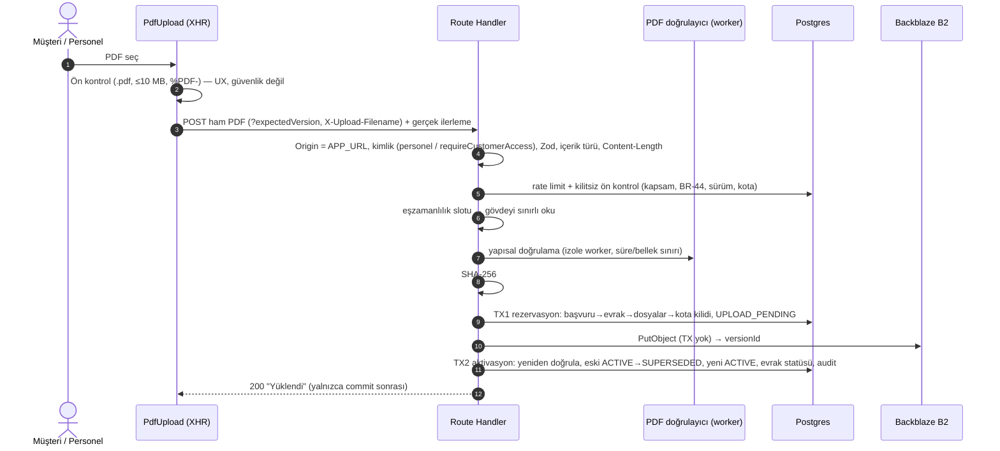

# PDF Depolama ve Dosya Güvenliği

> Doğrulama kaynakları (2026-11-25): backblaze.com/apidocs (s3-put-object, s3-head-object, s3-get-object, s3-delete-object, s3-list-object-versions, introduction-to-the-s3-compatible-api), backblaze.com/docs (cloud-storage-s3-compatible-api, cloud-storage-file-versions, cloud-storage-server-side-encryption, cloud-storage-data-caps-and-alerts, cloud-storage-application-key-capabilities), backblaze.com/cloud-storage/pricing ve transaction-pricing; `node_modules/next/dist/docs` (proxyClientMaxBodySize).
> Kurallar: BR-40…BR-48, BR-70…BR-73, BR-150…BR-153 · Dosya state'leri: [STATE_TRANSITIONS.md](STATE_TRANSITIONS.md) §3 · Şema: [DATABASE_SCHEMA.md](DATABASE_SCHEMA.md) §4.6, §9.8 · Kararlar: OD-25, D-096…D-107.
> **Tarihçe:** PHASE 00–07 tasarımı Vercel Blob private store + doğrudan client upload idi (D-017, D-040). OD-25 (2026-11-25) ile **Backblaze B2** seçildi; yükleme sunucu üzerinden yapılır (D-100). Eski kararlar DECISION_LOG'da Superseded olarak durur.

## 1. Temel Kararlar

| Konu | Karar |
|---|---|
| Sağlayıcı | **Backblaze B2** (OD-25), S3 uyumlu API — `@aws-sdk/client-s3` 3.1176.0 (D-096). Bucket `cs-global-documents`, **private**, bölge **EU Central** `eu-central-003`, uç nokta `https://s3.eu-central-003.backblazeb2.com`, varsayılan şifreleme **SSE-B2**, CORS kapalı ("hiçbir kaynakla paylaşma"), lifecycle "tüm versiyonları sakla". **Bucket'a kısıtlı Application Key**; Master Application Key kullanılmaz (B2 S3 API zaten kabul etmez). Bu bucket **geliştirme** kapsamındadır; production ayrı bucket + bağımsız anahtar gerektirir (D-098 koruması). |
| Soyutlama | `src/server/storage/` — `types.ts` (arayüz), `b2.ts`, `local-private.ts`, `config.ts`, `factory.ts`, `quota.ts`, `errors.ts` (D-097). Domain kodu AWS SDK'ye bağlı değildir. Yerel private adapter yalnızca izole testler ve açıkça yetkilendirilmiş yerel geliştirme içindir. **Sessiz yedek sağlayıcı yok.** |
| DB'de binary | Yok. PostgreSQL yalnızca metadata: ilişkiler, versiyon, yaşam döngüsü, boyut, SHA-256, nesne anahtarı (`blob_pathname`), sağlayıcı versiyon kimliği (`storage_version_id`), yükleyen aktör, zaman damgaları. |
| Yükleme yolu | **Sunucu üzerinden** (D-100): tarayıcı → kimlik doğrulamalı Route Handler (ham PDF gövdesi) → doğrulama → B2. Presigned/doğrudan tarayıcı yüklemesi **yok** (CORS kapalı kalır). |
| Okuma yolu | Yalnızca `GET /api/files/[fileId]` (personel) ve `GET /api/portal/[context]/files/[fileId]` (müşteri): yetki → audit → `GetObject(key, versionId)` → akış. Public/kalıcı/imzalı URL yok; sağlayıcı URL'si istemciye gönderilmez. |
| Nesne anahtarı | `applications/{applicationId}/{requirementId}/{fileId}.pdf` — yalnızca UUID; kişisel veri, orijinal ad, token, istemci yolu yok. Yalnızca sunucu üretir; DB CHECK biçimi zorunlu kılar; her versiyon yeni `fileId` → üzerine yazma yok. |
| Sabit limitler (OD-16) | Yalnızca PDF · dosya başına `MAX_PDF_SIZE_BYTES = 10 485 760` · evrak başına **1 aktif PDF** · panelden/env'den değiştirilemez (env'de tanımlıysa koddaki değerle aynı olmalı). |
| Versiyonlama | Uygulama düzeyi: her yükleme yeni dosya kaydı; yalnızca yeni versiyon `ACTIVE`, öncekiler `SUPERSEDED`. Sağlayıcı düzeyi (B2 native versioning) ayrıdır: aynı anahtara yazılan her nesne ayrı fiziksel versiyondur; uygulama kaydettiği versiyonu (`storage_version_id`) okur/siler. |
| Kota | **Hedef (OD-26, D-140):** uygulama sınırı 100 000 000 000 bayt, uyarı 90 000 000 000 (önceki 9 000 000 000 / 8 000 000 000 değerlerinin yerine). Aktif değer env'dedir; sağlayıcı hesabı hazır olana kadar 9 / 8 GB'ta kalabilir (§7.2). |

## 2. Yükleme Akışı (D-100, D-103)

### 2.1 Kurallar
1. **Kimlik/kapsam:** personel `getCurrentStaff()` (iki hesap eşit); müşteri `requireCustomerAccess(context)` (D-095) — başvuru yalnızca oturumdan; evrak başka başvuruya aitse 404. İstek başında doğrulanan bağlam istek boyunca sabittir; başka sekmenin yeni cookie'si hedefi değiştirmez. Bağlam uyuşmazlığı → `409 CONTEXT_MISMATCH` ("Bu sayfa artık güncel değil… Dosya yüklenmedi").
2. **Taşıma:** gövde = ham PDF, `Content-Type: application/pdf` (aksi 415), `Content-Length` zorunlu (411), 0 → 400, > 10 485 760 → 413 (gövde okunmadan); okunan gerçek bayt sayısı beyanla aynı olmalı. Proxy bu yolları kapsamaz (gövde tamponlama/kesme — D-100).
3. **Eşzamanlılık:** süreç başına 4 yükleme; en fazla 16 bekleyen, 30 sn; aksi 503 "Sistem şu anda yoğun". Rate limit: aktör başına 30 yükleme/saat, 120 görüntüleme/saat (429).
4. **Doğrulama önce, storage sonra:** reddedilen dosya storage'a yazılmaz, kayıt oluşmaz; audit `DOCUMENT_VALIDATION_REJECTED {requirementId, reason}`; kullanıcıya Türkçe mesaj + "Önceki dosyanız korunuyor".
5. **Rezervasyon (TX1):** BR-44 + `expectedVersion` kilit altında yeniden; evrakta süresi dolmamış devam eden yükleme varsa `409 UPLOAD_IN_PROGRESS` (süresi dolmuşsa `EXPIRED`); atomik kota (§7); `UPLOAD_PENDING` (boyut + SHA-256, 15 dk).
6. **Storage yazımı:** TX/kilit açık değil. Yanıt kaybolursa (`AMBIGUOUS`) kör yeniden yazma yok → HEAD ile boyut eşleşirse o versiyon; aksi `EXPIRED` + `DOCUMENT_UPLOAD_FAILED`. Cap/limit (`LIMIT`) → 503, yeniden deneme yok. Versiyon kimliği yoksa aktifleştirilmez.
7. **Aktivasyon (TX2, BR-45):** başvuru silinmiyor, müşteri token'ı aktif + oturum süresi dolmadı, BR-44, `expectedVersion`, rezervasyon hâlâ `UPLOAD_PENDING`. Değilse `REJECTED (STATE_CHANGED)` + audit + nesne en iyi çabayla silinir (olmazsa temizlik). Geçerliyse eski ACTIVE → `SUPERSEDED`, yeni `ACTIVE` (v = max+1), evrak statüsü, evrak `version+1`, `DOCUMENT_UPLOADED`/`DOCUMENT_REPLACED` audit'i (personelde `onBehalfOfCustomer`), onaylı evrakta `DOCUMENT_APPROVAL_INVALIDATED` — hepsi tek transaction.
8. **Belirsiz commit:** aktivasyon hata verirse DB durumu yeniden okunur; `ACTIVE` ise başarı döner (nesne silinmez); `UPLOAD_PENDING` kalmışsa `EXPIRED`. Eski aktif dosya hiçbir hata yolunda kaybolmaz.
9. **Personel `UNDER_REVIEW` yüklemesi (OD-17):** aynı akış; evrak `PENDING_REVIEW` olur, önceki onay aktarılmaz, eski inceleme kayıtları değişmez (BR-48).
10. **İlerleme (D-100):** `XMLHttpRequest.upload.onprogress` gerçek yüzde → aktarım bitince "Sunucuda doğrulanıyor ve kaydediliyor…" → "Yüklendi" yalnızca başarılı yanıtta; sahte zamanlayıcı yok; buton hydration tamamlanana ve yükleme bitene kadar pasif.
11. **Kaldırma** (BR-44 "kaldır", `REMOVED`) PHASE 08'de **uygulanmadı** (D-103) — PHASE 09.

## 3. Görüntüleme / İndirme (D-104; PHASE 11 Range — D-135, görüntüleyici — D-136)

`GET|HEAD /api/files/[fileId]?disposition=inline|attachment` (personel) · `GET|HEAD /api/portal/[context]/files/[fileId]?disposition=…` (müşteri)
1. Aktör: personel yolu yalnızca personel oturumu (yoksa 401); müşteri yolu yalnızca müşteri oturumu + bağlam (yoksa 401/409). Aynı tarayıcıda iki cookie yetki yükseltmez.
2. Dosya + başvuru: başvuru silinmekte veya `blob_deleted_at` dolu → 404.
3. **Müşteri:** dosya oturum başvurusuna ait ve `ACTIVE` değilse **404**; token iptal/yenilenmiş veya oturum süresi dolmuşsa 404. **Personel:** `ACTIVE`/`SUPERSEDED`/`REMOVED` değilse 404. Yetkisiz/kapsam dışı isteklerde sağlayıcıya hiç gidilmez (ölçümlü sağlayıcıyla test edildi).
4. **Aralık kararı (D-135)** kayıtlı boyuta göre: Range yok/bilinmeyen birim → 200 tam; tek aralık → 206; çoklu/bozuk/aşırı uzun/taşan/başlangıç ≥ boyut → **416** + `Content-Range: bytes */boyut` (sağlayıcıya gidilmez). `If-Range` yalnızca güçlü ETag birebir eşleşirse aralığı korur. İstemciden storage anahtarı veya versiyon kimliği kabul edilmez.
5. Rate limit (aktör başına): tam veya > 1 MiB aralık = `transfer` → 120/saat; ≤ 1 MiB aralık, HEAD, 416, 404 → 600/saat → 429.
6. Audit `DOCUMENT_VIEWED` / `DOCUMENT_DOWNLOADED` storage okumasından **önce** (yazılamazsa dosya sunulmaz): `transfer` her istekte; ≤ 1 MiB parça istekleri aktör + dosya + biçim başına 10 dakikada bir. HEAD/416 audit yazmaz.
7. **HEAD:** aynı yetki; gövde yok; sağlayıcıya istek yok.
8. `GetObject(key, storage_version_id[, Range])` → akış (tam tampon/base64 yok; aralık sağlayıcıda uygulanır, uygulamada kesilmez). Doğrulama: sağlayıcı `Content-Range` (başlangıç/bitiş/toplam), uzunluk ve versiyon kimliği kayıtla birebir; aralık istenip 200 dönerse gövde iptal edilir → 502. Gövde beklenen uzunlukla sınırlanır (kısa/uzun → akış hata ile kesilir). İstemci bağlantıyı kapatırsa sağlayıcı isteği/akışı iptal edilir. Cap aşımı → 503 "Günlük dosya erişim sınırına ulaşıldı…".
9. Başlıklar: `Content-Type: application/pdf`, güvenli `Content-Disposition`, `X-Content-Type-Options: nosniff`, `Cache-Control: private, no-store, max-age=0`, `Referrer-Policy: no-referrer`, `X-Frame-Options: DENY`, `Cross-Origin-Resource-Policy: same-origin`, `Accept-Ranges: bytes`, `ETag` (opak), 206'da `Content-Range`; CORS başlığı yok; CSP indirmede `default-src 'none'; sandbox; frame-ancestors 'none'`, satır içinde `default-src 'none'; frame-ancestors 'none'; base-uri 'none'; form-action 'none'`.

**Görüntüleme yaklaşımı (PHASE 11, D-136):** "Görüntüle" uygulama içi tam ekran pencere açar; pdf.js ve yerel worker yalnızca açılışta yüklenir. Görüntüleyici dosyayı aralıklarla okur (≤ 1 MiB dosya tek istek; büyük dosyada ilk 256 KiB + gereken parçalar, 4 istekten sonra hizalı 1 MiB bloklar — yalnızca oturum belleğinde; otomatik ön-getirme kapalı); sayfa gezinme, yakınlaştırma (%50–%300), kapatma (istekler iptal). Annotation/form/metin katmanı, betik, XFA, WebAssembly kapalı; tuval piksel sınırlı. PDF baytları kalıcı hiçbir yerde saklanmaz. Hata durumunda güvenli mesaj + "İndir". İndirme (`attachment`) tam dosyadır (değişmedi). **Gerçek cihaz/in-app tarayıcı doğrulaması açık (TD-12).** Sayfa açılışında PDF, HEAD veya ön-getirme yoktur (E2E ile doğrulandı).

## 4. Dosya Adı Sanitizasyonu

Unicode NFC; kontrol karakterleri, sıfır genişlikli ve yön (bidi) denetim karakterleri ve `/ \ : * ? " < > |` kaldırılır; baştaki noktalar kaldırılır; çoklu boşluk teke; uzantı `.pdf` olarak normalleşir; ≤ 200 karakter (uzantı korunarak); boşsa `belge.pdf`; uzantı `.pdf` değilse red. Ad istemciden `X-Upload-Filename` başlığında URL kodlu gelir (URL'ye yazılmaz). Orijinal ad kişisel veri içerebilir: yalnızca metadata — nesne anahtarına, log'a, audit'e yazılmaz. UI'da `wrap-anywhere` + `title`.

## 5. Versiyonlar, Teknik Temizlik ve Silme

| Veri | Davranış |
|---|---|
| `ACTIVE`, `SUPERSEDED`, `REMOVED` kayıtlı versiyonlar | **Otomatik silinmez** (OD-06, BR-47). Kapasite dolsa bile silinmez. Yalnızca personelin manuel kalıcı başvuru silme işlemiyle (OD-24; **PHASE 10 — uygulandı**, §5.1). Tekil dosya/eski versiyon kalıcı silme yoktur (BR-47; D-118). |
| `REJECTED`, `EXPIRED` kayıtların fiziksel versiyonları | `pnpm storage:cleanup --apply` ile versiyona özgü silinir; listede kalmadığı doğrulanınca **ve kaydın tüm yazım girişimleri listeleme başlamadan önce çözülmüşse** `blob_deleted_at` (PHASE 10.1, D-127). Belirsiz girişimli veya takipsiz (eski) kayıt kotada kalır. Metadata kalır. |
| Süresi dolmuş `UPLOAD_PENDING` | Temizlikte `EXPIRED` (koşullu güncelleme — aktivasyonla yarışta güvenli); başlamamış yazım girişimi kalıcı olarak `FENCED (RESERVATION_EXPIRED)` (PHASE 10.1). |
| Kayıtlı dosyanın yinelenen fiziksel versiyonları (yeniden deneme) | Kayıtlı versiyon listede varsa diğerleri silinir; yoksa anahtara dokunulmaz (bütünlük incelemesi). |
| Sahipliği doğrulanmamış nesneler (DB'de kaydı yok / önek dışı) | **Silinmez**; yalnızca `storage:reconcile` raporu ve kota hesabında `untracked_bytes`. |
| Kalıcı silme sürecindeki başvuruların nesneleri | Teknik temizlik **dokunmaz** (D-120); yalnızca kiralı silme iş akışı siler (§5.1). |

**B2 silme semantiği:** versionId'siz `DeleteObject` yalnızca silme işareti (delete marker) ekler, veri kalır ve kapasite tüketir; kalıcı silme yalnızca versionId'li `DeleteObject` ile (apidocs/s3-delete-object). Uygulama yalnızca versiyona özgü siler; bucket genelinde toplu silme/purge yoktur.

**Zamanlama:** ücretli cron/worker yok; komutlar elle çalıştırılır (varsayılan dry-run). Planlı bakım stratejisi PHASE 10/13'te (hosting seçimiyle — TD-10). Bu mekanizma müşteri verisi saklama süresi politikası **değildir**.

### 5.1 Kalıcı başvuru silme (BR-150…BR-154) — PHASE 10, uygulandı (D-116, D-117)
`src/features/deletion/service.ts`. PostgreSQL ile B2 arasında dağıtık transaction olmadığından akış kalıcı durum kaydıyla (`application_deletions`, `application_deletion_objects`) ve sınırlı, yeniden sürdürülebilir adımlarla ilerler:
1. **Talep (kısa TX):** başvuru kilidi, `expectedVersion`, başvuru numarası onayı (sunucuda), gerekçe → `deletion_requested_at` (müşteri erişimi ve tüm mutasyonlar anında kapanır) + token iptali (`APPLICATION_DELETION`) + işlem kaydı + audit.
2. **Yazım girişimi takibi (PHASE 10.1 — D-121…D-124; önceki zamana dayalı bekleme kapısı kaldırıldı):** her PUT girişimi rezervasyonla birlikte `storage_write_attempts`'e `ADMITTED` yazılır, PUT'tan önce `IN_PROGRESS` çiti commit edilir. Silme talebi başlamamış girişimleri `FENCED` yapar (PUT hiç gönderilmez); başlamış olanlar sonuçları kanıtlanana kadar sonlandırmayı engeller. Aktivasyon silme işaretini kilit altında görür ve dosyayı aktifleştirmez; geç gelen nesne kaybolmaz (envantere girer, girişime atanır ve silinir).
3. **Adım (kira altında, TX dışında ağ):** `applications/{applicationId}/` öneki (sondaki `/` ile — benzer önekli başka başvuru etkilenmez) tüm sayfalarıyla listelenir (adım başına ≤5 × 1000); her versiyonun sahipliği bu başvurunun dosya kaydıyla doğrulanır (başka kayda ait / hiçbir kayda ait değil → **hiçbir şey silinmeden durur**, manuel inceleme); envantere yazılır; ≤50 versiyona özgü `DeleteObject` sıralı; yeniden listeleme. `DELETED` yalnızca eksiksiz listelemede yokluk görülünce. Silme işaretleri de versiyona özgü kaldırılır. `GetObject` (PDF indirme) yapılmaz.
4. **Sonlandırma (kısa TX):** önek boş + liste eksiksiz + **çözülmemiş yazım girişimi yok** + takipsiz dosya kaydı yok + tüm girişimler bu listeleme başlamadan önce çözülmüş + onaylanmış her versiyon silinmiş görülmüş veya versiyona özgü HEAD ile yok → `final_listing_started_at` → dosya kayıtları `blob_deleted_at` (kota şimdi ve bir kez düşer) → kota kilidi → `storage_verified_at` → `DELETE applications` (CASCADE) → audit `APPLICATION_DELETED`. DB trigger'ı (D-117) bu koşullar sağlanmadan başvuru satırının silinmesini reddeder.

Hata davranışı: erişilemeyen storage, kota/cap (`LIMIT`), eksik liste, kısmi silme, kaybolan yanıt → başvuru silme talebinde kalır, metadata korunur, personel "Silme İşlemini Sürdür" ile devam eder (yalnızca kalan versiyonlar silinir). Yetki reddi / Object Lock / politika (`FORBIDDEN`), yapılandırma (`NoSuchBucket` dahil → `NOT_CONFIGURED`), bilinmeyen/çakışan sahiplik → manuel inceleme; nesne "yok" sayılmaz, sağlayıcı politikası otomatik değiştirilmez. Sınırsız yeniden deneme yok. Sağlayıcı hesabının kullanım/faturalama değeri silmeden sonra hemen güncellenmeyebilir; uygulama kotası ayrı bir kavramdır. **Belirsiz yazım (D-123, D-124):** sonucu kanıtlanamayan bir PUT (zaman aşımı, yanıt kaybı, sağlayıcı hatası, süreç çökmesi) varken silme `UPLOAD_OUTCOME_UNKNOWN` ile **güvenle bekletilir**; süre geçmesi kanıt değildir; çözüm yalnızca o anahtarda sahiplenilmemiş versiyonun gözlenmesiyle (sonra silinir). Sonuç hiç kanıtlanamazsa başvuru süresiz kilitli kalabilir (bypass yok — D-124). **Doğrulanmayan:** gerçek B2 üzerinde uygulama silme akışı (testler yerel adapter ile; canlı smoke yalnızca tek versiyonun versiyona özgü silinmesini doğruladı), gerçek cap/rate limit davranışı, Object Lock'lu bucket davranışı.

## 6. PDF Doğrulama (OD-07, D-099)

### 6.1 Riskler
- Uzantı ve MIME istemci kontrollüdür — güvenilmez.
- PDF aktif içerik taşıyabilir: JavaScript (`/JavaScript`, `/JS`), otomatik eylemler (`/OpenAction`, `/AA` içindeki eylemler), dış program (`/Launch`), gömülü dosyalar (`/EmbeddedFile`, `/EmbeddedFiles`, `/FileAttachment`), form/veri gönderimi (`/SubmitForm`, `/ImportData`, `/XFA`), `/RichMedia`, `/GoToR`, `/GoToE`, medya (`/Rendition`, `/Movie`, `/Sound`, `Screen` açıklaması).
- Polyglot dosyalar, şifreli PDF'ler, bozuk yapı ile ayrıştırıcı istismarı, dekompresyon bombaları ve derin iç içe yapılar (kaynak tüketimi).
- Hedef: dosyayı açan **personel cihazı**.

### 6.2 Uygulanan kontroller (uygulama içi, harici servis yok)
1. İçerik türü `application/pdf` (sunucu), uzantı `.pdf`; istemci MIME'ı tek başına güvenilmez.
2. Gerçek boyut 1…10 485 760 bayt.
3. **Zarf:** `%PDF-1.0…1.7` / `%PDF-2.0` dosyanın **ilk baytında** (önünde içerik → `NOT_PDF`); son 1024 baytta `%%EOF`; `startxref` ofseti dosya içinde ve xref tablosunu (girdi biçimi + `trailer` + `/Root`) ya da xref stream nesnesini gösterir → değilse `MALFORMED` (kesik/bozuk xref/trailer).
4. **Nesne düzeyi tarama:** tüm dosya + FlateDecode nesne akışları (ObjStm) PDF sözdizimine göre taranır (yorum/dize/diğer akış içerikleri atlanır); `#xx` kaçışlı adlar çözülür; dolaylı referanslar dahil her nesne. Yasaklı ad → `ENCRYPTED` / `EMBEDDED_FILE` / `ACTIVE_CONTENT`. Desteklenmeyen ObjStm kodlaması → `MALFORMED`. `/URI` ret sebebi değildir; `/OpenAction`/`/AA` tek başına değil, içerdiği yasaklı eylem türü reddedilir.
5. **pdf.js (pdfjs-dist 6.5.438) tam ayrıştırma:** katalog, sayfa ağacı (her sayfa), şifre (`ENCRYPTED`), ekler, belge/sayfa JavaScript eylemleri, açıklama türleri, widget eylemleri, XFA.
6. **Kaynak sınırları:** ayrı worker thread; bellek 256 MB, süre 20 sn (aşılırsa sonlandırılır), 2 000 sayfa, 100 000 nesne, 64 MiB açılmış ObjStm, 64 iç içe derinlik → `RESOURCE_LIMIT`. Worker'ın ortam değişkenleri boş; ağ/eval/harici program yok.
7. SHA-256 sunucuda gerçek baytlardan (D-107).
8. Nesne anahtarı DB kaydıyla ve başvuru/evrak ilişkisiyle eşleşir (DB CHECK).

### 6.3 Sınırlar ve dürüst beyan
- Bu kontroller **yapısal doğrulamadır; antivirüs / malware taraması değildir**. Bilinen zararlı imzalar, ayrıştırıcının ve ad taramasının göremediği teknikler ve PDF görüntüleyici zafiyetleri tespit edilemez. Yapısal olarak geçerli bir PDF'in güvenli/zararsız olduğu garanti edilmez.
- Dosyalar "virüssüz", "malware-free", "güvenli" olarak **etiketlenmez**. Arayüz: müşteriye "Yüklendi"; personele "Yapısal kontrol tamamlandı (antivirüs taraması değildir)".
- Harici AV (ClamAV, ticari API) kapsam dışı (OD-07); gerçek müşteri verisiyle production öncesi risk değerlendirmesi **zorunlu** (PB-05).
- Yanlış pozitif oranı (meşru PDF'lerin reddi) gerçek tarayıcı/tarama uygulaması/ofis çıktılarıyla **ölçülmedi** (PHASE 12).
- Azaltıcı önlemler: private storage, yalnızca yetkili sunum, sandbox'lı indirme yanıtı, tarayıcıda görüntüleme önerisi, personel cihazlarında güncel işletim sistemi/tarayıcı ve yerleşik antivirüs (operasyonel öneri).

### 6.4 Kabul kriterleri (PHASE 08 + PHASE 12)
1. Uzantısı `.pdf` olan JPEG/metin → `NOT_PDF` (unit + integration + E2E). ✓
2. Sahte `application/pdf` ile PDF olmayan dosya → reddedilir. ✓
3. `/JavaScript` içeren eylem (düz, ObjStm içinde, hex-escape'li) → `ACTIVE_CONTENT`; yalnızca sayfa hedefli `/OpenAction` → kabul. ✓
4. Gömülü dosya → `EMBEDDED_FILE`. ✓
5. `/Launch` → `ACTIVE_CONTENT`. ✓
6. Şifreli PDF → `ENCRYPTED`. ✓
7. Dekompresyon bombası / aşırı iç içe yapı / süre aşımı → `RESOURCE_LIMIT`. ✓
8. `10 485 761` bayt → 413 / `TOO_LARGE`; `10 485 760` bayt → kabul. ✓
9. `UPLOAD_PENDING` / `REJECTED` / `EXPIRED` dosyaya erişim → 404. ✓
10. Başka başvurunun `fileId`'si → 404; müşteri için `SUPERSEDED` → 404. ✓
11. Tekrarlanan/belirsiz yazma → tek aktivasyon (HEAD mutabakatı). ✓
12. Yükleme sırasında başvuru `UNDER_REVIEW` oldu → müşteri yüklemesi `STATE_CHANGED`; personel yüklemesi kabul (OD-17). ✓
13. Aynı evrağa paralel yüklemeler → yalnızca biri; asla iki `ACTIVE`. ✓
14. Normal PDF'ler kabul edilir — **gerçek belge setiyle yanlış pozitif ölçümü yapılmadı (PHASE 12).**
15. Başvuru silme sonrası önek boş — **PHASE 10** (başvuru silme henüz yok).

## 7. Kapasite, Kota ve Maliyet (D-101)

**Sağlayıcı (2026-11-25 doğrulandı):** "First 10GB storage is always free"; aylık ortalama depolamanın 3 katına kadar indirme ücretsiz, sonrası $0.01/GB; Class A çağrılar (PutObject, DeleteObject) ücretsiz; Class B (GetObject, HeadObject) ve Class C (ListObjectVersions, ListBuckets) çağrıları için ücretsiz günlük pay ve cap'ler hesap panelinden yönetilir; cap'ler günlük harcama sınırıdır, sayaçlar **00:00 GMT**'de sıfırlanır, uyarılar %75/%100'de; cap ayarı yoksa kullanım sınırsızdır; değişiklikler 10 dakikaya kadar sürebilir. Kullanıcının hesabında görülen: günlük depolama $0 / 10 GB, indirme $0 / 1 GB, Class B ve C 2 500/gün. Cap aşımında S3 API'nin döndürdüğü hata kodu belgelerde açık değildir (native API: 403 "storage cap") — uygulama 403+cap/limit ve 429'u `LIMIT` olarak sınıflandırır, yeniden denemez.

**Uygulama kotası:** kullanım = `blob_deleted_at IS NULL` tüm dosya kayıtlarının boyutu (aktif + önceki versiyonlar + devam eden rezervasyonlar + temizlik bekleyenler) + `untracked_bytes` (mutabakat). `STORAGE_MAX_TOTAL_BYTES` kod tavanı 100 000 000 000 (OD-26; önceki 9 000 000 000), varsayılan `STORAGE_WARNING_BYTES` 90 000 000 000 (önceki 8 000 000 000); env yalnızca eşit/daha düşük verebilir. Atomik: rezervasyonda tek satırlık `storage_quota_state` kilidi. Sınır aşılacaksa yükleme başlamadan reddedilir ("Depolama kapasitesi dolu. Şu anda yeni evrak yüklenemiyor. Lütfen CS Global ile iletişime geçiniz."). Mevcut dosyalar silinmez, erişime kapatılmaz. Dashboard "Dosya Depolama" kartı yalnızca DB'den (aktif / önceki / devam eden / temizlik bekleyen + kalan, %, yapılandırılan uyarı eşiği (hedef 90 GB), sınırda "yükleme durdu" (hedef 100 GB), son mutabakat zamanı) — sağlayıcı faturalama verisi değildir.

**İşlem/bant optimizasyonu:** sayfa açılışında PDF, HEAD veya liste çağrısı yok; dosya listesi ve geçmiş DB'den; PDF yalnızca açık "Görüntüle/İndir" aksiyonunda okunur; yükleme başına tek PutObject (+ yalnızca belirsiz yazmada tek HEAD); polling yok; en fazla 1 yeniden deneme, cap/limit hatalarında hiç. Mutabakat yalnızca elle (Class C). Uygulama tarafından ölçülen günlük indirme göstergesi eklenmedi (ileride değerlendirilebilir; faturalama verisi olarak sunulmaz).

**Uyarı:** uygulama kotası ve hesap cap'leri olası tüm ücretleri kesin olarak önlediğini garanti etmez.

**Günlük indirme kapasitesi modeli (PHASE 11, D-135/D-136):** hesap cap'leri 1 GB/gün indirme ve 2 500/gün Class B (GetObject/HeadObject). Her aralık isteği ayrı bir Class B işlemidir. Ölçülen görüntüleme maliyetleri ve günlük kapasite tablosu §7.1'dedir.

**Kapasite tahmini:** hedef 100 GB ≈ ortalama 2 MB'lık ~50 000 PDF versiyonu; başvuru başına versiyonlarla ~20 MB varsayımıyla **≈ 5 000 başvuru** (önceki 9 GB ≈ 450 başvuru). Otomatik silme olmadığından kapasite birikimlidir (PB-02).

### 7.1 Günlük indirme kapasitesi modeli (PHASE 11 — ölçülen, izole/sentetik)

**Not (PHASE 11.1, OD-26):** aşağıdaki model, kullanıcının şu an hesapta ayarlı tuttuğu kendi cap'lerine göredir; genel fiyatlandırmada Class A/B/C işlemleri ücretsizdir ve 100 GB ortalama depolamada aylık ~300 GB egress ücretsizdir (§7.2). Cap'ler kullanıcı tarafından güncellendiğinde işlem sayısı maliyet kısıtı olmaktan çıkar; görüntüleme başına bayt (aşağıda) bütçe açısından belirleyicidir.

Varsayımlar (mevcut hesap cap'leri): **1 GB/gün indirme** (10⁹ bayt; B2 ondalık GB kullanır) ve **2 500/gün Class B** işlemi (her `GetObject`, aralıklı dahil, bir işlemdir; HEAD artık sağlayıcıya gitmez). Görüntüleme = görüntüleyicide ilk sayfa (yerel ölçüm, `pnpm perf:isolated`; sağlayıcıya giden bayt = tarayıcıya giden bayt — integration'da ölçümlü sağlayıcıyla doğrulandı). Günlük kapasite = min(10⁹ / bayt, 2 500 / istek). Gerçek B2 ile doğrulanmadı (PHASE 12).

| Sentetik PDF | Eski: bayt / istek / görüntüleme | Yeni: bayt / istek / görüntüleme | Günlük görüntüleme (eski → yeni) |
|---|---|---|---|
| 20 KB, 1 sayfa | 20 030 / 1 | 20 043 / 1 | 2 500 → 2 500 (Class B sınırı) |
| 1 MB, 10 sayfa (≤ 1 MiB: tek istek) | 997 231 / 1 | 997 379 / 1 | 1 002 → 1 002 |
| 5 MB, 50 sayfa (kümelenmiş) | 4 985 460 / 1 | 266 922 / 2 | 200 → 1 250 (Class B sınırı) |
| 10 MB, 100 sayfa (kümelenmiş) | 9 970 912 / 1 | 271 638 / 2 | 100 → 1 250 (Class B sınırı) |
| 10 MB, 100 sayfa (dağınık, en kötü) | 9 970 912 / 1 | 10 496 718 / 14 | 100 → 95 |

- Sonraki sayfa ve yakınlaştırma bu fixture'larda ek istek üretmedi (veri ilk parçalarda); uzak sayfalara gitmek parça başına ≤ 1 MiB ek istek getirir.
- **İndirme** (`attachment`) değişmedi: tam dosya, 1 istek. 416, HEAD, yetkisiz/eski/silinen dosya isteği sağlayıcıya gitmez (eski: 416 → tam GET; HEAD → tam GET).
- En kötü durum (sayfa sözlükleri büyük görsellerin arasında): uyarlamalı pencere olmadan 39 istek ölçüldü (günlük 64 görüntüleme — Class B sınırı eski 100'ün altına inerdi); pencereyle 14 istek, bayt +%5.
- Görüntüleyici yeniden açıldığında veri yeniden indirilir (kalıcı önbellek yok — güvenlik kararı).
- Cap'ler hesap genelidir; aktör başına rate limit (transfer 120/saat, parça 600/saat) tek kullanıcının tüm günlük payı tüketmesini sınırlamaz — cap aşımında 503 "Günlük dosya erişim sınırına ulaşıldı" (D-101).

### 7.2 Bütçe, maliyet ve hesap hazırlığı (PHASE 11.1 — OD-26)

**Fiyatlandırma (Backblaze resmî fiyat sayfası, 2026-11-27):** kullanım bazlı (sabit paket değil); ilk 10 GB ücretsiz; sonrası $6,95/TB/ay (≈ $0,00695/GB/ay, bayt-saat bazlı); aylık ortalama depolamanın 3 katına kadar egress ücretsiz, fazlası $0,01/GB; Class A/B/C işlemleri ücretsiz (pay-as-you-go); minimum ücret/süre yok. (İşlem fiyatlandırması sayfasında $0,005/GB ifadesi de geçiyor — birincil fiyat sayfası esas alındı.)

| Ortalama depolama | Yıllık depolama maliyeti (vergi hariç) | Koşullu ücretsiz egress / ay |
|---|---|---|
| 10 GB | 0,00 USD | ~30 GB |
| 25 GB | 1,25 USD | ~75 GB |
| 50 GB | 3,34 USD | ~150 GB |
| 100 GB | 7,51 USD | ~300 GB |

Hesap: (ortalama GB − 10) × 0,00695 × 12. Ücretsiz egress gerçek ortalama depolamaya bağlıdır; 100 GB sınır tanımlamak 300 GB ücretsiz trafik sağlamaz. Fazla egress $0,01/GB (ör. ayda 50 GB fazlası ≈ 0,50 USD). Bütçe hedeftir, garanti değildir.

**Aktif hesap durumu (kullanıcı tarafından önceden ayarlanmış):** günlük depolama cap'i $0 (10 GB), indirme cap'i $0 (1 GB/gün), Class B ve C 2 500/gün, e-posta uyarıları; ödeme yöntemi eklenmedi. Bu cap'ler 100 GB hedefini **desteklemez** (10 GB üzerinde depolama ücretlidir). Belgeler, cap'e ulaşıldığında isteklerin nasıl reddedildiğini ve ödeme yöntemi gerekip gerekmediğini açıkça belirtmiyor → doğrulanmadı. Uygulama sağlayıcı hesabında hiçbir ayarı değiştirmez.

**Etkinleştirme (yalnızca kullanıcı):** (1) Backblaze → Billing/hesap ayarlarında ödeme yöntemini kendisi ekler (uygulama/asistan kart bilgisi istemez veya saklamaz). (2) B2 Cloud Storage → **Caps & Alerts** → **Edit Caps**: depolama, Class B (indirme/okuma) ve Class C için günlük dolar cap'lerini bütçeye uygun belirler (ör. depolama cap'i 100 GB'ı karşılayacak düzeyde, indirme/işlem cap'leri kontrollü). (3) Uyarıları (%75/%100 e-posta) açık tutar. (4) Kullanım/fatura ekranını ilk ay haftalık izler. (5) Hazır olduğunda env'de `STORAGE_MAX_TOTAL_BYTES=100000000000` ve `STORAGE_WARNING_BYTES=90000000000` yapılır (kod değişikliği gerekmez; mevcut kullanım/muhasebe sıfırlanmaz). Değişiklikler sağlayıcıda 10 dakikaya kadar sürebilir; sayaçlar 00:00 GMT'de sıfırlanır.

## 8. Müşteri Dosya Sözleşmesi (D-095 — PHASE 08'de uygulandı)
- Müşteri yükleme ve dosya istekleri URL'de `contextId` taşır; sunucu `requireCustomerAccess(contextId)` ile imza, süre, bağlam eşitliği, token aktifliği ve başvurunun silinmediğini **her istekte** doğrular; aktivasyon transaction'ında token aktifliği ve oturum süresi **yeniden** kontrol edilir. `applicationId` istemciden alınmaz; evrak/dosya oturumdaki başvuruya ait değilse 404.
- Yükleme yalnızca `AWAITING_DOCUMENTS`/`REVISION_REQUIRED` ve BR-44'ün izin verdiği evrak statülerinde (`canUploadDocument`).
- Bağlam uyuşmazlığında yükleme 409 ile reddedilir, dosya hiçbir başvuruya bağlanmaz (TM-40 dosya kısmı — E2E ile doğrulandı).
- Müşteri dosya yanıtları `no-store`, `no-referrer`; müşteri yolu iç notları, eski versiyonları, storage anahtarını/versiyonunu ve personel bilgisini döndürmez.

## 9. Canlı Doğrulama (`pnpm storage:verify`, D-106) — **PASS (2026-11-25, kullanıcı terminali)**

Sonuç: bucket erişimi PASS (başlangıç envanteri: 0 fiziksel versiyon, 0 bayt, bilinmeyen nesne 0, silme işareti 0); sentetik PDF yazma PASS; SSE-B2 `AES256` yanıtı PASS; sağlayıcı versiyon kimliği PASS; HEAD 400/400 bayt; GET SHA-256 PASS; imzasız erişim path-style / virtual-host / friendly URL → **HTTP 401**; versiyona özgü fiziksel silme PASS (1 versiyon). Kapsam yalnızca kontrollü smoke testidir — tarayıcıdan B2'ye tam yükleme akışı, gerçek kota/cap aşımı, tüm hata/kurtarma senaryoları, gerçek cihaz görüntüleme, Object Lock/replikasyon ve production doğrulanmış sayılmaz.

Elle çalıştırılır, otomatik testlerde yoktur: bucket erişimi + sınırlı envanter (uygulama dışı nesne uyarısı), `_verification/<rastgele>.pdf` sentetik yazma (SSE-B2 yanıtı, versiyon kimliği, ETag=MD5), HEAD (boyut), GET (SHA-256), imzasız erişimin reddi (path-style, virtual-host, friendly URL), yalnızca kendi nesnesinin tüm fiziksel versiyonlarının versiyona özgü silinmesi ve doğrulanması. ≈10 API çağrısı. Değer/anahtar yazdırmaz.

## 10. Yazım Girişimi Sözleşmesi (PHASE 10.1 — D-121…D-123)
- Her fiziksel PUT bir `storage_write_attempts` kaydına sahiptir; kayıt olmadan PUT gönderilmez (`ADMITTED` → çit `IN_PROGRESS` → PUT). PUT için SDK yeniden denemesi kapalıdır (tek girişim = en fazla bir versiyon); anahtar dosyaya özgüdür; kör yeniden yazma yoktur.
- Sonuç sınıfları: **kesin başarı** (versiyon kimliği), **kesin başarısızlık** yalnızca istek sağlayıcıya ulaşmadığında (`NOT_SENT`), **belirsiz** diğer her durum (B2 belgeleri hata yanıtı/zaman aşımı sonrası yazım olmadığını garanti etmez). Belirsiz → yalnızca gözlemle `CONFIRMED (OBSERVED)`.
- Etkisi: yarım/başarısız yükleme kayıtları, sonuçları kanıtlanana kadar kotada sayılır; silme bu girişimler çözülmeden tamamlanmaz.
- **Doğrulanmayan:** gerçek B2 üzerinde bu sözleşmenin uçtan uca davranışı (PHASE 12); B2 listeleme/HEAD tutarlılık modeli (belgelenmemiş).

## 11. Mutabakat ve Muhasebe Nesli (PHASE 10.2 — D-130)
- `pnpm storage:reconcile --apply` muhasebe neslini listelemeden önce okur ve `untracked_bytes`'ı yalnızca nesil değişmemişse yazar. Envanter sırasında fiziksel silme/kayıt sonlandırma (başvuru silme, teknik temizlik, yükleme yolu en iyi çaba silme) veya başka bir mutabakat olduysa sonuç **bayattır**, yazılmaz (çıkış kodu 3; yeniden çalıştırılır). Böylece silinen nesneler eski envanterle kotaya geri eklenmez ve eski sonuç yeniyi ezmez.
- Eksik liste veya liste ortasında hata hiçbir değer yazmaz. Bilinmeyen kullanım sıfır sayılmaz; belirsiz yazım kayıtları kotada kalır (D-127). Dashboard açılışında sağlayıcı çağrısı yoktur.
- **Doğrulanmayan:** gerçek B2 üzerinde çok sayfalı mutabakat ve tutarlılık modeli (PHASE 12).

## PHASE 12.1 — Sağlayıcı yanıt sözleşmesi, gözlem bütünlüğü ve kapasite yapılandırması

- **Versiyon kimliği (D-147):** versiyona özgü GET yanıtında `VersionId` eşleşmeli; eksik/farklı → gövde aktarılmadan INTEGRITY (servis de aynı kuralı uygular). Backblaze belgeleri başlığı yalnızca örnekte gösterir → gerçek davranış Checkpoint B'de doğrulanmadan production'a geçilmez.
- **Aralık:** 206 + birebir `Content-Range` (başlangıç/bitiş/toplam) + `Content-Length`; 200 tam gövde → INTEGRITY (gövde iptal). Akış tam uzunluk korumalı (kısa/uzun gövde hata).
- **Yokluk:** yalnızca `NoSuchKey`/`NoSuchVersion` (GET/DELETE) ve gövdesiz HEAD `NotFound`; kodsuz 404 → UNAVAILABLE. HEAD yokluğu tek başına silme/sonlandırma kanıtı değildir (tam envanter — D-116/D-123).
- **Belirsiz yazım gözlemi:** HEAD (versiyon + boyut) + o TEK versiyonun sınırlı SHA-256 okuması eşleşirse CONFIRMED (OBSERVED); aksi, okuma hatası veya kaydedilemeyen onay (benzersizlik) → UNKNOWN. Normal görüntüleme/indirme trafiğine ek GET eklenmez.
- **Kapasite (D-151):** production/preview'da `STORAGE_MAX_TOTAL_BYTES` ve `STORAGE_WARNING_BYTES` zorunlu; development'ta eksikse 9 GB / 8 GB. Hedef 100 / 90 GB yalnızca etkinleştirme kapısından sonra (VERIFICATION_PLANS §1.5). Aktif değer: 9 / 8 GB (değişmedi).
- **En az yetkili anahtar (D-143):** `listFiles, readFiles, writeFiles, deleteFiles` (+ isteğe bağlı `listBuckets` yalnızca denetim için).
