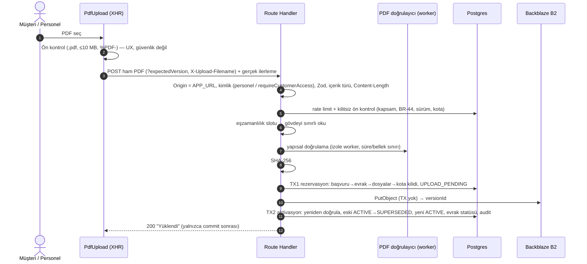

# PDF Depolama ve Dosya Güvenliği

> Doğrulama kaynakları (2026-11-25): backblaze.com/apidocs (s3-put-object, s3-head-object, s3-get-object, s3-delete-object, s3-list-object-versions, introduction-to-the-s3-compatible-api), backblaze.com/docs (cloud-storage-s3-compatible-api, cloud-storage-file-versions, cloud-storage-server-side-encryption, cloud-storage-data-caps-and-alerts, cloud-storage-application-key-capabilities), backblaze.com/cloud-storage/pricing ve transaction-pricing; `node_modules/next/dist/docs` (proxyClientMaxBodySize).
> Kurallar: BR-40…BR-48, BR-70…BR-73, BR-150…BR-153 · Dosya state'leri: [STATE_TRANSITIONS.md](STATE_TRANSITIONS.md) §3 · Şema: [DATABASE_SCHEMA.md](DATABASE_SCHEMA.md) §4.6, §9.8 · Kararlar: OD-25, D-096…D-107.
> **Tarihçe:** PHASE 00–07 tasarımı Vercel Blob private store + doğrudan client upload idi (D-017, D-040). OD-25 (2026-11-25) ile **Backblaze B2** seçildi; yükleme sunucu üzerinden yapılır (D-100). Eski kararlar DECISION_LOG'da Superseded olarak durur.

## 1. Temel Kararlar

| Konu | Karar |
|---|---|
| Sağlayıcı | **Backblaze B2** (OD-25), S3 uyumlu API — `@aws-sdk/client-s3` 3.1176.0 (D-096). Bucket `cs-global-documents`, **private**, bölge **EU Central** `eu-central-003`, uç nokta `https://s3.eu-central-003.backblazeb2.com`, varsayılan şifreleme **SSE-B2**, CORS kapalı ("hiçbir kaynakla paylaşma"), lifecycle "tüm versiyonları sakla". **Bucket'a kısıtlı Application Key**; Master Application Key kullanılmaz (B2 S3 API zaten kabul etmez). Bu bucket **geliştirme** kapsamındadır; production ayrı bucket + bağımsız anahtar gerektirir (D-098 koruması). |
| Soyutlama | `src/server/storage/` — `types.ts` (arayüz), `b2.ts`, `local-private.ts`, `config.ts`, `factory.ts`, `quota.ts`, `errors.ts` (D-097). Domain kodu AWS SDK'ye bağlı değildir. Yerel private adapter yalnızca izole testler ve açıkça yetkilendirilmiş yerel geliştirme içindir. **Sessiz yedek sağlayıcı yok.** |
| DB'de binary | Yok. PostgreSQL yalnızca metadata: ilişkiler, versiyon, yaşam döngüsü, boyut, SHA-256, nesne anahtarı (`blob_pathname`), sağlayıcı versiyon kimliği (`storage_version_id`), yükleyen aktör, zaman damgaları. |
| Yükleme yolu | **Sunucu üzerinden** (D-100): tarayıcı → kimlik doğrulamalı Route Handler (ham PDF gövdesi) → doğrulama → B2. Presigned/doğrudan tarayıcı yüklemesi **yok** (CORS kapalı kalır). |
| Okuma yolu | Yalnızca `GET /api/files/[fileId]` (personel) ve `GET /api/portal/[context]/files/[fileId]` (müşteri): yetki → audit → `GetObject(key, versionId)` → akış. Public/kalıcı/imzalı URL yok; sağlayıcı URL'si istemciye gönderilmez. |
| Nesne anahtarı | `applications/{applicationId}/{requirementId}/{fileId}.pdf` — yalnızca UUID; kişisel veri, orijinal ad, token, istemci yolu yok. Yalnızca sunucu üretir; DB CHECK biçimi zorunlu kılar; her versiyon yeni `fileId` → üzerine yazma yok. |
| Sabit limitler (OD-16) | Yalnızca PDF · dosya başına `MAX_PDF_SIZE_BYTES = 10 485 760` · evrak başına **1 aktif PDF** · panelden/env'den değiştirilemez (env'de tanımlıysa koddaki değerle aynı olmalı). |
| Versiyonlama | Uygulama düzeyi: her yükleme yeni dosya kaydı; yalnızca yeni versiyon `ACTIVE`, öncekiler `SUPERSEDED`. Sağlayıcı düzeyi (B2 native versioning) ayrıdır: aynı anahtara yazılan her nesne ayrı fiziksel versiyondur; uygulama kaydettiği versiyonu (`storage_version_id`) okur/siler. |
| Kota | Uygulama sınırı 9 000 000 000 bayt, uyarı 8 000 000 000 (D-101). |

## 2. Yükleme Akışı (D-100, D-103)

### 2.1 Kurallar
1. **Kimlik/kapsam:** personel `getCurrentStaff()` (iki hesap eşit); müşteri `requireCustomerAccess(context)` (D-095) — başvuru yalnızca oturumdan; evrak başka başvuruya aitse 404. İstek başında doğrulanan bağlam istek boyunca sabittir; başka sekmenin yeni cookie'si hedefi değiştirmez. Bağlam uyuşmazlığı → `409 CONTEXT_MISMATCH` ("Bu sayfa artık güncel değil… Dosya yüklenmedi").
2. **Taşıma:** gövde = ham PDF, `Content-Type: application/pdf` (aksi 415), `Content-Length` zorunlu (411), 0 → 400, > 10 485 760 → 413 (gövde okunmadan); okunan gerçek bayt sayısı beyanla aynı olmalı. Proxy bu yolları kapsamaz (gövde tamponlama/kesme — D-100).
3. **Eşzamanlılık:** süreç başına 4 yükleme; en fazla 16 bekleyen, 30 sn; aksi 503 "Sistem şu anda yoğun". Rate limit: aktör başına 30 yükleme/saat, 120 görüntüleme/saat (429).
4. **Doğrulama önce, storage sonra:** reddedilen dosya storage'a yazılmaz, kayıt oluşmaz; audit `DOCUMENT_VALIDATION_REJECTED {requirementId, reason}`; kullanıcıya Türkçe mesaj + "Önceki dosyanız korunuyor".
5. **Rezervasyon (TX1):** BR-44 + `expectedVersion` kilit altında yeniden; evrakta süresi dolmamış devam eden yükleme varsa `409 UPLOAD_IN_PROGRESS` (süresi dolmuşsa `EXPIRED`); atomik kota (§7); `UPLOAD_PENDING` (boyut + SHA-256, 15 dk).
6. **Storage yazımı:** TX/kilit açık değil. Yanıt kaybolursa (`AMBIGUOUS`) kör yeniden yazma yok → HEAD ile boyut eşleşirse o versiyon; aksi `EXPIRED` + `DOCUMENT_UPLOAD_FAILED`. Cap/limit (`LIMIT`) → 503, yeniden deneme yok. Versiyon kimliği yoksa aktifleştirilmez.
7. **Aktivasyon (TX2, BR-45):** başvuru silinmiyor, müşteri token'ı aktif + oturum süresi dolmadı, BR-44, `expectedVersion`, rezervasyon hâlâ `UPLOAD_PENDING`. Değilse `REJECTED (STATE_CHANGED)` + audit + nesne en iyi çabayla silinir (olmazsa temizlik). Geçerliyse eski ACTIVE → `SUPERSEDED`, yeni `ACTIVE` (v = max+1), evrak statüsü, evrak `version+1`, `DOCUMENT_UPLOADED`/`DOCUMENT_REPLACED` audit'i (personelde `onBehalfOfCustomer`), onaylı evrakta `DOCUMENT_APPROVAL_INVALIDATED` — hepsi tek transaction.
8. **Belirsiz commit:** aktivasyon hata verirse DB durumu yeniden okunur; `ACTIVE` ise başarı döner (nesne silinmez); `UPLOAD_PENDING` kalmışsa `EXPIRED`. Eski aktif dosya hiçbir hata yolunda kaybolmaz.
9. **Personel `UNDER_REVIEW` yüklemesi (OD-17):** aynı akış; evrak `PENDING_REVIEW` olur, önceki onay aktarılmaz, eski inceleme kayıtları değişmez (BR-48).
10. **İlerleme (D-100):** `XMLHttpRequest.upload.onprogress` gerçek yüzde → aktarım bitince "Sunucuda doğrulanıyor ve kaydediliyor…" → "Yüklendi" yalnızca başarılı yanıtta; sahte zamanlayıcı yok; buton hydration tamamlanana ve yükleme bitene kadar pasif.
11. **Kaldırma** (BR-44 "kaldır", `REMOVED`) PHASE 08'de **uygulanmadı** (D-103) — PHASE 09.

## 3. Görüntüleme / İndirme (D-104)

`GET /api/files/[fileId]?disposition=inline|attachment` (personel) · `GET /api/portal/[context]/files/[fileId]?disposition=…` (müşteri)
1. Aktör: personel yolu yalnızca personel oturumu (yoksa 401); müşteri yolu yalnızca müşteri oturumu + bağlam (yoksa 401/409). Aynı tarayıcıda iki cookie yetki yükseltmez.
2. Dosya + başvuru: başvuru silinmekte veya `blob_deleted_at` dolu → 404.
3. **Müşteri:** dosya oturum başvurusuna ait ve `ACTIVE` değilse **404**; token iptal edildiyse 404. **Personel:** `ACTIVE`/`SUPERSEDED`/`REMOVED` değilse 404.
4. Aktör başına rate limit (120/saat) → 429.
5. Audit `DOCUMENT_VIEWED` / `DOCUMENT_DOWNLOADED` storage okumasından **önce** (yazılamazsa dosya sunulmaz).
6. `GetObject(key, storage_version_id)` → akış (tam tampon/base64 yok); sağlayıcı boyutu kayıttan farklıysa sunulmaz (502). Cap aşımı → 503 "Günlük dosya erişim sınırına ulaşıldı. Lütfen daha sonra tekrar deneyiniz." (sıfırlanma saati söylenmez).
7. Başlıklar: `Content-Type: application/pdf`, güvenli `Content-Disposition` (ASCII yedek + `filename*=UTF-8''…`), `X-Content-Type-Options: nosniff`, `Cache-Control: private, no-store, max-age=0`, `Referrer-Policy: no-referrer`, `X-Frame-Options: DENY`, `Cross-Origin-Resource-Policy: same-origin`, `Accept-Ranges: none`; CSP indirmede `default-src 'none'; sandbox; frame-ancestors 'none'`, satır içinde `default-src 'none'; frame-ancestors 'none'; base-uri 'none'; form-action 'none'`.

**Görüntüleme yaklaşımı:** "Dosyayı Görüntüle" yeni sekmede (`target=_blank`, `rel=noopener noreferrer`) tarayıcının yerleşik görüntüleyicisini açar; uygulamaya PDF.js görüntüleyici veya iframe eklenmedi (uygulama genelindeki `frame-ancestors 'none'` korunur). Satır içi yanıtta `sandbox` yoktur (bazı tarayıcıların yerleşik görüntüleyicisi sandbox'lı belgede çalışmaz); aktif içerik zaten yüklemede reddedilir. **Gerçek tarayıcılarda (iOS Safari, Android Chrome, WhatsApp in-app) satır içi görüntüleme doğrulanmadı (TD-12 açık);** sorun çıkarsa "İndir" yolu kullanılır. Range desteklenmez: tarayıcı dosyayı bir kez tam indirir (≤ 10 MiB). Sayfa açılışında PDF okunmaz; link önizleme botları müşteri oturumu taşımadığından dosya çekemez (401).

## 4. Dosya Adı Sanitizasyonu

Unicode NFC; kontrol karakterleri, sıfır genişlikli ve yön (bidi) denetim karakterleri ve `/ \ : * ? " < > |` kaldırılır; baştaki noktalar kaldırılır; çoklu boşluk teke; uzantı `.pdf` olarak normalleşir; ≤ 200 karakter (uzantı korunarak); boşsa `belge.pdf`; uzantı `.pdf` değilse red. Ad istemciden `X-Upload-Filename` başlığında URL kodlu gelir (URL'ye yazılmaz). Orijinal ad kişisel veri içerebilir: yalnızca metadata — nesne anahtarına, log'a, audit'e yazılmaz. UI'da `wrap-anywhere` + `title`.

## 5. Versiyonlar, Teknik Temizlik ve Silme

| Veri | Davranış |
|---|---|
| `ACTIVE`, `SUPERSEDED`, `REMOVED` kayıtlı versiyonlar | **Otomatik silinmez** (OD-06, BR-47). Kapasite dolsa bile silinmez. Yalnızca personelin manuel başvuru silme işlemiyle (OD-24; PHASE 10 — henüz yok). |
| `REJECTED`, `EXPIRED` kayıtların fiziksel versiyonları | `pnpm storage:cleanup --apply` ile versiyona özgü silinir; listede kalmadığı doğrulanınca `blob_deleted_at`. Metadata kalır. |
| Süresi dolmuş `UPLOAD_PENDING` | Temizlikte `EXPIRED` (koşullu güncelleme — aktivasyonla yarışta güvenli). |
| Kayıtlı dosyanın yinelenen fiziksel versiyonları (yeniden deneme) | Kayıtlı versiyon listede varsa diğerleri silinir; yoksa anahtara dokunulmaz (bütünlük incelemesi). |
| Sahipliği doğrulanmamış nesneler (DB'de kaydı yok / önek dışı) | **Silinmez**; yalnızca `storage:reconcile` raporu ve kota hesabında `untracked_bytes`. |
| Yarım kalan başvuru silmeleri | Başvuru silme PHASE 10 kapsamında (storage aşaması orada; D-036). |

**B2 silme semantiği:** versionId'siz `DeleteObject` yalnızca silme işareti (delete marker) ekler, veri kalır ve kapasite tüketir; kalıcı silme yalnızca versionId'li `DeleteObject` ile (apidocs/s3-delete-object). Uygulama yalnızca versiyona özgü siler; bucket genelinde toplu silme/purge yoktur.

**Zamanlama:** ücretli cron/worker yok; komutlar elle çalıştırılır (varsayılan dry-run). Planlı bakım stratejisi PHASE 10/13'te (hosting seçimiyle — TD-10). Bu mekanizma müşteri verisi saklama süresi politikası **değildir**.

### 5.1 Başvuru silme (BR-150…BR-154) — PHASE 10 hedefi
Önceki tasarım (D-036) geçerlidir: TX1 `deletion_requested_at` + token iptali → tüm kayıtlı nesnelerin tüm fiziksel versiyonları versiyona özgü silinir → önek boşluğu `ListObjectVersions` ile doğrulanır → TX2 `DELETE applications` (CASCADE; migration 0005 ile token FK'leri de CASCADE — müşteri yüklemesi olan başvurular zincirleme silinebilir). DB kayıtları, storage nesneleri silindiği doğrulanmadan silinmez.

## 6. PDF Doğrulama (OD-07, D-099)

### 6.1 Riskler
- Uzantı ve MIME istemci kontrollüdür — güvenilmez.
- PDF aktif içerik taşıyabilir: JavaScript (`/JavaScript`, `/JS`), otomatik eylemler (`/OpenAction`, `/AA` içindeki eylemler), dış program (`/Launch`), gömülü dosyalar (`/EmbeddedFile`, `/EmbeddedFiles`, `/FileAttachment`), form/veri gönderimi (`/SubmitForm`, `/ImportData`, `/XFA`), `/RichMedia`, `/GoToR`, `/GoToE`, medya (`/Rendition`, `/Movie`, `/Sound`, `Screen` açıklaması).
- Polyglot dosyalar, şifreli PDF'ler, bozuk yapı ile ayrıştırıcı istismarı, dekompresyon bombaları ve derin iç içe yapılar (kaynak tüketimi).
- Hedef: dosyayı açan **personel cihazı**.

### 6.2 Uygulanan kontroller (uygulama içi, harici servis yok)
1. İçerik türü `application/pdf` (sunucu), uzantı `.pdf`; istemci MIME'ı tek başına güvenilmez.
2. Gerçek boyut 1…10 485 760 bayt.
3. **Zarf:** `%PDF-1.0…1.7` / `%PDF-2.0` dosyanın **ilk baytında** (önünde içerik → `NOT_PDF`); son 1024 baytta `%%EOF`; `startxref` ofseti dosya içinde ve xref tablosunu (girdi biçimi + `trailer` + `/Root`) ya da xref stream nesnesini gösterir → değilse `MALFORMED` (kesik/bozuk xref/trailer).
4. **Nesne düzeyi tarama:** tüm dosya + FlateDecode nesne akışları (ObjStm) PDF sözdizimine göre taranır (yorum/dize/diğer akış içerikleri atlanır); `#xx` kaçışlı adlar çözülür; dolaylı referanslar dahil her nesne. Yasaklı ad → `ENCRYPTED` / `EMBEDDED_FILE` / `ACTIVE_CONTENT`. Desteklenmeyen ObjStm kodlaması → `MALFORMED`. `/URI` ret sebebi değildir; `/OpenAction`/`/AA` tek başına değil, içerdiği yasaklı eylem türü reddedilir.
5. **pdf.js (pdfjs-dist 6.5.438) tam ayrıştırma:** katalog, sayfa ağacı (her sayfa), şifre (`ENCRYPTED`), ekler, belge/sayfa JavaScript eylemleri, açıklama türleri, widget eylemleri, XFA.
6. **Kaynak sınırları:** ayrı worker thread; bellek 256 MB, süre 20 sn (aşılırsa sonlandırılır), 2 000 sayfa, 100 000 nesne, 64 MiB açılmış ObjStm, 64 iç içe derinlik → `RESOURCE_LIMIT`. Worker'ın ortam değişkenleri boş; ağ/eval/harici program yok.
7. SHA-256 sunucuda gerçek baytlardan (D-107).
8. Nesne anahtarı DB kaydıyla ve başvuru/evrak ilişkisiyle eşleşir (DB CHECK).

### 6.3 Sınırlar ve dürüst beyan
- Bu kontroller **yapısal doğrulamadır; antivirüs / malware taraması değildir**. Bilinen zararlı imzalar, ayrıştırıcının ve ad taramasının göremediği teknikler ve PDF görüntüleyici zafiyetleri tespit edilemez. Yapısal olarak geçerli bir PDF'in güvenli/zararsız olduğu garanti edilmez.
- Dosyalar "virüssüz", "malware-free", "güvenli" olarak **etiketlenmez**. Arayüz: müşteriye "Yüklendi"; personele "Yapısal kontrol tamamlandı (antivirüs taraması değildir)".
- Harici AV (ClamAV, ticari API) kapsam dışı (OD-07); gerçek müşteri verisiyle production öncesi risk değerlendirmesi **zorunlu** (PB-05).
- Yanlış pozitif oranı (meşru PDF'lerin reddi) gerçek tarayıcı/tarama uygulaması/ofis çıktılarıyla **ölçülmedi** (PHASE 12).
- Azaltıcı önlemler: private storage, yalnızca yetkili sunum, sandbox'lı indirme yanıtı, tarayıcıda görüntüleme önerisi, personel cihazlarında güncel işletim sistemi/tarayıcı ve yerleşik antivirüs (operasyonel öneri).

### 6.4 Kabul kriterleri (PHASE 08 + PHASE 12)
1. Uzantısı `.pdf` olan JPEG/metin → `NOT_PDF` (unit + integration + E2E). ✓
2. Sahte `application/pdf` ile PDF olmayan dosya → reddedilir. ✓
3. `/JavaScript` içeren eylem (düz, ObjStm içinde, hex-escape'li) → `ACTIVE_CONTENT`; yalnızca sayfa hedefli `/OpenAction` → kabul. ✓
4. Gömülü dosya → `EMBEDDED_FILE`. ✓
5. `/Launch` → `ACTIVE_CONTENT`. ✓
6. Şifreli PDF → `ENCRYPTED`. ✓
7. Dekompresyon bombası / aşırı iç içe yapı / süre aşımı → `RESOURCE_LIMIT`. ✓
8. `10 485 761` bayt → 413 / `TOO_LARGE`; `10 485 760` bayt → kabul. ✓
9. `UPLOAD_PENDING` / `REJECTED` / `EXPIRED` dosyaya erişim → 404. ✓
10. Başka başvurunun `fileId`'si → 404; müşteri için `SUPERSEDED` → 404. ✓
11. Tekrarlanan/belirsiz yazma → tek aktivasyon (HEAD mutabakatı). ✓
12. Yükleme sırasında başvuru `UNDER_REVIEW` oldu → müşteri yüklemesi `STATE_CHANGED`; personel yüklemesi kabul (OD-17). ✓
13. Aynı evrağa paralel yüklemeler → yalnızca biri; asla iki `ACTIVE`. ✓
14. Normal PDF'ler kabul edilir — **gerçek belge setiyle yanlış pozitif ölçümü yapılmadı (PHASE 12).**
15. Başvuru silme sonrası önek boş — **PHASE 10** (başvuru silme henüz yok).

## 7. Kapasite, Kota ve Maliyet (D-101)

**Sağlayıcı (2026-11-25 doğrulandı):** "First 10GB storage is always free"; aylık ortalama depolamanın 3 katına kadar indirme ücretsiz, sonrası $0.01/GB; Class A çağrılar (PutObject, DeleteObject) ücretsiz; Class B (GetObject, HeadObject) ve Class C (ListObjectVersions, ListBuckets) çağrıları için ücretsiz günlük pay ve cap'ler hesap panelinden yönetilir; cap'ler günlük harcama sınırıdır, sayaçlar **00:00 GMT**'de sıfırlanır, uyarılar %75/%100'de; cap ayarı yoksa kullanım sınırsızdır; değişiklikler 10 dakikaya kadar sürebilir. Kullanıcının hesabında görülen: günlük depolama $0 / 10 GB, indirme $0 / 1 GB, Class B ve C 2 500/gün. Cap aşımında S3 API'nin döndürdüğü hata kodu belgelerde açık değildir (native API: 403 "storage cap") — uygulama 403+cap/limit ve 429'u `LIMIT` olarak sınıflandırır, yeniden denemez.

**Uygulama kotası:** kullanım = `blob_deleted_at IS NULL` tüm dosya kayıtlarının boyutu (aktif + önceki versiyonlar + devam eden rezervasyonlar + temizlik bekleyenler) + `untracked_bytes` (mutabakat). `STORAGE_MAX_TOTAL_BYTES = 9 000 000 000` (kod tavanı), `STORAGE_WARNING_BYTES = 8 000 000 000`. Atomik: rezervasyonda tek satırlık `storage_quota_state` kilidi. Sınır aşılacaksa yükleme başlamadan reddedilir ("Depolama kapasitesi dolu. Şu anda yeni evrak yüklenemiyor. Lütfen CS Global ile iletişime geçiniz."). Mevcut dosyalar silinmez, erişime kapatılmaz. Dashboard "Dosya Depolama" kartı yalnızca DB'den (aktif / önceki / devam eden / temizlik bekleyen + kalan, %, 8 GB uyarısı, 9 GB "yükleme durdu", son mutabakat zamanı) — sağlayıcı faturalama verisi değildir.

**İşlem/bant optimizasyonu:** sayfa açılışında PDF, HEAD veya liste çağrısı yok; dosya listesi ve geçmiş DB'den; PDF yalnızca açık "Görüntüle/İndir" aksiyonunda okunur; yükleme başına tek PutObject (+ yalnızca belirsiz yazmada tek HEAD); polling yok; en fazla 1 yeniden deneme, cap/limit hatalarında hiç. Mutabakat yalnızca elle (Class C). Uygulama tarafından ölçülen günlük indirme göstergesi eklenmedi (ileride değerlendirilebilir; faturalama verisi olarak sunulmaz).

**Uyarı:** uygulama kotası ve hesap cap'leri olası tüm ücretleri kesin olarak önlediğini garanti etmez.

**Kapasite tahmini:** 9 GB ≈ ortalama 2 MB'lık ~4 500 PDF versiyonu; başvuru başına versiyonlarla ~20 MB varsayımıyla **≈ 450 başvuru**. Otomatik silme olmadığından kapasite birikimlidir (PB-02).

## 8. Müşteri Dosya Sözleşmesi (D-095 — PHASE 08'de uygulandı)
- Müşteri yükleme ve dosya istekleri URL'de `contextId` taşır; sunucu `requireCustomerAccess(contextId)` ile imza, süre, bağlam eşitliği, token aktifliği ve başvurunun silinmediğini **her istekte** doğrular; aktivasyon transaction'ında token aktifliği ve oturum süresi **yeniden** kontrol edilir. `applicationId` istemciden alınmaz; evrak/dosya oturumdaki başvuruya ait değilse 404.
- Yükleme yalnızca `AWAITING_DOCUMENTS`/`REVISION_REQUIRED` ve BR-44'ün izin verdiği evrak statülerinde (`canUploadDocument`).
- Bağlam uyuşmazlığında yükleme 409 ile reddedilir, dosya hiçbir başvuruya bağlanmaz (TM-40 dosya kısmı — E2E ile doğrulandı).
- Müşteri dosya yanıtları `no-store`, `no-referrer`; müşteri yolu iç notları, eski versiyonları, storage anahtarını/versiyonunu ve personel bilgisini döndürmez.

## 9. Canlı Doğrulama (`pnpm storage:verify`, D-106) — **PASS (2026-11-25, kullanıcı terminali)**

Sonuç: bucket erişimi PASS (başlangıç envanteri: 0 fiziksel versiyon, 0 bayt, bilinmeyen nesne 0, silme işareti 0); sentetik PDF yazma PASS; SSE-B2 `AES256` yanıtı PASS; sağlayıcı versiyon kimliği PASS; HEAD 400/400 bayt; GET SHA-256 PASS; imzasız erişim path-style / virtual-host / friendly URL → **HTTP 401**; versiyona özgü fiziksel silme PASS (1 versiyon). Kapsam yalnızca kontrollü smoke testidir — tarayıcıdan B2'ye tam yükleme akışı, gerçek kota/cap aşımı, tüm hata/kurtarma senaryoları, gerçek cihaz görüntüleme, Object Lock/replikasyon ve production doğrulanmış sayılmaz.

Elle çalıştırılır, otomatik testlerde yoktur: bucket erişimi + sınırlı envanter (uygulama dışı nesne uyarısı), `_verification/<rastgele>.pdf` sentetik yazma (SSE-B2 yanıtı, versiyon kimliği, ETag=MD5), HEAD (boyut), GET (SHA-256), imzasız erişimin reddi (path-style, virtual-host, friendly URL), yalnızca kendi nesnesinin tüm fiziksel versiyonlarının versiyona özgü silinmesi ve doğrulanması. ≈10 API çağrısı. Değer/anahtar yazdırmaz.
