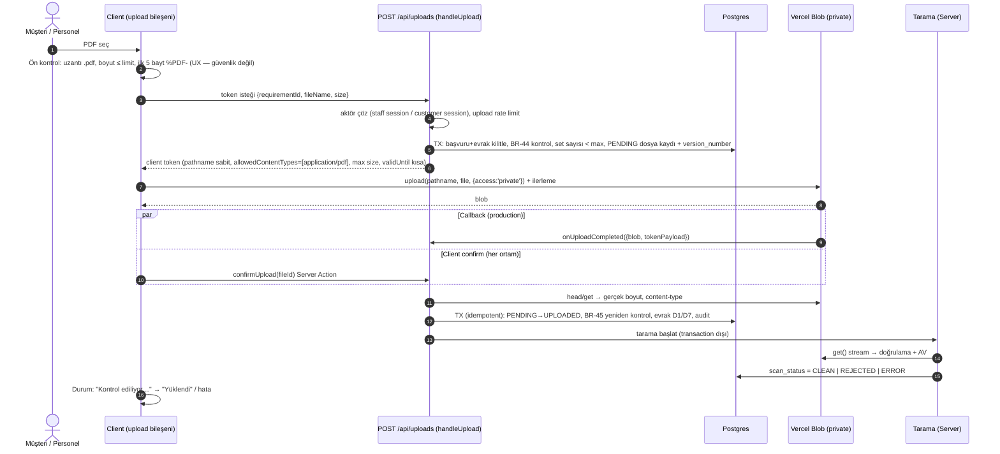

# PDF Depolama ve Dosya Güvenliği

> Doğrulama kaynakları: vercel.com/docs/vercel-blob (private-storage, client-upload, using-blob-sdk, usage-and-pricing), vercel.com/docs/functions/limitations — 2026-11-24.
> İlgili kurallar: BR-40…BR-47, BR-70…BR-73 ([BUSINESS_RULES.md](BUSINESS_RULES.md)); dosya state'leri [STATE_TRANSITIONS.md](STATE_TRANSITIONS.md) §3; şema [DATABASE_SCHEMA.md](DATABASE_SCHEMA.md) §4.7.

## 1. Temel Kararlar

| Konu | Karar |
|---|---|
| Depolama | **Vercel Blob, private store** (`access: 'private'`, `@vercel/blob >= 2.3`). Public store **kullanılmaz**. |
| Bölge | `fra1` (Frankfurt) — store oluştururken seçilir, **sonradan değiştirilemez**. |
| Store ayrımı | Ortam başına ayrı store: `cs-global-blob-dev`, `cs-global-blob-preview`, `cs-global-blob-prod` (D-022). |
| DB'de binary | **Yok.** Yalnızca metadata. |
| Yükleme yolu | **Client upload** (tarayıcı → Blob doğrudan). Function body limiti 4.5 MB olduğu için sunucu üzerinden yükleme yapılmaz (D-017). |
| Okuma yolu | Yalnızca `GET /api/files/[fileId]` Route Handler: yetki → `get(pathname, { access: 'private' })` → stream. Kalıcı/public URL **verilmez**; signed URL **kullanılmaz** (MVP). |
| Pathname | `applications/{applicationId}/{requirementId}/{fileId}.pdf` — yalnızca UUID; ad, e-posta, orijinal dosya adı **yok**. `addRandomSuffix: false` (fileId zaten rastgele), `allowOverwrite: false`. |
| Varsayılan limit | 10 MB/dosya (sistem ayarı `max_upload_size_bytes`), şablon başına maks dosya sayısı (varsayılan 1, en çok 10). |

## 2. Yükleme Akışı

### 2.1 Kurallar
1. **Token üretimi** (`onBeforeGenerateToken`): aktör doğrulanır; istemcinin gönderdiği `pathname` **kullanılmaz** — sunucu `fileId` üretip pathname'i kendisi belirler ve `tokenPayload` içine `{ fileId }` koyar. `allowedContentTypes: ['application/pdf']`, `maximumSizeInBytes: requirement.max_file_size_bytes`, kısa `validUntil` (Proposed 15 dk). (`maximumSizeInBytes` / `validUntil` adları PHASE 08'de SDK referansından doğrulanacak.)
2. **Callback doğrulaması:** `handleUpload` callback isteğini SDK doğrular; ek olarak `tokenPayload.fileId` DB'deki `PENDING` kayıtla ve `blob.pathname` ile eşleşmelidir. Eşleşmezse 400 (Blob 400'de yeniden denemez).
3. **Idempotency:** tamamlama işlemi `fileId` + `blob_pathname` üzerinden; zaten `UPLOADED` ise aynı sonucu döndürür. Callback 5xx'te en fazla 5 kez yeniden denenir — her deneme güvenli.
4. **Localhost:** `onUploadCompleted` yerelde çalışmaz → client confirm aynı idempotent fonksiyonu çağırır; production'da ikisi de çalışır, ilk gelen kazanır.
5. **Yarış (BR-45):** tamamlama transaction'ında başvuru/evrak statüsü değiştiyse (ör. personel gönderdi) dosya `EXPIRED` yapılır ve blob silinir; kullanıcıya "Başvurunuz bu sırada incelemeye gönderildiği için dosya kaydedilemedi." mesajı.
6. **Boyut gerçeklik kontrolü:** Blob'dan okunan gerçek boyut limiti aşarsa veya `declared_size_bytes` ile çelişirse `REJECTED (SIZE_MISMATCH)`.
7. **Eşzamanlı yüklemeler:** aynı evrağa paralel yüklemelerde `max_file_count` token üretiminde (kilit altında, `PENDING + UPLOADED` toplamı) uygulanır.
8. **Upload rate limit** (Proposed): aktör başına 10 dk'da 30 token; başvuru başına günde 200.
9. **İlerleme:** `@vercel/blob/client` `upload()` ilerleme callback'i (adı PHASE 08'de doğrulanacak) ile gerçek yüzde; başarısızlıkta "Tekrar dene".

## 3. Görüntüleme / İndirme

`GET /api/files/[fileId]?disposition=inline|attachment`
1. Aktör çöz (staff veya customer session). Yoksa 401.
2. Dosya + başvuru + evrak getir; **müşteri** için `file.application_id = session.application_id` değilse **404**; personel için kapsam (404).
3. `scan_status = 'CLEAN'` ve `upload_status = 'UPLOADED'` ve `blob_deleted_at IS NULL` değilse **404** (tarama bekleyen dosya görünmez).
4. Müşteri yalnızca **güncel set** (`removed_at IS NULL`) dosyalarını görebilir; eski versiyonlar yalnızca personel.
5. `get(pathname, { access: 'private', useCache: false })` → `new Response(result.stream, headers)`.
6. Header'lar: `Content-Type: application/pdf`, `Content-Disposition: inline|attachment; filename*=UTF-8''<encoded>`, `Cache-Control: private, no-store`, `X-Content-Type-Options: nosniff`, `Content-Security-Policy: default-src 'none'; sandbox; frame-ancestors 'self'`, `Referrer-Policy: no-referrer`.
7. Audit: `DOCUMENT_VIEWED` / `DOCUMENT_DOWNLOADED`.
8. Rate limit: aktör başına dakikada 60.

Görüntüleme yöntemi: yeni sekmede tarayıcının yerleşik PDF görüntüleyicisi (`inline`). iOS Safari ve WhatsApp in-app tarayıcı davranışı PHASE 08'de test edilir; sorun olursa `attachment` + açıklayıcı metin. Ek PDF render kütüphanesi (pdf.js) yalnızca test sonuçları gerektirirse eklenir.

## 4. Dosya Adı Sanitizasyonu

- Unicode NFC normalize; kontrol karakterleri, `/ \ : * ? " < > |`, baştaki noktalar kaldırılır; çoklu boşluk teke; ≤200 karakter (uzantı korunarak kırpılır); boşsa `belge.pdf`.
- Uzantı `.pdf` değilse (case-insensitive) reddedilir.
- Görüntülemede: UI'da CSS `truncate` + `title` ile tam ad; `break-all` ile taşma engellenir.
- Orijinal ad yalnızca metadata; pathname'de kullanılmaz.

## 5. Versiyonlama ve Saklama

- Her yükleme yeni `application_document_files` satırı, `version_number` artar (BR-71).
- Değiştir (tek dosyalı) = yeni dosya + eskinin `removed_at` (aynı TX).
- İncelenmiş (review_files'ta geçen) dosyalar silinmez, geçmiş versiyon olur; incelenmemiş ve kaldırılan dosyaların blob'u hemen silinir (BR-47).
- Saklama (Proposed, **hukuki onay bekler — OD-06**):

| Veri | Süre | İşlem |
|---|---|---|
| `PENDING` (tamamlanmamış) upload | 24 saat | Blob (varsa) sil, `EXPIRED` |
| `REJECTED` dosya | 7 gün (personel inceleyebilsin) | Blob sil, metadata kalır |
| Geçmiş (superseded) versiyonlar | Başvuru terminal olduktan sonra X gün (öneri 90) | Blob sil, `blob_deleted_at` |
| Güncel dosyalar | Başvuru terminal olduktan sonra Y gün (öneri: sözleşme/yasal yükümlülüğe göre) | Blob sil; başvuru anonimleştirme süreci (DATA_PRIVACY §5) |

- Silme işi: Vercel Cron → `GET /api/cron/cleanup` (günlük). Blob silme başarısızsa yeniden denenir; `blob_deleted_at` yalnızca başarıdan sonra set edilir.
- **Orphan temizliği:** (a) `PENDING` + `upload_expires_at < now()` kayıtlar; (b) haftalık mutabakat: Blob `list()` ile `applications/` önekindeki pathname'ler DB ile karşılaştırılır, DB'de karşılığı olmayan ve 24 saatten eski blob'lar silinir.

## 6. Dosya Güvenliği ve Zararlı Yazılım Taraması

### 6.1 Riskler
- Uzantı ve MIME **istemci kontrollüdür** — güvenilmez.
- PDF aktif içerik taşıyabilir: JavaScript (`/JavaScript`, `/JS`), otomatik aksiyonlar (`/OpenAction`, `/AA`), dış program çalıştırma (`/Launch`), gömülü dosyalar (`/EmbeddedFile`, `/EmbeddedFiles`), formlar/veri gönderimi (`/SubmitForm`, `/ImportData`, `/XFA`), `/RichMedia`, `/GoToR`/`/URI` (dış bağlantı).
- Polyglot dosyalar (hem PDF hem HTML/ZIP), şifreli PDF'ler (içeriği incelenemez), bozuk yapı ile parser istismarı, dekompresyon bombaları.
- Dosyayı açan **personel cihazı** ana hedeftir (müşteri → personel saldırı yolu).

### 6.2 Katmanlı çözüm (D-018, Proposed)

**Katman 1 — Yapısal doğrulama (uygulama içi, zorunlu, MVP'de):** Node.js Function içinde (10 MB'lık dosya için süre/bellek limitleri içinde):
1. Gerçek boyut ≤ limit.
2. İlk 1024 bayt içinde `%PDF-1.x` / `%PDF-2.0` imzası; sonda `%%EOF`.
3. Bakımı süren bir PDF ayrıştırıcı ile tam ayrıştırma (sıkıştırılmış object stream'ler dahil); ayrıştırılamayan dosya → `REJECTED (MALFORMED)`. Kütüphane seçimi PHASE 08'de (lisans, bakım, güvenlik geçmişi doğrulanarak).
4. Aktif içerik anahtarları (6.1 listesi; hex-escape'li isimler `#4A` normalize edilerek) bulunursa → `REJECTED (ACTIVE_CONTENT)`. (Proposed: `/URI` link'leri reddetme sebebi değil, yalnızca işaretlenir.)
5. `/Encrypt` varsa → `REJECTED (ENCRYPTED)` — müşteriye "Şifre korumalı PDF yüklenemez" mesajı.
6. Açılan stream boyutu sınırı (dekompresyon bombası koruması).
7. SHA-256 hesaplanır.

**Katman 2 — Zararlı yazılım taraması (AV) — production blocker (OD-07):**

| Seçenek | Artı | Eksi | KVKK |
|---|---|---|---|
| a. **Kendi kontrolümüzde ClamAV** (AB'de küçük VM/konteyner, HTTPS + kimlik doğrulamalı iç API, dosya diskte tutulmaz) | Belge üçüncü bir SaaS'a gitmez; düşük sabit maliyet | Sunucu bakımı, imza güncellemeleri, izleme — operasyonel yük; ClamAV'nin hedefli PDF exploit tespiti sınırlı | Hosting sağlayıcı ek veri işleyen olur (DPA) |
| b. **Ticari tarama API'si** (AB bölgesi + DPA + dosya saklamama taahhüdü olan) | Operasyon yükü yok, çoklu motor | Hassas belge üçüncü tarafa gider; dosya/tarama başı maliyet | Ek veri işleyen + muhtemel yurt dışı aktarım; sözleşme incelemesi şart |
| c. **AV yok — yalnızca Katman 1 + 3** | Basit, ek maliyet yok | Bilinen zararlı yazılım imzaları kontrol edilmez | — |
| ✗ VirusTotal vb. topluluk servisleri | — | Yüklenen dosyalar diğer kullanıcılarla paylaşılabilir | **Kabul edilemez** |

**Öneri:** Katman 1 her durumda + (a) veya (b) — seçim maliyet/KVKK değerlendirmesiyle kullanıcı kararı. (c) yalnızca hukuki ve güvenlik risk kabulü yazılı olarak verilirse.

**Katman 3 — Güvenli sunum (zorunlu):** yalnızca `CLEAN` dosyalar; `Content-Disposition`, `nosniff`, `CSP sandbox`, `no-store`; personel cihazlarında güncel tarayıcı ve PDF okuyucu kullanımı (operasyonel politika — PROJECT_STATE'te açık konu).

### 6.3 Çalışma modeli
- Tarama, tamamlama sonrası **transaction dışında**, aynı istekte `waitUntil` (Vercel `@vercel/functions`) ile veya cron yedeğiyle tetiklenir. Kalıcı kuyruk servisi eklenmez (KISS); `scan_status = PENDING/ERROR` + `scan_attempts` alanları + cron (her 5–15 dk, plan limiti doğrulanacak) yeniden deneme kuyruğu işlevi görür.
- 3 başarısız denemeden sonra `ERROR` kalır, personele uyarı, müşteriye "Dosyanız kontrol edilemedi, lütfen tekrar yükleyin".
- Karantina: Blob'da ayrı "karantina" klasörü/taşıma yok; dosya `CLEAN` olana kadar **uygulama seviyesinde erişilemez** (store zaten private). Bu, "dosya güvenlik kontrolü tamamlanmadan görüntülenemez" gereksinimini karşılar.

### 6.4 Kabul kriterleri (PHASE 08 + PHASE 12)
1. Uzantısı `.pdf` olan PNG/EXE/HTML → `REJECTED (NOT_PDF)`.
2. MIME `application/pdf` olarak sahte gönderilen PDF olmayan dosya → reddedilir.
3. `/JavaScript` veya `/OpenAction` içeren PDF (düz ve sıkıştırılmış object stream içinde, hex-escape'li isimle) → `REJECTED (ACTIVE_CONTENT)`.
4. Gömülü dosya içeren PDF → `REJECTED`.
5. Şifreli PDF → `REJECTED (ENCRYPTED)`.
6. EICAR test imzası içeren dosya (AV seçeneği a/b) → `REJECTED (MALWARE)`.
7. Limit + 1 bayt → token reddi veya `SIZE_MISMATCH`.
8. `PENDING`/`REJECTED`/`ERROR` dosyaya `/api/files` isteği → 404 (personel ve müşteri).
9. Başka başvurunun `fileId`'si ile istek → 404.
10. Callback'in iki kez çağrılması → tek kayıt, tek audit.
11. Token üretimi sonrası başvuru `UNDER_REVIEW` olduysa tamamlama → reddedilir ve blob silinir.
12. 24 saatten eski `PENDING` kayıt ve orphan blob temizlik işiyle silinir.
13. Temiz, normal PDF'ler (tarayıcıdan "PDF olarak kaydet", tarayıcı uygulaması çıktıları, e-Devlet belgesi benzeri sahte örnekler) **kabul edilir** — yanlış pozitif oranı kabul edilebilir düzeyde (test seti ile ölçülür).

## 7. Maliyet Notları

Vercel Blob (Pro, "starting at"): depolama $0.023/GB-ay, basit işlem $0.35/1M, gelişmiş işlem $4.50/1M; veri transferi Pro'da "Flat Rate CDN" kapsamında. Hobby: 1 GB, 10K basit / 2K gelişmiş işlem, 10 GB transfer (aşımda erişim 30 gün bloklanır). fra1 bölgesel fiyatları doğrulanmadı. Ayrıntı: [DEPLOYMENT.md](DEPLOYMENT.md) §6.
