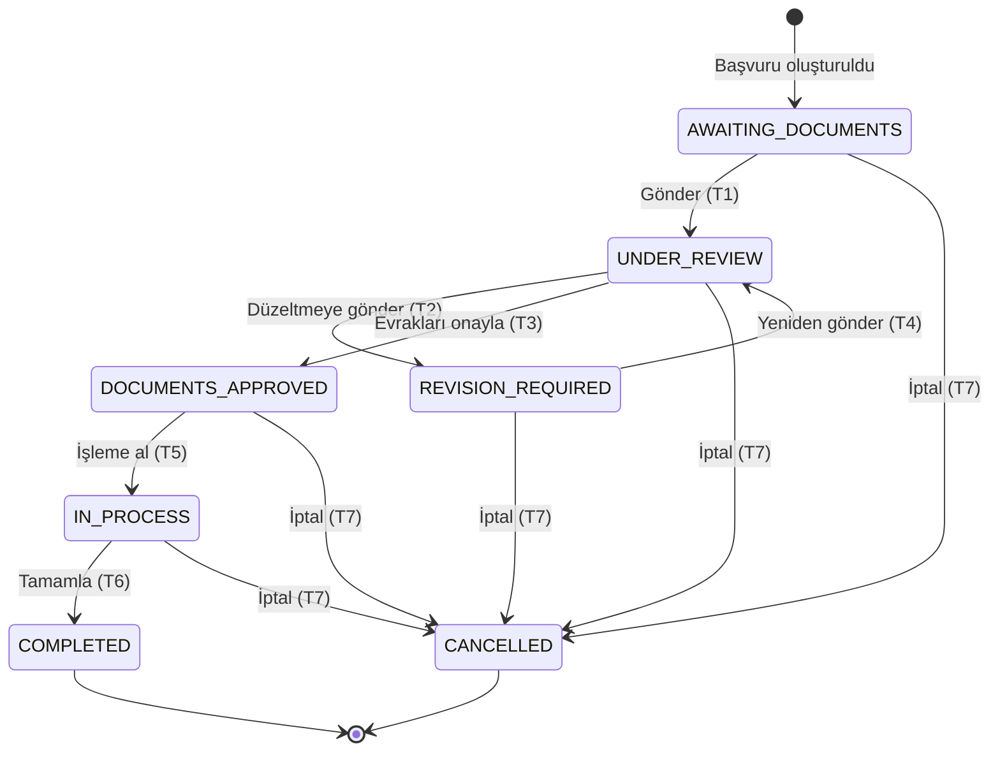
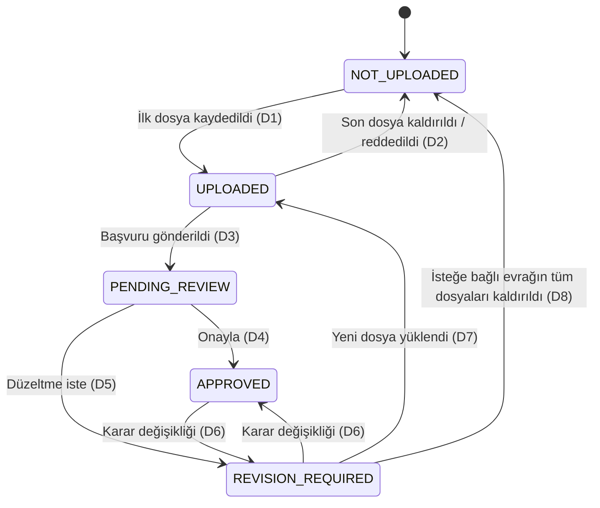

# State Machine'ler ve Geçiş Matrisleri

> Tüm geçişler **sunucu tarafında**, merkezi domain modülünde (`src/features/applications/domain/application-status.ts`, `src/features/documents/domain/document-status.ts`) doğrulanır. Frontend yalnızca sunucunun "izin verilen aksiyonlar" listesini gösterir; geçişi kendisi belirleyemez.
> Guard'lar [BUSINESS_RULES.md](BUSINESS_RULES.md) kurallarına referans verir.

## 1. Başvuru Statüleri

| Kod | Türkçe | Açıklama (müşteriye) | Terminal |
|---|---|---|---|
| `AWAITING_DOCUMENTS` | Evrak Bekleniyor | Gerekli evraklarınızı yükleyip incelemeye gönderin. | Hayır |
| `UNDER_REVIEW` | İncelemede | Evraklarınız ekibimiz tarafından inceleniyor. | Hayır |
| `REVISION_REQUIRED` | Düzeltme Bekleniyor | Bazı evraklarınızın düzeltilmesi gerekiyor. | Hayır |
| `DOCUMENTS_APPROVED` | Evraklar Onaylandı | Evraklarınız onaylandı. Başvuru işlemlerine geçilecek. | Hayır |
| `IN_PROCESS` | Başvuru İşlemde | Başvuru işlemleriniz CS Global tarafından yürütülüyor. | Hayır |
| `COMPLETED` | Süreç Tamamlandı | CS Global danışmanlık süreciniz tamamlandı. *(Resmî vize sonucu değildir.)* | Evet |
| `CANCELLED` | İptal Edildi | Bu başvuru iptal edilmiştir. | Evet |

Başlangıç statüsü: `AWAITING_DOCUMENTS` (başvuru oluşturma transaction'ında, `application_status_history`'ye `from_status = NULL` kaydıyla).

### 1.1 Diyagram

### 1.2 Geçiş Matrisi

| # | From → To | Aksiyon kodu | Roller | Tetik | Guard | Yan etkiler | Audit event |
|---|---|---|---|---|---|---|---|
| T1 | `AWAITING_DOCUMENTS → UNDER_REVIEW` | `SUBMIT` | CUSTOMER, ADMIN, EMPLOYEE (müşteri adına) | Manuel | BR-50 | `UPLOADED` evraklar → `PENDING_REVIEW` (BR-52); `submitted_at` güncellenir | `APPLICATION_SUBMITTED` |
| T2 | `UNDER_REVIEW → REVISION_REQUIRED` | `REQUEST_REVISION` | ADMIN, EMPLOYEE | Manuel | BR-59 | Müşteri panelinde düzeltme rozetleri | `APPLICATION_STATUS_CHANGED` |
| T3 | `UNDER_REVIEW → DOCUMENTS_APPROVED` | `APPROVE_DOCUMENTS` | ADMIN, EMPLOYEE | Manuel | BR-60 | Müşteri yüklemeleri kalıcı olarak kilitlenir | `APPLICATION_STATUS_CHANGED` |
| T4 | `REVISION_REQUIRED → UNDER_REVIEW` | `RESUBMIT` | CUSTOMER, ADMIN, EMPLOYEE (müşteri adına) | Manuel | BR-50 | `UPLOADED` evraklar → `PENDING_REVIEW` | `APPLICATION_RESUBMITTED` |
| T5 | `DOCUMENTS_APPROVED → IN_PROCESS` | `START_PROCESSING` | ADMIN, EMPLOYEE | Manuel | — | — | `APPLICATION_STATUS_CHANGED` |
| T6 | `IN_PROCESS → COMPLETED` | `COMPLETE` | ADMIN, EMPLOYEE | Manuel | — | Panel salt okunur; bağlantı süre sonu sayacı başlar (BR-103) | `APPLICATION_STATUS_CHANGED` |
| T7 | `* (terminal olmayan) → CANCELLED` | `CANCEL` | ADMIN, EMPLOYEE (Proposed, OD-05) | Manuel | Gerekçe zorunlu (personel içi, müşteriye gösterilmez) | Panel salt okunur; açık upload token'ları geçersiz | `APPLICATION_STATUS_CHANGED` |

**Matriste olmayan her geçiş reddedilir** (`INVALID_STATUS_TRANSITION`). Terminal statülerden çıkış yoktur.

**Açık kararlar (OD-05):**
- `CANCELLED → AWAITING_DOCUMENTS` (yeniden açma, yalnızca ADMIN) gerekli mi?
- `DOCUMENTS_APPROVED/IN_PROCESS → REVISION_REQUIRED` (ek evrak/düzeltme talebi) gerekli mi?
- `COMPLETED` yeniden açılabilir mi?
- İptal yetkisi yalnızca ADMIN'de mi olmalı?

Bu geçişler onaylanmadan **implement edilmez**.

### 1.3 Statüye özel davranışlar

| Statü | Müşteri yükleme | Müşteri gönderim | Personel inceleme | Müşteri paneli |
|---|---|---|---|---|
| `AWAITING_DOCUMENTS` | Evet (BR-44) | Evet (guard'lı) | Hayır | Düzenlenebilir |
| `UNDER_REVIEW` | **Hayır** | Hayır | Evet | Salt okunur + "İnceleniyor" |
| `REVISION_REQUIRED` | Yalnızca izinli evraklar | Evet (guard'lı) | Hayır | Düzeltme rozetleri |
| `DOCUMENTS_APPROVED` | Hayır | Hayır | Hayır | Salt okunur |
| `IN_PROCESS` | Hayır | Hayır | Hayır | Salt okunur |
| `COMPLETED` | Hayır | Hayır | Hayır | Salt okunur |
| `CANCELLED` | Hayır | Hayır | Hayır | Salt okunur, minimal bilgi |

### 1.4 Statü geçmişi
Her geçiş `application_status_history`'ye yazılır: `from_status`, `to_status`, `actor_type`, `actor_user_id`, `on_behalf_of_customer` (bool), `reason` (opsiyonel; T7'de zorunlu), `created_at`. Kayıtlar değiştirilemez.

Müşteri paneli geçmişten yalnızca statü + tarih gösterir; `reason` ve aktör gösterilmez.

## 2. Evrak (Başvuru Evrak Gereksinimi) Statüleri

| Kod | Türkçe | Anlamı |
|---|---|---|
| `NOT_UPLOADED` | Yüklenmedi | Güncel dosya seti boş. |
| `UPLOADED` | Yüklendi | Güncel sette ≥1 dosya var; henüz incelemeye gönderilmedi. |
| `PENDING_REVIEW` | İnceleme Bekliyor | Gönderildi; personel kararı bekleniyor. |
| `APPROVED` | Onaylandı | Personel onayladı; kilitli. |
| `REVISION_REQUIRED` | Düzeltme Gerekli | Personel düzeltme istedi (gerekçeli). |

> Evrak statüsü **iş süreci** statüsüdür. Dosyanın **güvenlik taraması** statüsü (`scan_status`) ayrı bir kavramdır (§3). Bir evrak `UPLOADED` olabilir ama dosyası hâlâ `scan_status = PENDING` olabilir; bu durumda gönderim BR-50 gereği engellenir.

### 2.1 Diyagram

### 2.2 Geçiş Matrisi

| # | From → To | Aktör | Başvuru statüsü koşulu | Guard / not |
|---|---|---|---|---|
| D1 | `NOT_UPLOADED → UPLOADED` | Sistem (yükleme kaydı) | `AWAITING_DOCUMENTS`, `REVISION_REQUIRED` | BR-44, BR-45; tarama sonucu beklenmez (scan ayrı) |
| D2 | `UPLOADED → NOT_UPLOADED` | Sistem (kaldırma / tarama reddi sonrası set boşaldı) | Aynı | — |
| D3 | `UPLOADED → PENDING_REVIEW` | Sistem (T1/T4 içinde) | T1/T4 transaction'ı | BR-52 |
| D4 | `PENDING_REVIEW → APPROVED` | ADMIN, EMPLOYEE | `UNDER_REVIEW` | Güncel setteki tüm dosyalar `CLEAN`; review kaydı + dosya seti |
| D5 | `PENDING_REVIEW → REVISION_REQUIRED` | ADMIN, EMPLOYEE | `UNDER_REVIEW` | Müşteri açıklaması zorunlu (BR-56) |
| D6 | `APPROVED ↔ REVISION_REQUIRED` | ADMIN, EMPLOYEE | **Yalnızca** `UNDER_REVIEW` (T2/T3 öncesi) | BR-58; yeni review kaydı; D5 kuralları geçerli |
| D7 | `REVISION_REQUIRED → UPLOADED` | Sistem (yükleme kaydı) | `REVISION_REQUIRED` | İlk yeni dosya geldiğinde. Eski dosyalar kullanıcı kaldırana kadar güncel sette kalabilir (çoklu dosyalı evraklar için). |
| D8 | `REVISION_REQUIRED → NOT_UPLOADED` | Sistem | `REVISION_REQUIRED` | Yalnızca `is_required = false` evraklar; zorunlu evrakta set boşalırsa statü `REVISION_REQUIRED` kalır |

Not (D7): Tek dosyalı evrakta (`max_file_count = 1`) yeni yükleme, eski dosyayı aynı transaction içinde `removed_at` ile güncel setten çıkarır ("değiştir" davranışı).

## 3. Dosya Statüleri (teknik)

İki bağımsız eksen:

### 3.1 `upload_status`

| Kod | Anlamı |
|---|---|
| `PENDING` | Upload token üretildi, dosya kaydı (niyet) oluşturuldu; blob henüz doğrulanmadı. |
| `UPLOADED` | Blob varlığı ve boyutu sunucuda doğrulandı. |
| `EXPIRED` | Süresi içinde tamamlanmadı veya statü yarışında reddedildi; orphan temizliğiyle blob silindi. |

`PENDING → UPLOADED` (callback veya client confirm, idempotent) · `PENDING → EXPIRED` (temizlik işi / BR-45 reddi).

### 3.2 `scan_status`

| Kod | Anlamı | Görüntülenebilir mi |
|---|---|---|
| `PENDING` | Güvenlik kontrolü sürüyor. | Hayır |
| `CLEAN` | Tüm kontroller geçti. | Evet (yetkiliye) |
| `REJECTED` | PDF değil / aktif içerik / şifreli / zararlı yazılım şüphesi. | **Asla** — blob saklama politikasına göre silinir |
| `ERROR` | Tarama tamamlanamadı (geçici hata). | Hayır — yeniden denenir; N denemeden sonra müşteriden yeniden yükleme istenir |

`PENDING → CLEAN | REJECTED | ERROR` · `ERROR → PENDING` (yeniden deneme). `CLEAN` ve `REJECTED` son durumlardır.

Ayrıntı: [FILE_STORAGE.md](FILE_STORAGE.md).

## 4. Personel için "izin verilen aksiyonlar"

Domain modülü, verilen `(actor, application, requirements)` için izin verilen aksiyon listesini döndüren saf bir fonksiyon sağlar (`getAllowedApplicationActions`). UI butonları bu listeye göre gösterilir; Server Action aynı fonksiyonu **yeniden** çağırarak doğrular. Bu fonksiyon unit test ile matristeki her hücre için test edilir.
