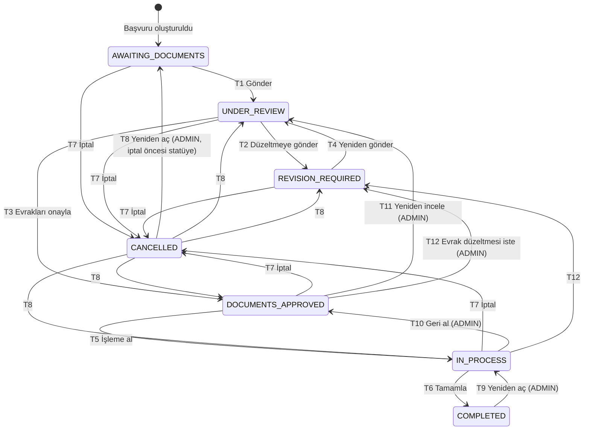
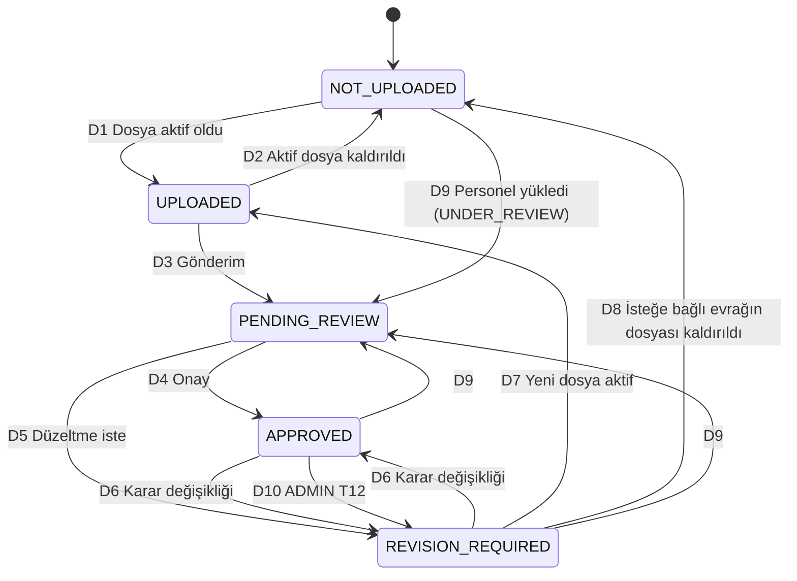
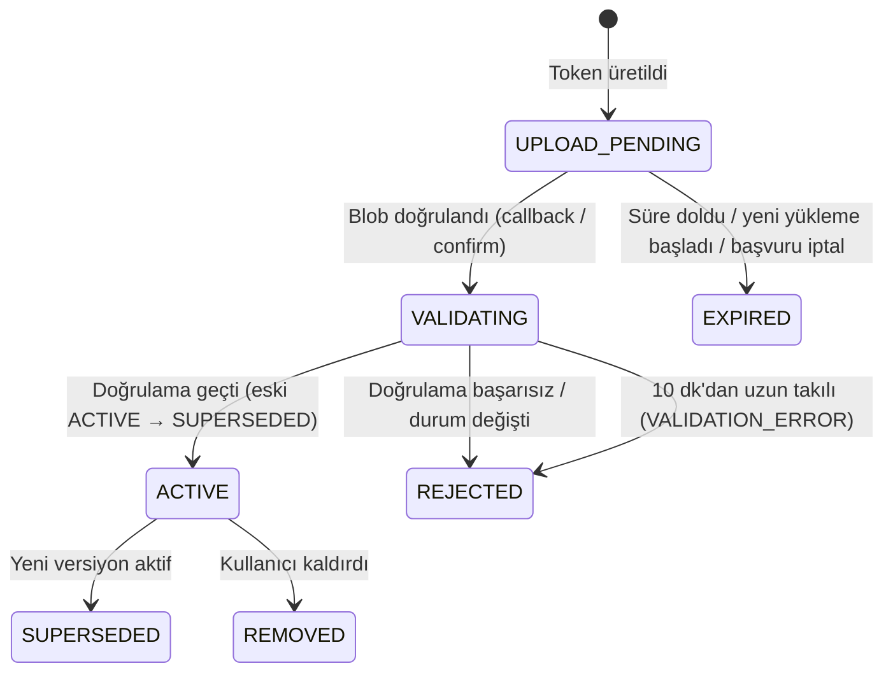

# State Machine'ler ve Geçiş Matrisleri

> Tüm geçişler **sunucu tarafında**, merkezi domain modüllerinde (`src/features/applications/domain/application-status.ts`, `src/features/documents/domain/document-status.ts`, `src/features/documents/domain/file-status.ts`) doğrulanır. Frontend yalnızca sunucunun döndürdüğü "izin verilen aksiyonlar" listesini gösterir.
> ADMIN yetkisi keyfî statü değişikliği değildir: ADMIN de yalnızca bu matristeki geçişleri yapabilir (OD-05).
> Guard'lar [BUSINESS_RULES.md](BUSINESS_RULES.md) kurallarına referans verir.

## 1. Başvuru Statüleri

| Kod | Türkçe | Açıklama (müşteriye) | Terminal* |
|---|---|---|---|
| `AWAITING_DOCUMENTS` | Evrak Bekleniyor | Gerekli evraklarınızı yükleyip incelemeye gönderin. | Hayır |
| `UNDER_REVIEW` | İncelemede | Evraklarınız ekibimiz tarafından inceleniyor. | Hayır |
| `REVISION_REQUIRED` | Düzeltme Bekleniyor | Bazı evraklarınızın düzeltilmesi gerekiyor. | Hayır |
| `DOCUMENTS_APPROVED` | Evraklar Onaylandı | Evraklarınız onaylandı. Başvuru işlemlerine geçilecek. | Hayır |
| `IN_PROCESS` | Başvuru İşlemde | Başvuru işlemleriniz CS Global tarafından yürütülüyor. | Hayır |
| `COMPLETED` | Süreç Tamamlandı | CS Global danışmanlık süreciniz tamamlandı. *(Resmî vize sonucu değildir.)* | Evet* |
| `CANCELLED` | İptal Edildi | Bu başvuru iptal edilmiştir. | Evet* |

\* "Terminal": EMPLOYEE için çıkışı olmayan, müşteri paneli salt okunur statü. Yalnızca ADMIN gerekçeli yeniden açma geçişleriyle (T8, T9) çıkarabilir.

Başlangıç statüsü: `AWAITING_DOCUMENTS` (`application_status_history`'ye `from_status = NULL`). Arşiv statüsü **yoktur** (OD-23).

### 1.1 Diyagram

### 1.2 Geçiş Matrisi

| # | From → To | Aksiyon kodu | Roller | Gerekçe | Guard | Yan etkiler | Audit event |
|---|---|---|---|---|---|---|---|
| T1 | `AWAITING_DOCUMENTS → UNDER_REVIEW` | `SUBMIT` | CUSTOMER; ADMIN/EMPLOYEE (müşteri adına) | — | BR-50 | `UPLOADED` → `PENDING_REVIEW` (BR-52); `submitted_at` | `APPLICATION_SUBMITTED` |
| T2 | `UNDER_REVIEW → REVISION_REQUIRED` | `REQUEST_REVISION` | ADMIN, EMPLOYEE | — | BR-59 | Müşteri panelinde düzeltme rozetleri | `APPLICATION_STATUS_CHANGED` |
| T3 | `UNDER_REVIEW → DOCUMENTS_APPROVED` | `APPROVE_DOCUMENTS` | ADMIN, EMPLOYEE | — | BR-60 | Yükleme kapanır | `APPLICATION_STATUS_CHANGED` |
| T4 | `REVISION_REQUIRED → UNDER_REVIEW` | `RESUBMIT` | CUSTOMER; ADMIN/EMPLOYEE (müşteri adına) | — | BR-50 | `UPLOADED` → `PENDING_REVIEW` | `APPLICATION_RESUBMITTED` |
| T5 | `DOCUMENTS_APPROVED → IN_PROCESS` | `START_PROCESSING` | ADMIN, EMPLOYEE | — | — | — | `APPLICATION_STATUS_CHANGED` |
| T6 | `IN_PROCESS → COMPLETED` | `COMPLETE` | ADMIN, EMPLOYEE | — | — | Panel salt okunur (bağlantı açık kalır) | `APPLICATION_STATUS_CHANGED` |
| T7 | `{AWAITING_DOCUMENTS, UNDER_REVIEW, REVISION_REQUIRED, DOCUMENTS_APPROVED, IN_PROCESS} → CANCELLED` | `CANCEL` | ADMIN, EMPLOYEE | **Zorunlu** | — | Panel salt okunur; devam eden yüklemeler iptal (`EXPIRED`); evrak statüleri **değişmez**; bağlantı açık kalır | `APPLICATION_STATUS_CHANGED` |
| T8 | `CANCELLED → <iptal öncesi statü>` | `REOPEN_CANCELLED` | **ADMIN** | **Zorunlu** | Hedef = son `→ CANCELLED` geçmiş kaydının `from_status`'u (sunucu belirler; istemci hedef seçemez) | Evrak statüleri iptal öncesindeki gibi olduğundan tutarlılık korunur | `APPLICATION_STATUS_CHANGED` (`metadata.action = REOPEN_CANCELLED`) |
| T9 | `COMPLETED → IN_PROCESS` | `REOPEN_COMPLETED` | **ADMIN** | **Zorunlu** | — | Evraklar/onaylar korunur | `APPLICATION_STATUS_CHANGED` |
| T10 | `IN_PROCESS → DOCUMENTS_APPROVED` | `REVERT_TO_DOCUMENTS_APPROVED` | **ADMIN** | **Zorunlu** | — | — | `APPLICATION_STATUS_CHANGED` |
| T11 | `DOCUMENTS_APPROVED → UNDER_REVIEW` | `REVERT_TO_REVIEW` | **ADMIN** | **Zorunlu** | — | Evrak kararları korunur; personel D6 ile kararları değiştirebilir, D9 ile dosya değiştirebilir | `APPLICATION_STATUS_CHANGED` |
| T12 | `{DOCUMENTS_APPROVED, IN_PROCESS} → REVISION_REQUIRED` | `REVERT_FOR_REVISION` | **ADMIN** | **Zorunlu** (iç) + seçilen her evrak için **müşteri açıklaması** (BR-56) | ≥1 evrak seçilmiş; seçilenler `APPROVED` | Seçilen evraklar `APPROVED → REVISION_REQUIRED` (D10; aktif dosyaya bağlı yeni review kaydı); diğer onaylar korunur; müşteri yeniden yükleyebilir | `APPLICATION_STATUS_CHANGED` + `DOCUMENT_REVISION_REQUESTED` (her evrak) |

**Matriste olmayan her geçiş reddedilir** (`INVALID_STATUS_TRANSITION`). Yeniden açma ve geri alma geçişlerinde evraklar, dosya versiyonları, önceki onaylar ve geçmiş kayıtları **silinmez**.

### 1.3 Statüye özel davranışlar

| Statü | Müşteri yükleme | Personel yükleme | Gönderim | Personel inceleme | Müşteri paneli |
|---|---|---|---|---|---|
| `AWAITING_DOCUMENTS` | Evet (BR-44) | Evet (BR-44) | Evet (guard'lı) | Hayır | Düzenlenebilir |
| `UNDER_REVIEW` | **Hayır** | **Yükle/değiştir** (D9) | Hayır | Evet | Salt okunur + "İnceleniyor" |
| `REVISION_REQUIRED` | İzinli evraklar | İzinli evraklar | Evet (guard'lı) | Hayır | Düzeltme rozetleri |
| `DOCUMENTS_APPROVED` | Hayır | Hayır | Hayır | Hayır | Salt okunur |
| `IN_PROCESS` | Hayır | Hayır | Hayır | Hayır | Salt okunur |
| `COMPLETED` | Hayır | Hayır | Hayır | Hayır | Salt okunur |
| `CANCELLED` | Hayır | Hayır | Hayır | Hayır | Salt okunur, minimal bilgi |

ADMIN bir başvuruyu yeniden açtığında/geri aldığında, hedef statünün satırındaki işlemler otomatik olarak yeniden açılır.

### 1.4 Statü geçmişi
Her geçiş `application_status_history`'ye yazılır: `from_status`, `to_status`, `actor_type`, `actor_user_id`, `actor_access_token_id`, `on_behalf_of_customer`, `reason` (T7–T12'de zorunlu), `created_at`. Kayıtlar değiştirilemez (başvuru silinmesi hariç). Müşteri paneli geçmişten yalnızca statü + tarih gösterir; gerekçe ve aktör gösterilmez.

## 2. Evrak (Başvuru Evrak Gereksinimi) Statüleri

| Kod | Türkçe | Anlamı |
|---|---|---|
| `NOT_UPLOADED` | Yüklenmedi | Aktif dosya yok. |
| `UPLOADED` | Yüklendi | Aktif dosya var; henüz incelemeye gönderilmedi. |
| `PENDING_REVIEW` | İnceleme Bekliyor | Personel kararı bekleniyor. |
| `APPROVED` | Onaylandı | Aktif dosya onaylandı; kilitli. |
| `REVISION_REQUIRED` | Düzeltme Gerekli | Personel düzeltme istedi (gerekçeli). |

> Evrak statüsü iş süreci statüsüdür; dosyanın teknik durumu (§3) ayrı bir eksendir.

### 2.1 Diyagram

### 2.2 Geçiş Matrisi

| # | From → To | Tetikleyen | Başvuru statüsü | Guard / not |
|---|---|---|---|---|
| D1 | `NOT_UPLOADED → UPLOADED` | Dosya aktifleşmesi (müşteri/personel yüklemesi) | `AWAITING_DOCUMENTS`, `REVISION_REQUIRED` | BR-44, BR-45 |
| — | `UPLOADED → UPLOADED` | Değiştirme: yeni dosya aktif, eskisi `SUPERSEDED` | Aynı | Statü değişmez, `version` artar |
| D2 | `UPLOADED → NOT_UPLOADED` | Aktif dosyanın kaldırılması (`REMOVED`) | Aynı | BR-44 |
| D3 | `UPLOADED → PENDING_REVIEW` | T1/T4 transaction'ı | — | BR-52 |
| D4 | `PENDING_REVIEW → APPROVED` | ADMIN, EMPLOYEE | `UNDER_REVIEW` | BR-57: `fileId` = aktif dosya |
| D5 | `PENDING_REVIEW → REVISION_REQUIRED` | ADMIN, EMPLOYEE | `UNDER_REVIEW` | BR-56, BR-57 |
| D6 | `APPROVED ↔ REVISION_REQUIRED` | ADMIN, EMPLOYEE | Yalnızca `UNDER_REVIEW` | BR-57, BR-58 |
| D7 | `REVISION_REQUIRED → UPLOADED` | Yeni dosya aktif (müşteri/personel) | `REVISION_REQUIRED` | Eski dosya `SUPERSEDED` |
| D8 | `REVISION_REQUIRED → NOT_UPLOADED` | Aktif dosyanın kaldırılması | `REVISION_REQUIRED` | Yalnızca `is_required = false`. Zorunlu evrakta kaldırma yapılırsa statü `REVISION_REQUIRED` kalır |
| D9 | `{NOT_UPLOADED, PENDING_REVIEW, APPROVED, REVISION_REQUIRED} → PENDING_REVIEW` | **Personel** yeni dosya yükledi/değiştirdi | Yalnızca `UNDER_REVIEW` (OD-17) | BR-48: önceki onay aktarılmaz; `PENDING_REVIEW → PENDING_REVIEW` için yalnızca `version` artar |
| D10 | `APPROVED → REVISION_REQUIRED` | ADMIN, T12 içinde | `DOCUMENTS_APPROVED`, `IN_PROCESS` | Müşteri açıklaması zorunlu; review kaydı aktif dosyaya bağlı |

Not: `UNDER_REVIEW` sırasında personel yükleme yaparsa, aynı anda o evrağı inceleyen başka bir personelin kararı BR-57 gereği `CONFLICT` ile reddedilir.

## 3. Dosya Statüleri (teknik, tek eksen)

| Kod | Anlamı | Görüntülenebilir | Blob |
|---|---|---|---|
| `UPLOAD_PENDING` | Upload token üretildi; blob bekleniyor | Hayır | Henüz yok / doğrulanmadı |
| `VALIDATING` | Blob alındı; yapısal doğrulama sürüyor | Hayır | Var |
| `ACTIVE` | Doğrulamayı geçti; evrağın **tek** aktif dosyası | Evet (yetkiliye) | Var |
| `SUPERSEDED` | Doğrulamayı geçmiş, yerine yenisi aktif olmuş eski versiyon | Personel | Var (manuel silmeye kadar) |
| `REMOVED` | Doğrulamayı geçmiş, kullanıcı tarafından yerine yenisi konmadan kaldırılmış | Personel | Var (manuel silmeye kadar) |
| `REJECTED` | Doğrulamayı geçemedi (`rejection_reason`) | **Asla** | Hemen silinir |
| `EXPIRED` | Yükleme tamamlanmadı / iptal edildi | Hayır | Varsa silinir |

Kurallar:
- `ACTIVE` dosya evrak başına en fazla bir tane (DB partial unique index).
- `UPLOAD_PENDING` + `VALIDATING` evrak başına en fazla bir tane (DB partial unique index); yeni token isteği önceki `UPLOAD_PENDING`'i `EXPIRED` yapar, 10 dakikadan eski `VALIDATING`'i `REJECTED (VALIDATION_ERROR)` yapar; güncel `VALIDATING` varsa yeni istek "Devam eden bir yükleme var" ile reddedilir.
- Statüler "virüssüz" anlamı taşımaz; `ACTIVE`, yalnızca yapısal doğrulamanın geçildiğini ifade eder (OD-07).

Ayrıntı: [FILE_STORAGE.md](FILE_STORAGE.md).

## 4. İzin verilen aksiyonlar

Domain modülü `(actor, application, requirements)` için izin verilen aksiyon listesini döndüren saf bir fonksiyon sağlar (`getAllowedApplicationActions`, `getAllowedDocumentActions`). UI butonları bu listeye göre gösterilir; Server Action aynı fonksiyonu kilit altında **yeniden** çağırarak doğrular. Matrisin her hücresi unit test ile kapsanır.
